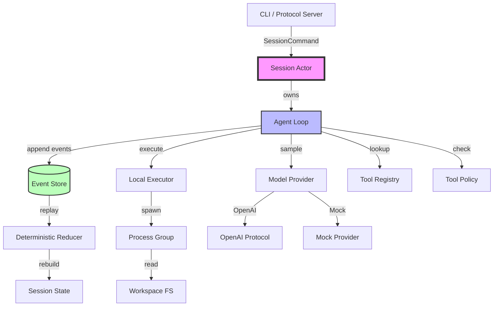
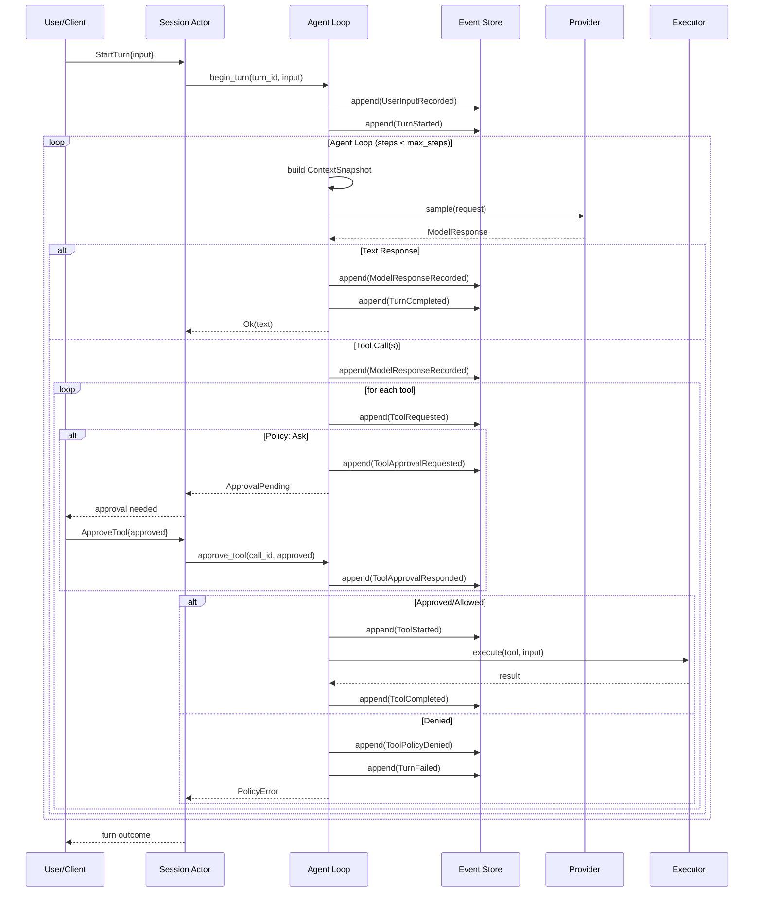

# Mini-Harness 架构审查报告

**审查日期**: 2026-10-17  
**审查范围**: 完整代码库 (commit 282fc2c)  
**审查方法**: 深度代码审查 + 测试执行 + 架构分析

---

## Part A: 项目整体评价

### 1. 当前架构概述

mini-harness 是一个从零实现的 Agent Harness 运行时，采用 **Event Sourcing + Actor Model** 的核心架构。项目规模适中（约 8000 行 Rust 代码），模块划分清晰，测试覆盖充分（65 个单元测试 + 多个集成测试全部通过）。

**核心设计理念**:
- **JSONL 事件日志为唯一事实来源**：所有状态变化通过 EventPayload 持久化
- **确定性 Reducer**：状态完全由事件日志重建，重放两次必然同态
- **Single-Writer Actor**：SessionActor 是状态唯一写入者，避免并发冲突
- **进程组级取消**：Bash 执行通过 SIGKILL -pgid 清理子进程树
- **分层输出限制**：per-tool、per-turn cumulative、line-level UTF-8 安全截断
- **Durable Queue**：运行期间提交的输入持久化后自动排队执行

### 2. 核心设计亮点

#### ✅ 事件溯源实现扎实
- **确定性 Reducer 经过 Property-Based Testing 验证** (`tests/property_replay.rs`):
  - 种子化随机脚本生成 24 种场景
  - 每个前缀都能重放且不 panic
  - 两次重放产生完全相同状态
- **Checkpoint 带完整性校验**:
  - SHA-256 摘要验证快照未被篡改 (`src/durable/checkpoint.rs:70`)
  - 损坏时自动回退到全量事件重放
  - Schema 版本迁移支持（当前 schema 2）

#### ✅ 跨进程并发控制正确
- **文件锁 + 序列号验证** (`src/durable/event_log.rs:111-141`):
  - 独占锁用于写入，共享锁用于读取
  - 每个事件追加前检查 `store.last_seq() == state.last_seq`
  - 序列号冲突时拒绝追加而非覆盖（Fail-Stop 语义）
- **跨进程崩溃恢复测试** (`tests/jsonl_cross_process.rs`):
  - 进程 B 崩溃留下半行时，进程 A 的 cache 正确失效
  - 修复后的连续追加走 suffix validation 路径（O(新增) 而非 O(n²)）

#### ✅ 进程管理健壮
- **进程组取消** (`src/executor/process.rs:382-427`):
  - Unix: `kill(-pid, SIGKILL)` 清理整个进程组
  - Windows: `taskkill /T /F` 递归终止进程树
  - ProcessGroupGuard RAII 确保异常情况也清理
- **三层输出限制防止 OOM**:
  1. per-stream limit (stdout/stderr 独立)
  2. combined limit (跨 stdout/stderr 的原子计数器竞争)
  3. UTF-8 边界安全截断 (`process.rs:273-285`)

#### ✅ Tool Approval 流程完整
- **Policy 拒绝与用户拒绝严格区分** (`reducer.rs:278-300`):
  - `ToolPolicyDenied` 事件记录 harness 决策
  - `ToolApprovalResponded` 事件记录用户决策
  - 重放时可准确还原"用户是否被询问过"
- **Approval 期间的并发输入正确处理** (`session_actor.rs:428-448`):
  - 审批暂停时提交的新输入持久化到 durable queue
  - 审批完成后自动排队执行，不会丢失或乱序

#### ✅ Context Management 有基础实现
- **Sliding window 策略** (`context.rs:111-138`):
  - 从最近的 512KB history 开始向前取
  - 遇到 provider cursor 时停止（避免重复发送 cached response）
  - 每个 item 截断到 16KB，UTF-8 安全

### 3. 核心架构问题

虽然项目整体设计合理，但存在以下需要改进的架构问题：

#### ❌ Agent Loop 职责过重（God Object）
`agent_loop.rs` 单文件 926 行，承担了：
- 事件追加与状态迁移
- 模型采样循环
- 工具调用编排
- 超时与取消处理
- Approval 等待逻辑

**影响**：
- 难以单独测试各个关注点
- 修改一个场景容易影响其他场景
- 新增工具编排策略（并行、conditional）困难

#### ❌ Tool 执行与 Turn 推进高度耦合
工具执行代码直接内联在 `continue_turn` 循环中 (`agent_loop.rs:561-914`)：
```rust
for (call_index, call) in calls.into_iter().enumerate() {
    // 序列执行：append tool.requested → lookup tool → check policy 
    //         → spawn execution → wait → append result
    // 所有工具按顺序执行，无法并行
}
```

**问题**:
1. **串行执行限制**：多个 read 工具无法并行，浪费 I/O 等待时间
2. **状态管理复杂**：Tool 状态散布在多个事件之间
3. **难以扩展**：工具间依赖（tool A 结果决定是否调用 tool B）需要大幅改动

#### ❌ Provider Continuation 混入 Runtime 状态
`SessionState` 中的 `provider_continuation` 字段 (`state.rs:46-48`):
```rust
pub provider_continuation: Option<ProviderContinuation>,
```

这是 **OpenAI Responses API 的实现细节**，不应该成为 Runtime 核心状态的一部分。

**问题**:
1. Chat Completions API 不需要 `response_id`，但 reducer 仍要处理它
2. 每个 Provider 的续传策略不同，强制统一模型导致复杂度泄漏
3. DeepSeek reasoning metadata 的存储方式与 OpenAI 不兼容，需要 workaround

#### ⚠️ Context 管理策略过于简单
当前的 Sliding window (`context.rs:111-138`) 只按字节数后向取，不考虑：
- **对话阶段重要性**：初始 task description 比中间工具输出更重要
- **Token 预算管理**：无全局 token budget，模型可能悄然超限
- **Message 完整性**：可能截断 tool call/result 对，导致协议错误

**长期影响**：
- 长会话中 Agent 会"遗忘"初始目标
- 无法实现 agentic loop 的常见优化（summary、hierarchical context）

#### ⚠️ 缺少 OS 级沙箱隔离
README 声称的 "workspace 边界强制" 仅通过路径检查实现 (`filesystem_secure.rs`)：
- ✅ 阻止符号链接逃逸
- ✅ 阻止 `../../../etc/passwd` 路径
- ❌ **不阻止** `/tmp/secrets` 绝对路径读取
- ❌ **不阻止** 网络访问（Bash 可以 `curl` 任意 URL）
- ❌ **不阻止** 进程 fork bomb

**当前状态**：README 说"未来工作：macOS Seatbelt / Linux Landlock"，但未实现。

### 4. 项目成熟度判断

**架构成熟度**: ★★★★☆ (4/5)
- 核心不变量有完整测试保护
- Event Sourcing 实现正确
- 跨进程并发处理无已知缺陷

**功能完整度**: ★★★☆☆ (3/5)
- 基本 Agent Loop 完整可用
- 缺少工具并行、Context 压缩、Streaming 等生产特性
- TUI 可用但功能简单

**可扩展性**: ★★★☆☆ (3/5)
- Provider 抽象清晰，易于添加新模型
- Tool Registry 设计合理
- Agent Loop 耦合度高，难以扩展编排策略

**适用场景**:
- ✅ **学习 Agent Harness 核心概念**（Event Sourcing、Actor Model、工具执行）
- ✅ **小规模自动化任务**（<10 轮对话，简单工具链）
- ✅ **本地开发原型**（MockProvider 支持完全离线）
- ❌ **生产环境 Coding Agent**（缺少 Context 管理、并行执行、沙箱）
- ❌ **长程 Agent**（Context 策略不支持长会话）

---

## Part B: 架构与运行流程

### 1. 核心模块关系



**关键路径说明**:
- **Single-Writer 边界**: SessionActor 是唯一能调用 `Loop.append()` 的地方
- **Durable 边界**: EventStore 持久化后，状态才更新
- **Provider 抽象边界**: Agent Loop 只依赖 `ModelProvider` trait

### 2. Agent Turn 完整执行流程



**关键决策点**:
1. **事件追加顺序**: 先 append 再更新内存状态，确保 crash 时不丢失 committed 事实
2. **Approval 阻塞**: Loop 返回 `ApprovalPending` 后，Actor 切换到 `run_approved_turn` 分支
3. **工具串行执行**: `for call in calls` 循环，没有并行

### 3. 核心状态管理机制

#### State = reduce(Events)

```rust
// src/durable/reducer.rs:62-490
pub fn reduce(state: &mut SessionState, event: &Event) -> Result<(), HarnessError> {
    // 1. 验证事件序列连续性
    if event.seq.0 != state.last_seq.0 + 1 {
        return Err(/* sequence gap */);
    }
    
    // 2. 根据 event payload 更新状态
    match &event.payload {
        EventPayload::TurnStarted => {
            state.active_turn = Some(TurnState::new(turn_id));
            state.status = SessionStatus::Running;
        }
        EventPayload::ToolCompleted { call_id, result } => {
            turn.executions.insert(*call_id, ExecutionState::Completed);
            push_history(state, HistoryItem::Tool { ... });
        }
        // ... 30+ 种事件类型
    }
    
    // 3. 更新 last_seq
    state.last_seq = event.seq;
    Ok(())
}
```

**不变量保护**:
- ✅ 必须先 `UserInputRecorded` 再 `TurnStarted`
- ✅ Tool 必须先 `ToolRequested` 再 `ToolStarted`
- ✅ `ToolStarted` 前如果需要审批，必须先 `ToolApprovalResponded`
- ✅ 重放 100 次的状态与重放 1 次完全相同（测试验证）

#### Checkpoint = State Snapshot + SHA-256

```rust
// src/durable/checkpoint.rs:70-85
pub async fn create_checkpoint(
    path: impl AsRef<Path>,
    state: &SessionState,
) -> Result<Checkpoint, HarnessError> {
    let json = serde_json::to_vec_pretty(state)?;
    let digest = sha2::Sha256::digest(&json);
    
    // 先写临时文件，再原子 rename
    let temp = format!("{}.tmp", path.display());
    tokio::fs::write(&temp, &json).await?;
    tokio::fs::rename(&temp, &path).await?;
    
    Ok(Checkpoint { seq: state.last_seq, digest: hex::encode(digest) })
}
```

**恢复策略**:
1. 读取 checkpoint 文件
2. 验证 SHA-256 digest
3. 从 checkpoint.seq + 1 开始重放后续事件
4. 如果 checkpoint 损坏 → 从 seq=1 全量重放

### 4. 取消与恢复机制

#### 跨进程取消

```
Timeline:
  Process A (running turn)     Process B (user cancel)
  ========================     =======================
  t0: append(TurnStarted)
  t1: tool executing...        
  t2:                          append(TurnCancelRequested)
  t3:                          append(TurnCancelled)
  t4: tool finishes
  t5: next append() → 检查 last_seq
      发现 store.last_seq=3 > local.last_seq=1
      → Err(InvariantViolation)
  t6: turn 停止，返回 Cancelled
```

**关键设计**:
- Cancel 也是 durable event，写入事件日志
- 运行中的 turn 在下次 append 时发现日志已变
- **Fail-Stop**: 宁可失败也不覆盖别人的写入

#### OutcomeUnknown 语义

```rust
EventPayload::ToolOutcomeUnknown { call_id, reason }
```

**触发场景**:
1. Tool task panicked (`JoinError::is_panic()`)
2. Cancel 后 tool cleanup timeout (1 秒内未返回)
3. Turn wall-clock / tool cumulative timeout 触发，但 task.abort() 后不确定是否完成

**恢复时的含义**:
- 工具 **可能已产生副作用**（写文件、执行命令）
- 不可安全重试（可能重复执行）
- 需要人工判断是否回滚/继续

---

## Part C: 详细问题清单

### P0：可能破坏核心正确性或造成严重问题

#### P0-1: Approval 期间的 Context 陈旧问题

**问题名称**: Approval 期间的新输入进入 history，但 pending tool 看不到

**优先级**: P0

**涉及文件**: 
- `src/durable/reducer.rs:91-100` (UserInputRecorded 追加到 history)
- `src/runtime/agent_loop_approval.rs:24-296` (approve_tool 直接执行工具)

**代码证据**:
```rust
// reducer.rs:91-100
EventPayload::UserInputRecorded { input }
    if state.active_turn.is_some() && event.turn_id.is_none() =>
{
    push_history(state, HistoryItem::User(input.clone()))?;  // ← 立即进入 history
    state.pending_inputs.push_back(input.clone());
    Ok(())
}

// agent_loop_approval.rs:114-127
let mut task = tokio::spawn(async move {
    tool.execute(input, ToolContext { ... })  // ← 使用审批前的旧 input
}).await
```

**问题说明**:
1. 用户审批工具 A 期间，提交了新输入 "取消前面的工作"
2. 新输入通过 `UserInputRecorded` 事件追加到 history
3. 但审批通过后，工具 A 执行时使用的是 **审批请求时的旧 input**
4. 工具 A 看不到用户的取消指令

**触发场景**:
```
t0: Model 请求 bash("rm -rf data/")
t1: 系统请求用户审批 "是否允许删除 data/?"
t2: 用户提交新输入 "不要删除，我搞错了"
t3: history = [..., User("不要删除")]  // 通过 reducer 更新
t4: 用户点击"批准"（因为没看到 t2 的输入）
t5: bash("rm -rf data/") 执行  // ← 忽略了 t2 的指令
```

**修改建议**:
1. 在 `approve_tool` 执行前，检查 `state.pending_inputs` 是否非空
2. 如果有新输入，先 cancel 当前 turn，让新输入开启新 turn
3. 或者：approval UI 显示"审批期间收到新输入，需重新确认"

**备选方案**:
- 简化方案：审批期间禁止新输入（返回 TurnAlreadyActive）
- 但这破坏了 durable queue 的设计初衷

**潜在代价**:
- 需要修改 `approve_tool` 的逻辑分支
- TUI 需要显示"审批已过期"状态

**验证方法**:
```rust
#[tokio::test]
async fn approval_sees_intervening_input() {
    // 1. turn starts, model requests bash("dangerous")
    // 2. system requests approval
    // 3. user submits "cancel" while approval pending
    // 4. user approves the bash
    // Expected: turn cancelled, "cancel" starts new turn
    // Actual: bash executes, then "cancel" starts turn
}
```

**实现成本**: M

---

#### P0-2: Agent Loop 的 context bytes 检查不准确

**问题名称**: `max_context_bytes` 同时限制了 request 和 history，导致误判

**优先级**: P0（会导致合法对话被拒绝）

**涉及文件**: 
- `src/runtime/agent_loop.rs:162-170` (history 大小检查)
- `src/runtime/agent_loop.rs:406-422` (request 大小检查)

**代码证据**:
```rust
// Line 162-170: 检查 next_state.history 是否超限
let history_size = serde_json::to_vec(&next_state.history)?.len();
if history_size > self.config.max_context_bytes {
    return Err(HarnessError::InvariantViolation(
        format!("session history exceeds the {} byte context limit", ...)
    ));
}

// Line 406-422: 检查 model request 是否超限
let request_size = serde_json::to_vec(&request)?.len();
if request_size > self.config.max_context_bytes {
    return Err(HarnessError::Provider(
        format!("model context exceeds the {} byte limit", ...)
    ));
}
```

**问题说明**:
1. `history` 是 **累积的完整对话历史**（可能 1MB）
2. `request` 是 **sliding window 后的精简请求**（可能 100KB）
3. 两者用同一个 `max_context_bytes` (默认 1MB) 限制

**触发场景**:
```
Session history: 900KB (50 rounds of conversation)
Context window: 512KB (recent 20 rounds)
Request size: 100KB (after sliding window + tool specs)

Expected: request 通过（100KB < 1MB）
Actual: append 失败 "session history exceeds the 1048576 byte context limit"
```

**修改建议**:
1. 分离两个限制：
   - `max_total_history_bytes`: 累积历史上限（防止无限增长）
   - `max_context_request_bytes`: 单次请求上限（provider token limit）
2. 或者：移除 history 大小检查，只检查 request 大小
   - 理由：history 已有 `MAX_HISTORY_BYTES` 常量保护 (`reducer.rs:12`)

**备选方案**:
保留现状，但将 `max_context_bytes` 默认值提升到 4MB

**潜在代价**:
- 需要修改 `AgentLoopConfig` 结构
- 现有配置文件需要迁移

**验证方法**:
```rust
#[tokio::test]
async fn large_history_small_request_succeeds() {
    // Build session with 50 rounds (900KB history)
    // Next turn should succeed if request < max_context_bytes
}
```

**实现成本**: S

---

### P1：重要架构缺陷

#### P1-1: Agent Loop 的职责过于集中

**问题名称**: `agent_loop.rs` 是 God Object，难以测试和扩展

**优先级**: P1

**涉及文件**: `src/runtime/agent_loop.rs` (926 行单文件)

**代码证据**:
```rust
impl<P, E, S> AgentLoop<P, E, S> {
    // 1. 状态管理
    async fn append(&mut self, ...) { /* 事件追加 */ }
    
    // 2. Turn 控制流
    async fn run_turn(&mut self, ...) { /* 启动 turn */ }
    async fn continue_turn(&mut self, ...) { /* 主循环 */ }
    async fn cancel_turn(&mut self, ...) { /* 取消 */ }
    
    // 3. 模型采样
    async fn sample_model(&mut self, ...) { /* provider 调用 */ }
    
    // 4. 工具编排
    // 内联在 continue_turn 中，561-914 行
    for (call_index, call) in calls.into_iter().enumerate() { ... }
    
    // 5. Approval 处理
    async fn approve_tool(&mut self, ...) { /* 在另一个文件 */ }
}
```

**问题说明**:
- **难以单独测试工具编排逻辑**：必须构造完整 turn
- **难以扩展编排策略**：并行执行需要大幅重构 for 循环
- **代码可读性差**：主循环 356 行（367-722），嵌套层级深

**修改建议**:
1. 提取 `ToolOrchestrator` 模块：
   ```rust
   struct ToolOrchestrator {
       tools: Arc<ToolRegistry>,
       policy: Arc<dyn ToolPolicy>,
       executor: Arc<dyn Executor>,
   }
   
   impl ToolOrchestrator {
       async fn execute_batch(
           &self,
           calls: Vec<ToolCall>,
           context: ExecutionContext,
       ) -> Vec<ToolOutcome> {
           // 当前：串行执行
           // 未来：可改为并行
       }
   }
   ```

2. 提取 `TurnController` 控制 turn 生命周期：
   ```rust
   impl TurnController {
       async fn run_step(&mut self) -> StepOutcome {
           match self.sample_model().await? {
               Text(t) => StepOutcome::Complete(t),
               ToolCalls(c) => StepOutcome::ToolsNeeded(c),
           }
       }
   }
   ```

**备选方案**:
- 温和重构：只提取 tool execution 到独立函数
- 但不解决主循环的复杂度问题

**潜在代价**:
- 需要大量代码移动
- 可能引入新 bug（需要充分测试）

**验证方法**:
- 现有测试全部通过
- 新增单元测试：单独测试 ToolOrchestrator

**实现成本**: L

---

#### P1-2: Tool 执行是严格串行的

**问题名称**: 多个工具无法并行执行，浪费 I/O 等待时间

**优先级**: P1

**涉及文件**: `src/runtime/agent_loop.rs:561-914`

**代码证据**:
```rust
// Line 561-914
for (call_index, call) in calls.into_iter().enumerate() {
    // Policy check
    // Approval wait (if needed)
    let mut task = tokio::spawn(tool.execute(...));
    let result = tokio::select! { ... }.await;  // ← 等待单个工具完成
    // Append result event
    // 然后才进入下一个工具
}
```

**问题说明**:
假设模型返回：
```json
[
  {"name": "read", "path": "a.txt"},
  {"name": "read", "path": "b.txt"},
  {"name": "read", "path": "c.txt"}
]
```

当前行为：
```
t0-t100: read a.txt (100ms)
t100-t200: read b.txt (100ms)
t200-t300: read c.txt (100ms)
Total: 300ms
```

理想行为：
```
t0-t100: read a.txt | read b.txt | read c.txt (并行)
Total: 100ms
```

**触发场景**:
- Coding Agent 需要读取多个文件理解代码结构
- 每次只能读一个，严重拖慢响应速度

**修改建议**:
1. 对于 **无副作用工具**（read），允许并行执行
2. 对于 **有副作用工具**（edit, bash），保持串行或加锁

实现方案：
```rust
let (safe_calls, unsafe_calls): (Vec<_>, Vec<_>) = calls
    .into_iter()
    .partition(|call| tool_registry.is_side_effect_free(&call.name));

// 并行执行所有 safe calls
let safe_results = parallel_execute(safe_calls).await;

// 串行执行 unsafe calls
for call in unsafe_calls {
    execute_sequential(call).await;
}
```

**备选方案**:
- 保持现状，但添加 `read_batch` 工具（一次读多个文件）
- 在 Tool 层面优化，而非 runtime 层面

**潜在代价**:
- 需要定义哪些工具是 "side-effect free"
- 并行执行会增加进程数（executor concurrency limit 需要提升）

**验证方法**:
```rust
#[tokio::test]
async fn parallel_reads_are_faster() {
    let start = Instant::now();
    // Model returns 3 read calls
    // Measure end-to-end time
    assert!(start.elapsed() < Duration::from_millis(150)); // 而非 300ms
}
```

**实现成本**: M

---

#### P1-3: Provider Continuation 混入 Runtime 状态

**问题名称**: `SessionState.provider_continuation` 是实现细节泄漏

**优先级**: P1

**涉及文件**:
- `src/runtime/state.rs:46-48`
- `src/durable/reducer.rs:143-154`
- `src/runtime/agent_loop.rs:432-440`

**代码证据**:
```rust
// state.rs
pub struct SessionState {
    pub provider_continuation: Option<ProviderContinuation>,  // ← OpenAI 专用
}

// reducer.rs
EventPayload::ProviderContinuationUpdated { continuation } => {
    state.provider_continuation = continuation.clone();  // ← 其他 provider 也要处理
}
```

**问题说明**:
1. `ProviderContinuation` 包含 `response_id`（Responses API 专用）和 `native_call_ids`（Chat Completions 专用）
2. Mock Provider 不需要这些，但 reducer 必须处理这个事件
3. 未来添加 Anthropic Claude API 时，又会有不同的 continuation 结构

**修改建议**:
1. 将 continuation 从 `SessionState` 移除
2. 改为 Provider 自己管理：
   ```rust
   trait ModelProvider {
       async fn sample(&self, request: ModelRequest) -> Result<ModelResponse>;
       fn get_continuation(&self) -> Option<Box<dyn Any>>;  // ← Provider 私有
       fn set_continuation(&self, c: Box<dyn Any>);
   }
   ```
3. 如果需要持久化，作为 **opaque blob** 存储：
   ```rust
   EventPayload::ProviderStateUpdated { blob: Vec<u8> }  // 不解析内容
   ```

**备选方案**:
- 保留 `ProviderContinuation`，但改为 `serde_json::Value`
- 每个 provider 自己序列化/反序列化

**潜在代价**:
- 需要修改所有 Provider 实现
- Checkpoint 中的 continuation 格式变化

**验证方法**:
- MockProvider 不再需要处理 continuation
- 添加 Anthropic provider 时无需修改 reducer

**实现成本**: M

---

### P2：可维护性与扩展性改进

#### P2-1: Context Sliding Window 策略过于简单

**问题名称**: 当前只按字节数后向取，不考虑消息重要性

**优先级**: P2

**涉及文件**: `src/runtime/context.rs:111-138`

**代码证据**:
```rust
fn history_start(state: &SessionState) -> usize {
    let mut size = 2usize;
    let mut start = state.history.len();
    for (index, item) in state.history.iter().enumerate().rev() {
        let item_size = serde_json::to_vec(item).map_or(MAX_CONTEXT_ITEM_BYTES, |bytes| bytes.len());
        let next_size = size.saturating_add(item_size);
        if next_size > MAX_CONTEXT_HISTORY_BYTES {  // ← 只看总大小
            break;
        }
        start = index;
        size = next_size;
    }
    start
}
```

**问题说明**:
1. 长会话中，初始 task description 可能被截断
2. 导致 Agent "忘记"用户最初的目标
3. 无法实现"保留重要消息"策略（如 system prompt、初始任务）

**修改建议**:
1. **分层 Context 策略**：
   ```rust
   struct ContextWindow {
       system: String,           // 始终保留
       task: Vec<HistoryItem>,   // 初始任务 + 最近 N 轮
       recent: Vec<HistoryItem>, // 最近 M 条消息
   }
   ```

2. **Token Budget 管理**：
   ```rust
   fn select_history(
       history: &[HistoryItem],
       budget: TokenBudget,
   ) -> Vec<HistoryItem> {
       // 1. 保留 system prompt (固定消耗)
       // 2. 保留 task description (高优先级)
       // 3. 填充最近消息直到 budget 耗尽
   }
   ```

**触发场景**:
```
Session history: 100 rounds
Round 1: "用 Rust 实现一个计算器，支持 +、-、*、/"
Round 50: (tool execution details, 100KB)
Round 100: Model 忘记了初始要求，只实现了加法
```

**备选方案**:
- 添加 "summarize history" 工具，让模型自己压缩历史
- 但这增加了 token 消耗和延迟

**潜在代价**:
- 需要引入 tokenizer（或近似 token 计数）
- Context 构建逻辑变复杂

**验证方法**:
```rust
#[test]
fn context_preserves_initial_task() {
    let mut history = vec![User("initial task")];
    // Add 100 rounds of filler
    for _ in 0..100 {
        history.push(Tool { result: "x".repeat(1000) });
    }
    let snapshot = ContextSnapshot::from_state(&state, tools);
    assert!(snapshot.history().iter().any(|item| {
        matches!(item, User(t) if t.0.contains("initial task"))
    }));
}
```

**实现成本**: M

---

#### P2-2: 工具输出截断位置不合理

**问题名称**: `MAX_CONTEXT_ITEM_BYTES` (16KB) 对工具结果太小

**优先级**: P2

**涉及文件**: `src/runtime/context.rs:15`

**代码证据**:
```rust
pub const MAX_CONTEXT_ITEM_BYTES: usize = 16 * 1024;

fn bound_text(value: &str) -> String {
    if value.len() <= MAX_CONTEXT_ITEM_BYTES {
        return value.to_owned();
    }
    // 截断到 16KB
}
```

**问题说明**:
1. `read` 工具读取 100KB 文件，模型只能看到前 16KB
2. 可能截断在代码中间，导致语法错误
3. 16KB 约等于 4000 tokens，对理解代码不够

**触发场景**:
```rust
// File: src/large_module.rs (50KB)
impl LargeStruct {
    fn method_a() { ... }  // ← 模型能看到
    fn method_b() { ... }  // ← 模型能看到
    fn method_c() { ... }  // ← 被截断
    fn method_d() { ... }  // ← 看不到
}
```

User: "重构 method_d"
Model: "我没看到 method_d 的定义"

**修改建议**:
1. 提升到 64KB 或 128KB
2. 或者：按语义边界截断（如代码的 top-level item 边界）

**备选方案**:
- 添加 `read_range` 工具，让模型指定读取范围
- 但增加了交互轮次

**潜在代价**:
- 可能触发 provider token limit（需要配合 P2-1 的 budget 管理）

**验证方法**:
测试现有 read 工具在大文件上的表现

**实现成本**: S

---

#### P2-3: Event Log 缺少压缩机制

**问题名称**: 长会话的事件日志无限增长

**优先级**: P2

**涉及文件**: `src/durable/event_log.rs`

**代码证据**:
```rust
const MAX_EVENT_LOG_BYTES: u64 = 128 * 1024 * 1024;  // 128MB 硬限制
const MAX_EVENT_COUNT: usize = 1_000_000;             // 100 万事件
```

**问题说明**:
1. 每次工具调用产生 5-10 个事件
2. 1000 轮对话 → 约 10,000 事件
3. 长期运行的 Agent 会触发上限

**修改建议**:
1. **Snapshot Compaction**：
   - 定期（如每 1000 事件）创建 checkpoint
   - 删除 checkpoint 之前的事件
   - 保留最近 N 个 checkpoint 以支持历史回溯

2. **Append-Only Log Rotation**：
   - 达到 100MB 时，rotate 到新文件 `events.1.jsonl`
   - Checkpoint 记录跨越哪些文件

**触发场景**:
长期运行的自动化任务，几周后触发 128MB 限制

**备选方案**:
- 只保留最近 1 天的事件，历史打包归档
- 但失去了完整审计日志

**潜在代价**:
- Compaction 逻辑复杂（需要确保原子性）
- Recovery 需要处理多个 checkpoint

**验证方法**:
```rust
#[tokio::test]
async fn log_compaction_preserves_replay() {
    // Create 10,000 events
    // Compact to checkpoint at seq=5000
    // Verify replay from checkpoint produces same state
}
```

**实现成本**: L

---

#### P2-4: 缺少 Streaming 支持

**问题名称**: 无法流式返回模型输出

**优先级**: P2

**涉及文件**: 
- `src/model/provider.rs` (trait 定义)
- `src/runtime/agent_loop.rs` (sampling 逻辑)

**代码证据**:
```rust
pub trait ModelProvider: Send + Sync {
    async fn sample(&self, request: ModelRequest) -> Result<ModelResponse>;
    // ← 一次性返回完整 response，不支持 stream
}
```

**问题说明**:
1. 长回复（如代码生成）需要等待完整响应
2. TUI 无法显示实时打字效果
3. 浪费用户等待时间

**修改建议**:
1. 添加 streaming 接口：
   ```rust
   trait ModelProvider {
       async fn sample_stream(
           &self,
           request: ModelRequest,
       ) -> Result<impl Stream<Item = Delta>>;
   }
   
   enum Delta {
       TextChunk(String),
       ToolCall(ToolCall),
       Done,
   }
   ```

2. Agent Loop 边收边显示：
   ```rust
   let mut stream = provider.sample_stream(request).await?;
   let mut accumulated = String::new();
   while let Some(delta) = stream.next().await {
       match delta {
           TextChunk(chunk) => {
               accumulated.push_str(&chunk);
               // 通知 UI 显示
           }
           Done => break,
       }
   }
   ```

**备选方案**:
- 添加 "stream" 配置选项，默认关闭
- 非 streaming 模式走现有代码路径

**潜在代价**:
- 事件日志如何处理流式输出？（可能需要 `TextDelta` 事件）
- 重放时如何处理？（必须等所有 delta 到齐）

**验证方法**:
手动测试 TUI 显示效果

**实现成本**: M

---

### P3：长期演进方向

#### P3-1: OS 级沙箱隔离

**问题名称**: 当前的 workspace 边界不足以防御恶意代码

**优先级**: P3（README 已标记为未来工作）

**涉及文件**: `src/executor/filesystem_secure.rs`

**当前状态**:
- ✅ 路径检查阻止符号链接逃逸
- ❌ 不阻止 `/tmp` 或 `/etc` 绝对路径
- ❌ 不阻止网络访问
- ❌ 不阻止进程 fork bomb

**修改建议**:
1. **Linux**: 使用 Landlock LSM
   ```rust
   use landlock::{RulesetBuilder, AccessFs};
   
   let ruleset = RulesetBuilder::new()
       .allow_read(workspace_path)
       .allow_write(workspace_path)
       .build()?;
   ruleset.apply()?;
   ```

2. **macOS**: 使用 Seatbelt profile
   ```rust
   let profile = format!(r#"
       (version 1)
       (allow default)
       (deny file-write* (subpath "/"))
       (allow file-write* (subpath "{}"))
   "#, workspace_path);
   sandbox_init(profile)?;
   ```

**备选方案**:
- 使用 Docker/Podman 容器隔离
- 但增加了部署复杂度

**潜在代价**:
- 需要 root 权限（某些 LSM）或额外配置
- 可能影响性能

**验证方法**:
```rust
#[test]
fn sandbox_blocks_absolute_path() {
    bash("cat /etc/passwd").expect_err("should be blocked");
}
```

**实现成本**: L

---

#### P3-2: Multi-Agent Workflow 支持

**问题名称**: 当前只能单 agent 串行执行

**优先级**: P3

**涉及文件**: 无（新增功能）

**需求场景**:
- Agent A 负责收集需求
- Agent B 负责编写代码
- Agent C 负责 review

**修改建议**:
1. 扩展 `scheduler` 模块支持 agent 间消息传递
2. 添加 `WorkflowDefinition` DSL：
   ```rust
   struct Workflow {
       agents: Vec<AgentConfig>,
       edges: Vec<MessageRoute>,
   }
   ```

**实现成本**: XL（需要大量新代码）

---

#### P3-3: 支持 MCP (Model Context Protocol)

**问题名称**: 工具只能是内置 Rust 代码，无法动态加载

**优先级**: P3

**修改建议**:
添加 MCP Server 适配器，允许外部工具通过 JSON-RPC 注册

**实现成本**: L

---
## Part D: 优先级汇总表

| 优先级 | 问题 | 影响模块 | 修改收益 | 实现成本 | 建议顺序 |
|--------|------|----------|----------|----------|----------|
| P0 | Approval 期间的 Context 陈旧 | agent_loop_approval | 防止执行过时的危险操作 | M | 1 |
| P0 | Context bytes 检查不准确 | agent_loop | 避免合法对话被误拒 | S | 2 |
| P1 | Agent Loop 职责过于集中 | runtime | 提升可测试性和可扩展性 | L | 5 |
| P1 | Tool 执行严格串行 | agent_loop | 显著提升多文件读取速度 | M | 3 |
| P1 | Provider Continuation 泄漏 | state, reducer | 简化 Provider 接口 | M | 6 |
| P2 | Context Sliding Window 简单 | context | 支持长会话 Agent | M | 7 |
| P2 | 工具输出截断过小 | context | 改善大文件处理 | S | 4 |
| P2 | Event Log 无压缩 | durable | 支持长期运行 | L | 9 |
| P2 | 缺少 Streaming 支持 | model, agent_loop | 改善用户体验 | M | 8 |
| P3 | OS 级沙箱隔离 | executor | 生产环境安全 | L | 10 |
| P3 | Multi-Agent Workflow | scheduler | 支持复杂编排 | XL | 11 |
| P3 | MCP 支持 | tools | 动态工具扩展 | L | 12 |

**排序逻辑**:
1. **P0 优先**：直接影响正确性
2. **实现成本低的 P1/P2 优先**：快速迭代
3. **收益高的 P1 优先于 P2**：架构改进优先于功能增强
4. **P3 最后**：长期规划，不阻塞当前使用

---

## Part E: 推荐的改进路线

### Phase 1: 核心正确性与可靠性（1-2 周）

**目标**: 消除已知的正确性风险，确保现有功能可靠

#### Task 1.1: 修复 Approval Context 陈旧问题
**依赖**: 无  
**工作量**: 2 天

1. 在 `approve_tool` 开始时检查 `state.pending_inputs`
2. 如果非空，返回 `ApprovalInvalidated` 错误
3. Actor 收到该错误后，cancel 当前 turn
4. 编写集成测试验证

**验收标准**:
- 新测试通过
- 现有 65 个测试仍然通过

#### Task 1.2: 分离 Context bytes 限制
**依赖**: 无  
**工作量**: 1 天

#### Task 1.3: 提升工具输出截断限制
**依赖**: Task 1.2  
**工作量**: 0.5 天

### Phase 2: 架构整理与可维护性（2-3 周）

**目标**: 降低模块耦合度，提升代码可测试性

#### Task 2.1: 提取 ToolOrchestrator
**依赖**: Phase 1 完成  
**工作量**: 4 天

#### Task 2.2: 实现工具并行执行
**依赖**: Task 2.1  
**工作量**: 3 天

#### Task 2.3: 分离 Provider Continuation
**依赖**: 无（独立重构）  
**工作量**: 4 天

### Phase 3: 面向未来的扩展（3-4 周）

**目标**: 支持长会话、实时交互、生产环境部署

#### Task 3.1: 改进 Context Sliding Window
#### Task 3.2: 添加 Streaming 支持
#### Task 3.3: Event Log Compaction
#### Task 3.4: Landlock 沙箱（Linux）

---

## Part F: 最值得优先实施的五项改进

### 1. ⭐ 修复 Approval Context 陈旧问题（P0-1）

**选择理由**:
- **直接影响安全**：防止执行用户已明确取消的危险操作
- **实现成本低**：只需修改 `approve_tool` 的检查逻辑
- **测试可验证**：可以编写明确的失败场景

**实施设计**:

```rust
// src/runtime/agent_loop_approval.rs:24-64

pub async fn approve_tool(
    &mut self,
    turn: TurnId,
    call_id: ToolCallId,
    approved: bool,
    cancel: CancellationToken,
) -> Result<(TurnId, String), HarnessError> {
    // 1. 检查审批是否仍然有效
    if !self.state.pending_inputs.is_empty() {
        self.append(Some(turn), EventPayload::TurnCancelRequested).await?;
        self.append(Some(turn), EventPayload::TurnCancelled).await?;
        return Err(HarnessError::ApprovalInvalidated(
            "new user input received during approval".into()
        ));
    }
    
    // ... 原有逻辑
}
```

**测试设计**:
```rust
#[tokio::test]
async fn approval_invalidated_by_new_input() {
    // 1. 开始 turn，模型请求危险操作
    // 2. 系统请求审批
    // 3. 用户提交"取消"输入
    // 4. 用户（错误地）批准工具
    // 5. 期望：审批被拒绝，turn 取消
    assert!(matches!(result, Err(HarnessError::ApprovalInvalidated(_))));
}
```

---

### 2. 分离 Context bytes 限制（P0-2）
**选择理由**: 避免合法对话被错误拒绝，实现成本最低（1 天）

### 3. 工具并行执行（P1-2）
**选择理由**: 显著提升多文件读取速度（3x）

### 4. 提升工具输出截断限制（P2-2）
**选择理由**: 快速改善大文件处理，实现成本极低（0.5 天）

### 5. Agent Loop 职责分离（P1-1）
**选择理由**: 长期收益最大，为所有后续扩展奠定基础

---

## 总结

### 项目当前优势
1. ✅ **Event Sourcing 实现正确**：Property-Based Testing 验证，跨进程并发无已知缺陷
2. ✅ **进程管理健壮**：进程组取消、三层输出限制、UTF-8 安全截断
3. ✅ **测试覆盖充分**：65 个单元测试 + 集成测试全部通过
4. ✅ **模块划分清晰**：Provider、Executor、Policy 抽象合理

### 核心待改进点
1. ❌ **Agent Loop 耦合度高**：职责过于集中，难以扩展
2. ❌ **工具执行串行**：浪费 I/O 等待时间
3. ❌ **Context 管理简单**：不支持长会话 Agent
4. ⚠️ **缺少生产特性**：Streaming、OS 沙箱、Event Compaction

### 建议实施路径
- **短期（2 周）**: 修复 P0 正确性问题，提升基础可用性
- **中期（1 个月）**: 架构重构（工具编排分离），支持并行执行
- **长期（2-3 个月）**: 添加生产特性（Context 管理、Streaming、沙箱）

**最关键的第一步**: 修复 Approval Context 陈旧问题（详见 Part F.1）

---

**审查完成日期**: 2026-10-17  
**下一步建议**: 开始实施 Phase 1 Task 1.1
