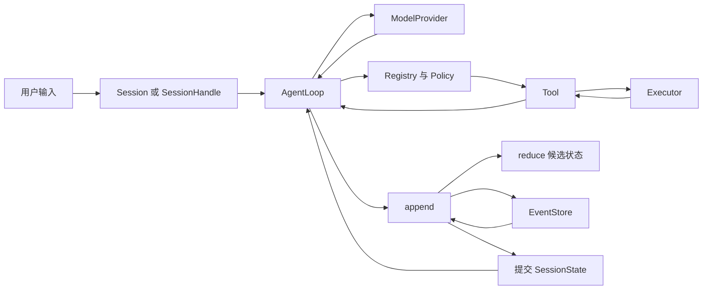

# 第 0 章：mini-harness 到底是什么？

## 1. 本章解决什么问题

假设模型要求读取 `README.md`，然后要求改文件、运行测试。模型能产生 JSON，却不能保证文件路径正确、进程能停止、权限获得批准、崩溃后还能知道做了什么。本章建立这套系统的任务范围。全书对应提交 `1720acefc11fe38cfb9b3bb3d649832ef951d4a8`；差异见[源码审查记录](source-audit.md)。

## 2. 先理解设计思想

先看一个**概念伪代码**，它不是仓库实现：

```text
history = [user_input]
loop:
    response = model(history, tools)
    if response is final_text: return response
    result = execute(response.tool_call)
    history.append(result)
```

理想情况下，这足以形成“模型提出动作—执行—回传结果”的闭环。但这里没有规定 `execute` 失败时谁处理、模型一直调用工具时如何结束、取消如何进入执行器，以及结果尚未记账就崩溃时如何判断。

mini-harness 给这个闭环补上可观察、可控制的边界：模型由 Provider 适配；参数由 Tool 校验；权限由 Policy 决定；真实文件和进程由 Executor 处理；事实由 EventStore 保存；状态由 reducer 推导；交互命令由 Actor 串行安排。不是模型更聪明了，而是模型的建议获得明确的执行语义。

## 3. 模块在整体架构中的位置



图中的返回箭头非常关键：只有结果回到主循环并进入 history，下一次模型请求才有工具结果。Executor 不会自己再调用模型。

## 4. 源码位置

- [src/main.rs](https://github.com/nothiny/mini-harness/blob/1720acefc11fe38cfb9b3bb3d649832ef951d4a8/src/main.rs)：`run_demo`，把上述模块装配起来。
- [src/runtime/agent_loop.rs](https://github.com/nothiny/mini-harness/blob/1720acefc11fe38cfb9b3bb3d649832ef951d4a8/src/runtime/agent_loop.rs)：`AgentLoop`、`run_turn`、`append`。
- [src/lib.rs](https://github.com/nothiny/mini-harness/blob/1720acefc11fe38cfb9b3bb3d649832ef951d4a8/src/lib.rs)：公共模块入口。
- [src/lib_tests.rs](https://github.com/nothiny/mini-harness/blob/1720acefc11fe38cfb9b3bb3d649832ef951d4a8/src/lib_tests.rs)：`full_mock_read_turn`，最短闭环的断言。

## 5. 从入口逐步分析源码

先在 `run_demo` 找到两项脚本：`MockResponse::ToolCall(read)` 和 `MockResponse::Text("read complete")`。它们模拟模型的两个响应，输入固定，因此可离线重复。

随后它注册 `ReadTool`、`EditTool`、`BashTool`，创建 `InMemoryEventStore` 和当前目录的 `LocalExecutor`，把这些对象传给 `Session::new_with_policy`。`Arc` 表示多个对象可共享这份组件的所有权；它没有赋予对象无限写权限。

最后 `session.start_turn(input).await` 驱动主循环。`await` 是等待异步操作推进，不表示另开一个线程，也不表示允许别人同时改 Session。主循环将事实写到 store，再把最终文本作为 `(TurnId, String)` 返回。Demo 从 store 读事件、打印，再检查 Turn 返回值，所以遇到工具失败仍能展示已有事件。

这里刻意先知道“谁做什么”。第 2 章再逐个展开调用，之后才解释类型和 Rust 机制。

## 6. 完整运行示例

在仓库根目录执行：

```bash
cargo run --locked -- demo read README.md
cargo test full_mock_read_turn
```

Demo 会读取 README 并输出工具摘要及脚本最终文本 `read complete`。这个文本没有语义总结能力；实际文件内容出现在 `tool.completed` 的结果中。测试在临时目录读取 `a.txt`，断言两次模型请求、第二次请求含文件内容、11 条事件和最后 Idle 状态。实测结果见[验证记录](validation.md)。

## 7. 为什么这么设计

| 补充能力 | 删除后会发生什么 | 当前边界 |
|---|---|---|
| 权限门 | 模型提出的写入立即执行 | 决策不是 OS 隔离 |
| 事件日志 | 重启只能猜副作用状态 | 外部操作和日志不能合成一个事务 |
| 取消与预算 | 长命令或无限循环占用资源 | 同进程 token 和跨进程日志取消不同 |
| 可替换 Provider/Executor | 模型协议和平台细节污染主循环 | trait 仍需行为测试约束 |
| 单会话串行执行 | 输入、审批、取消可能交叉修改状态 | 不提供并行工具执行 |

当前已经实现本地 read/edit/命令执行、Mock/两种 HTTP wire、JSONL、Checkpoint、恢复分类、审批、队列、Scheduler API 和两种 TUI。当前没有 OS sandbox、PTY 交互、MCP 工具接入、优先级调度、工具副作用 exactly-once、自动续跑所有崩溃任务或内置 benchmark 系统。不要把“存在 trait”误读为“相应后端已经实现”。

## 8. 常见误解

- `run "读取 README"` 的默认 Mock 只返回 `mock response`，不会理解自然语言并选 read；第一次工具闭环应使用 `demo read`。
- 持久化不等于自动重试；unknown outcome 正是为了避免不确定时重复副作用。
- workspace 对文件工具提供路径约束；bash 的 workspace 是 cwd，仍使用宿主权限。

## 9. 本章总结

Harness 的核心工作是把模型建议变成有权限、有预算、有账本、能取消和解释故障的执行。先记住闭环，再深入它的保障层。

## 10. 自测问题

1. 最小 loop 少了哪些工程能力？参考：权限、预算、取消、持久化与恢复。
2. Demo 的最终回答为何不能证明“模型理解了文件”？参考：它来自固定 Mock 脚本。
3. 文件实际在哪一层打开？参考：LocalExecutor 的 read 路径，不在 Provider。
4. 新远程执行器应替换哪层？参考：Executor，实现相同请求/结果与取消约定。

## 11. 下一章如何衔接

下一章建立[完整架构地图](architecture.md)，明确一个用户动作的控制流和数据流，再运行第一次请求。

---

导航：上一章 [教材首页](README.md) · [首页](README.md) · 下一章 [第 1 章：项目整体架构](architecture.md)
