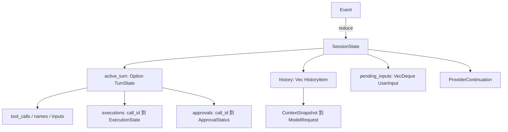

# 第 3 章：核心数据结构与身份

## 1. 本章解决什么问题

同一次 read 有 session_id、turn_id、call_id、execution_id、event_id 和 seq。为什么要这么多身份？把它们都变成字符串，会把哪些错误留到运行时？

## 2. 先理解设计思想

这些身份回答不同问题：在哪段会话、哪次用户工作、哪项模型建议、哪次现实执行、哪条事实、事实排第几。一次 Turn 可以反复向模型请求，每次称为 Step；每次响应可以提出多个 ToolCall。

不要把教学概念自动当成源码类型：仓库有 `Session/TurnState/ToolCall/ExecutionState/HistoryItem`；没有统一的 `Message`、`Step` 或 `ToolExecution` struct。`StepId` 虽然定义了，但当前主循环使用 `turn_steps: usize`，没有逐 Step ID 的事件；SchedulerTask 使用 SessionId+TurnId，不使用 TaskId。

## 3. 模块在整体架构中的位置



## 4. 源码位置

- [ids.rs](https://github.com/nothiny/mini-harness/blob/1720acefc11fe38cfb9b3bb3d649832ef951d4a8/src/runtime/ids.rs)：`id_type!`、`new/parse/Display/FromStr`。
- [types.rs](https://github.com/nothiny/mini-harness/blob/1720acefc11fe38cfb9b3bb3d649832ef951d4a8/src/runtime/types.rs)：UserInput、ModelText、ToolResult、EventSeq、ExecutionState。
- [state.rs](https://github.com/nothiny/mini-harness/blob/1720acefc11fe38cfb9b3bb3d649832ef951d4a8/src/runtime/state.rs)：SessionState、TurnState、HistoryItem、ProviderContinuation、run_state。
- [provider.rs](https://github.com/nothiny/mini-harness/blob/1720acefc11fe38cfb9b3bb3d649832ef951d4a8/src/model/provider.rs)：ToolCall、ModelRequest、ModelResponse、ModelCompletion。
- [event.rs](https://github.com/nothiny/mini-harness/blob/1720acefc11fe38cfb9b3bb3d649832ef951d4a8/src/durable/event.rs)：Event、EventPayload、kind、from_json。
- [src/lib_tests.rs](https://github.com/nothiny/mini-harness/blob/1720acefc11fe38cfb9b3bb3d649832ef951d4a8/src/lib_tests.rs)：`ids_are_round_tripable_and_type_scoped`、`every_core_event_round_trips`。

## 5. 从入口逐步分析源码

### 输入如何获得类型

CLI 将文本包装成 `UserInput`；直接 Session 入口接收 String，begin_turn 再包装。newtype 是“包着旧值的新类型”：`ModelText(String)` 和 `ToolResult(String)` 在 JSON 都可以是字符串，但在 Rust 不允许随意替换。

`id_type!` 为每种 UUID 生成独立类型，并序列化为 `sess_`、`turn_`、`step_`、`call_`、`exec_`、`evt_`、`task_` 加 UUID。`parse` 检查前缀和 UUID；`ToolCallId` 无法传给接受 `TurnId` 的方法。EventSeq 包 u64，它提供顺序，不提供全球唯一身份。

### 输入如何变为会话状态

`SessionState::new` 得到 Idle、空 history、无 active_turn、last_seq=0。第一条输入经 reducer 加入 history 和队列。TurnStarted 消费一条 pending input 并新建 Running 的 TurnState。Session 是长期会话容器/调用门面，TurnState 只表示当前进行中的一轮。

Turn 结束时 `active_turn=None`；源码不会把所有历史 TurnState 留成一个 Vec。Completed/Failed 的细节应从事件重放或查询日志，不能期待 `state.active_turn` 保存上一轮工具表。

### 模型和工具对象如何对应

`ModelRequest` 包含可选 model、system instructions、history、tools 和 continuation；`ModelResponse` 可以是 Text、ToolCall、ToolCalls、TextWithToolCalls。`ModelCompletion` 在响应外包 request_id、usage、attempts、continuation。

`ToolCall` 包 call_id/name/input。Loop 接受它后，`ToolRequested` 将 Pending execution 与 input 放入 TurnState；`ToolStarted` 生成 ExecutionId，Running 里保留该 ID。Completed 保存 ToolResult，Failed 保存 ExecutionError，OutcomeUnknown 只表示知识边界。失败不是“世界没有改变”的证明。

`HistoryItem` 是本项目的内部消息形状：User、Assistant、Tool。它没有保存完整 assistant tool_calls 及原始 arguments；tool_inputs 在 active Turn，原始调用永久保存在 Event 中。这个差异直接影响 Chat Completions 重建，见第 6 章。

### 事件信封与 payload

`Event::new` 创建 event_id/timestamp/schema_version，并暂设 seq=0。append 才确定序号。Event.turn_id 是 Option：SessionCreated、UserInputRecorded、CheckpointCreated、RecoveryStarted/Completed 没有 Turn ID；工具事实通常必须关联当前 Turn。

`EventPayload` 使用 serde 的 `tag="type", content="data"`：例如工具事实形状为 `{"type":"tool_requested","data":{...}}`，无字段的 SessionCreated 只有 type。`kind()` 产生稳定展示名，例如 `tool.requested`。

事件版本当前为 2，`from_json` 接受版本 1 和 2；这不代表任意新 payload 都能被旧读者解析。显式 `migrate_to_current` 修改版本标记，不修改事实含义。

## 6. 完整运行示例

```bash
cargo test ids_are_round_tripable_and_type_scoped
cargo test every_core_event_round_trips
cargo test --test context_snapshot
```

前两项检验身份和事件编码；第三组检查快照拥有数据、截断、最终文本去重、工具批次顺序。对照第 2 章 JSON，找到同一 call 的 ToolRequested 与 ToolStarted：call ID 相同，execution ID 只在开始事实中出现。

## 7. 为什么这么设计

不同 ID 降低跨模块误用；EventId 能在 sync 错误后识别同一事件是否已经落盘，seq 则判断是否连续。`Option` 明确允许缺失：无 active_turn 与某个 Turn 状态不是一个问题。`HashMap` 服务按 call 查询，Vec 保存工具建议顺序，VecDeque 服务输入 FIFO，各有用途。

模型原生 ID 不适合充当 runtime ID：不同服务格式不同，重试和恢复又需要稳定内部表示。ProviderContinuation 的 native_call_ids 建立映射，而不是让 reducer 理解所有服务协议。

## 8. 常见误解

- 有 StepId 不代表每轮采样已有持久化 Step 对象。
- SessionStatus::Closed 定义了，但当前没有 session.closed 事件；shutdown 主要关闭 Actor/进程，不把状态迁移为 Closed。
- HistoryItem 不是原始 wire message；它是给不同 Provider 适配的规范化输入。

## 9. 本章总结

区分身份、当前状态、规范化历史、原始事实。它们相关但不等价，后续恢复和协议都依赖这些区别。

## 10. 自测问题

1. EventId 与 seq 可否互相代替？参考：唯一身份与局部顺序用途不同。
2. Message 在哪定义？参考：没有同名类型；使用 HistoryItem。
3. Turn 完成后工具输入还能从哪里找到？参考：事件日志的 ToolRequested。
4. execution_id 为什么不复用 call_id？参考：模型建议和实际执行是不同生命周期。

## 11. 下一章如何衔接

下一章讲[Session 生命周期](03-mock-provider-and-session.md)，把这些数据放入开始、完成、失败、审批和取消的行为中。

---

导航：上一章 [第 2 章：第一次完整运行](first-run.md) · [首页](README.md) · 下一章 [第 4 章：Session 与生命周期](03-mock-provider-and-session.md)
