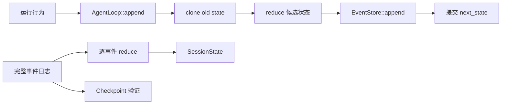

# 第 9 章：Event Sourcing、EventStore 与 Reducer

## 1. 本章解决什么问题

进程重启后，怎样知道用户说了什么、工具是否完成、是否还待审批？只存“status=Running”不能回答这些问题。本章从 11 条 read 事件演算当前状态，再追到磁盘。

## 2. 先理解设计思想

事件是过去发生的事实，状态是事实累计后的当前视图。事件溯源让日志成为事实来源，reducer 重放同样序列得到同样状态。它并不表示只要 JSON 能解码就合法，也不表示原始日志可任意改写。

## 3. 模块在整体架构中的位置



## 4. 源码位置

- [event.rs](https://github.com/nothiny/mini-harness/blob/1720acefc11fe38cfb9b3bb3d649832ef951d4a8/src/durable/event.rs)：事件版本、编码、kind。
- [store.rs](https://github.com/nothiny/mini-harness/blob/1720acefc11fe38cfb9b3bb3d649832ef951d4a8/src/durable/store.rs)、[memory.rs](https://github.com/nothiny/mini-harness/blob/1720acefc11fe38cfb9b3bb3d649832ef951d4a8/src/durable/memory.rs)：EventStore 与内存实现。
- [event_log.rs](https://github.com/nothiny/mini-harness/blob/1720acefc11fe38cfb9b3bb3d649832ef951d4a8/src/durable/event_log.rs)：JsonlEventStore、append、read_all_locked、validate_suffix、repair_partial_tail。
- [reducer.rs](https://github.com/nothiny/mini-harness/blob/1720acefc11fe38cfb9b3bb3d649832ef951d4a8/src/durable/reducer.rs)：reduce、active_turn_mut、push_history。
- [agent_loop.rs](https://github.com/nothiny/mini-harness/blob/1720acefc11fe38cfb9b3bb3d649832ef951d4a8/src/runtime/agent_loop.rs)：append。
- [src/lib_tests.rs](https://github.com/nothiny/mini-harness/blob/1720acefc11fe38cfb9b3bb3d649832ef951d4a8/src/lib_tests.rs)、[tests/property_replay.rs](https://github.com/nothiny/mini-harness/blob/1720acefc11fe38cfb9b3bb3d649832ef951d4a8/tests/property_replay.rs)、[tests/jsonl_cross_process.rs](https://github.com/nothiny/mini-harness/blob/1720acefc11fe38cfb9b3bb3d649832ef951d4a8/tests/jsonl_cross_process.rs)、[tests/reducer_turn_terminal.rs](https://github.com/nothiny/mini-harness/blob/1720acefc11fe38cfb9b3bb3d649832ef951d4a8/tests/reducer_turn_terminal.rs)。

## 5. 从入口逐步分析源码

### 5.1 从一张空表开始逐事件演算

设用户 U=`read a.txt`，工具 C 读到 hello，最终文本 F=done；表中 C/T 是同一个实际 call/turn ID 的缩写，不是可传给解析器的字符串。事件顺序来自 `full_mock_read_turn`：

| seq / 事件 | 前置条件 | 本步状态变化 |
|---|---|---|
| 1 SessionCreated | last_seq=0、无 turn_id | status=Idle，history=[]，pending=[] |
| 2 UserInputRecorded(U) | 无 active_turn、Idle | history=[User(U)]，pending=[U] |
| 3 TurnStarted(T) | pending 非空、无 active | pending=[]，active=T/Running，status=Running |
| 4 ProviderContinuationUpdated(mock cursor=1) | T active、cursor<=history.len | 保存 continuation，不加 history |
| 5 ModelResponseRecorded(tool call: read) | T active | last_model_response=摘要；history 加 Assistant |
| 6 ToolRequested(C,read,input) | C 尚不存在 | tool_calls=[C]；保存 name/input；execution[C]=Pending |
| 7 ToolStarted(C,E) | Pending 且无待批准/拒绝 | execution[C]=Running(E) |
| 8 ToolCompleted(C,result) | Running | execution[C]=Completed；history 加 Tool(C,read,result) |
| 9 ProviderContinuationUpdated(None) | T active | 清除 continuation |
| 10 ModelResponseRecorded(F) | T active | last_model_response=F；history 加 Assistant(F) |
| 11 TurnCompleted(F) | 所有 executions=Completed | active_turn=None，status=Idle；F 与上条一致，不重复加 history |

每一步成功后 last_seq 变为该行 seq。最终 history 是 User、工具摘要、工具结果、最终文本四项。工具表只在 active Turn 中；终态清空 active_turn 后，历史事实仍在日志里。

### 5.2 reducer 的输入、合法性与失败语义

`reduce(&mut SessionState, &Event) -> Result<(),HarnessError>` 不调用 Provider、Executor、时钟或随机数。首先检查同一 session、seq 恰好 last_seq+1、首事件必须 SessionCreated、SessionCreated 只能一次。`active_turn_mut` 检查 Turn 存在且 event.turn_id 匹配。

事件分支同时更新与校验：ToolRequested 不可重复；ToolStarted 必须 Pending 且批准状态允许；ToolCompleted 必须 Running；ToolFailed 可以从 Pending/Running；ToolOutcomeUnknown 只能从 Running。TurnCompleted 要求全部工具 Completed，不能用失败工具的结果装作成功。

ApprovalRequested 要 Pending tool，ApprovalResponded 要已有 Pending approval。PolicyDenied 不写 approvals，防止把程序决策伪造成人类回应。Recovery/Checkpoint 生命周期事件没有 TurnId；ActionRequired 则关联 active Turn 与未完成 call。

push_history 使用 JSON 编码字节计数，硬上限 1 MiB。最后才更新 last_seq。**reduce 不承诺对所有 Err 原地回滚**：一些分支可能先改 map 再遇到后续错误；安全 runtime 在 clone 上预验证，失败即丢掉副本。读者不要直接对共享真实状态反复试非法事件。

### 5.3 EventStore 接口与职责差别

append 返回最终 Event，因为 store 分配 seq；read_from 是包含传入序号的读取，last_seq 给当前尾部。InMemory 用 Arc<Mutex<Vec>>，追加只分配连续 seq，**不负责完整 reducer 预验证**。适合受 loop 约束的测试，不能当通用合法事件防火墙。

JSONL 每行一个 Event 并以换行结尾。`read_all_locked` 检查大小<=128 MiB、行数<=1,000,000、无空行、UTF-8/JSON/schema 正确、序号连续、同 Session，再 reduce 全部事件。合法 JSON 但非法 ToolCompleted 顺序仍算 Corrupt。

### 5.4 JsonlEventStore::append 的真实步骤

调用先获取实例内 Tokio Mutex，随后获取独立 `.jsonl.lock` 文件的 fs2 exclusive lock（通过 spawn_blocking），在锁内读取并验证已有日志，分配 seq=len+1，打开 append 文件。Unix 尽力设置 log/lock mode 0600。

编码 Event+换行，检查追加后总字节预算，write_all → flush；Synced 再 sync_data，Buffered 不强制设备同步。`JsonlEventStore::new` 库默认 Synced；CLI 配置默认 Buffered。sync 也不能被泛化成所有硬件/目录元数据的无条件断电保证。

写完释放文件锁。如果 write/flush/sync 报错，代码重新读取日志按 event_id 查找：这行可能已写完整，错误返回不一定表示事实未持久化。找到它则返回保存事件，否则返回 IO 错误。

成功后在 cached state 上 reduce 新事件；如果失败，只使 cache 失效，**事件已经写入了**。因此 JsonlEventStore.append 也不对新 payload 提供全套先验证承诺；调用方应该先 reduce，下一次 read 会发现非法完整日志。用户扩展 Store 或写恢复事件必须保持这个责任边界。

### 5.5 Actor、Mutex、file lock 和 seq 检查各保护什么

Actor/独占 loop 借用保护整个会话迁移的顺序；store Mutex 串行同实例 append；fs2 advisory lock 协调遵守协议的多个进程；seq 预检查及返回检查发现内存已落后。只有文件锁，并不能让两份 SessionState 同时驱动同一会话；`store.last_seq` 检查与 `append` 之间也不是数据库 CAS。

### 5.6 cache 与 suffix validation

LogCache 保存 len/mtime 指纹、完整 events、已验证 byte offset、reducer state。文件未变化直接用 cache；变长且可认定 append-only 时 validate_suffix 从 offset 读取新行、检查 seq/session、在缓存状态上 reduce。缩短、尾部半行等走 full read。

这在协作写入前提下减少反复全量验证；cache 仍复制 events/state，不能据此承诺所有操作 O(1)，len/mtime 也不是防恶意篡改认证。历史改写可能破坏 cursor、checkpoint 和复现；显式 schema migration 验证后原子改写版本标记，payload 语义保持，不能借 migration 修改事实。

### 5.7 Replay 和半行修复

restore 以 SessionState::new 开始按 seq reduce。中间损坏完整行不能猜测丢弃；缺末尾换行时 read 报 Corrupt。repair_partial_tail 在 exclusive lock 内截到最后完整换行，sync_data 并清 cache；它只按换行判断完整行，不会修复一个带换行的坏 JSON。

CLI inspect/recover/resume 等入口会先调用 repair，所以虽然 inspect 不追加恢复事件，它可能修理末尾半行；库 inspect_store 则只读。这是“只读分类”和“CLI 便利修复”的重要差别。

## 6. 完整运行示例

```bash
cargo test reducer_replay_is_deterministic
cargo test jsonl_rejects_sequence_gaps_and_middle_corruption
cargo test --test property_replay
cargo test --test jsonl_cross_process
cargo test --test reducer_turn_terminal
```

property 组生成固定种子的 Mock 脚本，重放每个 prefix/两次完整日志并比较；它没有使用 proptest，也不覆盖所有理论事件序列。cross-process 组检查 suffix 计数与半行修复后重新验证。对 read Demo 可按本章表手工演算，结果应和 Session.state 相等。

## 7. 为什么这么设计

日志保留因果关系，状态可重建；reducer 纯逻辑让恢复和执行共享规则。代价是额外编码、clone、日志增长、schema 兼容成本；当前不支持任意长 history，也没有日志压缩/历史清理协议。

如果直接存可变 SessionState，恢复只能看到一张最后快照，无法分辨审批、人类拒绝和策略拒绝，更无法明确工具“开始了但结果未记账”的窗口。

## 8. 常见误解

- EventStore 不是 reducer：存得下不等于状态转移合法。
- `tool.started` 证明进入执行窗口，不证明副作用一定发生或完成。
- replay 重建状态，不重放 OS 操作。
- append 事务不包含文件 rename 或 HTTP 副作用。

## 9. 本章总结

日志是事实，reducer 是验证与演算规则，内存 state 是结果。理解这三个角色，才能解释所有恢复结论的依据。

## 10. 自测问题

1. seq=8 直接跟 seq=6 可接受吗？参考：不可，必须连续。
2. reducer 可否读取现有文件决定结果？参考：不可，会破坏确定重放。
3. sync 出错为何按 EventId 重读？参考：错误时该行可能已经 durable。
4. memory store append 会验证工具顺序吗？参考：不会，Loop 负责预验证。
5. 修改历史 ToolCompleted 有什么后果？参考：重放事实改变、快照不匹配、因果与审计不再可靠。

## 11. 下一章如何衔接

下一章讲[Session Actor 与并发](session-actor.md)，解释谁有权执行这些状态迁移。

---

导航：上一章 [第 8 章：Executor 系统与副作用边界](executor.md) · [首页](README.md) · 下一章 [第 10 章：Session Actor 与并发](session-actor.md)
