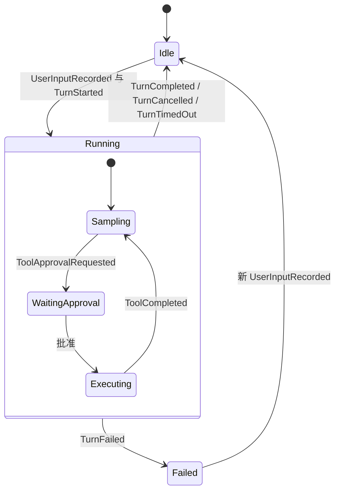

# 第 4 章：Session 与生命周期

## 1. 本章解决什么问题

用户连续输入两条消息时，会产生两个 Session 还是两个 Turn？模型出错后是否必须丢弃整个会话？等待审批时，返回 Err 是否意味着 Turn 已结束？

## 2. 先理解设计思想

Session 保持会话身份和跨 Turn 历史，AgentLoop 负责执行一轮的采样/工具闭环。直接 `Session` 是轻量 facade，Actor-backed `SessionHandle` 是并发命令入口。两者最终驱动同一种 loop，不是两套状态机。

## 3. 模块在整体架构中的位置



外层对应 SessionStatus；内层是教学行为阶段，不是该枚举的新成员。Unknown outcome 可能保留 Running/active_turn，不能画成必然终态。

## 4. 源码位置

- [session.rs](https://github.com/nothiny/mini-harness/blob/1720acefc11fe38cfb9b3bb3d649832ef951d4a8/src/runtime/session.rs)：Session、SessionHandle、spawn_actor、start_turn、resume。
- [agent_loop.rs](https://github.com/nothiny/mini-harness/blob/1720acefc11fe38cfb9b3bb3d649832ef951d4a8/src/runtime/agent_loop.rs)：begin_turn、begin_queued_turn、cancel_turn。
- [agent_loop_setup.rs](https://github.com/nothiny/mini-harness/blob/1720acefc11fe38cfb9b3bb3d649832ef951d4a8/src/runtime/agent_loop_setup.rs)：new_with_config、from_state、restore。
- [reducer.rs](https://github.com/nothiny/mini-harness/blob/1720acefc11fe38cfb9b3bb3d649832ef951d4a8/src/durable/reducer.rs)：输入和 Turn 终态分支。
- [tests/checkpoint.rs](https://github.com/nothiny/mini-harness/blob/1720acefc11fe38cfb9b3bb3d649832ef951d4a8/tests/checkpoint.rs)、[tests/session_cancel.rs](https://github.com/nothiny/mini-harness/blob/1720acefc11fe38cfb9b3bb3d649832ef951d4a8/tests/session_cancel.rs)、[tests/policy.rs](https://github.com/nothiny/mini-harness/blob/1720acefc11fe38cfb9b3bb3d649832ef951d4a8/tests/policy.rs)。

## 5. 从入口逐步分析源码

`Session::new/new_with_policy/new_with_policy_and_config` 创建 AgentLoop；new 并不立即写 SessionCreated，首次 begin_turn 才写。协议 create 是例外：它主动保存 SessionCreated 后再 restore Actor，因此无输入也已有 durable identity。

`Session::start_turn(&mut self, input)` 只是 `self.loop_.run_turn(input).await`。`&mut` 表示独占可变借用；while await，这个 Session 不能被另一个调用方同时借用来 cancel。需要中途控制，应使用 Actor handle、预先传入 token 的 AgentLoop API 或 start_turn_with_timeout。

`begin_turn` 接收新 TurnId 和文本，拒绝已有 active_turn，检查输入大小，保存输入，再调用 begin_queued_turn。后者要求 pending_inputs 非空，保存 TurnStarted，reset 进程内预算。输入不是 Turn 的一个直接字符串字段，而在 history 和 durable 队列里。

正常 Text 经 ModelResponseRecorded/TurnCompleted 结束；Provider 或 Tool 普通错误通常记录 TurnFailed，SessionStatus 留 Failed，但 active_turn 清空。新的 UserInputRecorded 是明确的恢复入口：从 Failed 转回 Idle，然后可以开始新 Turn。这避免一次网络失败永久毒化会话。

Ask 时保存 ToolApprovalRequested，然后返回 `HarnessError::ApprovalPending`；active_turn 保留。调用者应根据错误类型选择审批，不可把所有 Err 视为终态。`approve_tool` 校验当前 Turn 和 call 的 Pending approval，保存人类决策，批准后执行同一个工具并继续同一 Turn；拒绝则保存 TurnCancelled。

直接 `cancel_turn` 只能在没有 start future 持有 Session 借用时使用，例如审批已暂停。它保存 cancel_requested/cancelled，不负责向另一个进程发送 OS 信号。Actor 的 CancelTurn 路径会触发 live token，见第 10/11 章。

`Session::resume` 调 restore，只重建状态，既不调用 Provider，也不自动运行未完成 Turn。restore 最后比较 last_seq，确保重放期间 store 未发生无法接受的变化。from_state reset steps、tool_time_used 和开始时间；实时预算没有持久化。

## 6. 完整运行示例

```bash
cargo test --test checkpoint
cargo test --test session_cancel
cargo test approval_executes_the_pending_tool_and_keeps_the_turn_budget
```

观察：失败后同一个 Session 可运行下一轮；Actor 只取消当前 Turn；审批后原 TurnId 保持不变。`start_turn` 返回 `(TurnId, text)`，而 `SessionHandle::start_turn` 返回接收后的 TurnId，最终结果通过 wait_turn 获取。

## 7. 为什么这么设计

直接 facade 容易嵌入和测试，没有 channel 成本；它把串行访问要求交给 Rust 借用检查。Actor 增加命令与回复通道，让取消、等待、审批进入执行中的会话。代价是“命令接收”和“状态可以修改”之间需要显式安排。

没有把所有历史 TurnState 永久保存在内存，是为了避免重复保存日志已有事实；但状态查看者应知道只保留当前 Turn。SessionStatus 和 run_state 也不同：后者是调度投影，Failed 且无 active_turn 时可投影为 Idle。

## 8. 常见误解

- `ApprovalPending` 是暂停控制状态，不是已经执行失败。
- `resume` 不等于从崩溃指令下一行继续跑。
- `shutdown` 没有把整个会话事件历史删除，也没有新增 SessionClosed 事实。

## 9. 本章总结

Session 提供会话边界；Loop 提供执行算法；reducer 定义状态迁移。开始、失败、审批和取消的返回值要与 active_turn 和日志一起理解。

## 10. 自测问题

1. 两条用户输入通常对应几个 Turn？参考：两个，属于同一 Session。
2. Failed 后如何开始下一轮？参考：新输入事件恢复 Idle，再 TurnStarted。
3. 为什么不能在直接 Session.start_turn 进行中调用 cancel_turn？参考：future 持有独占可变借用。
4. resume 是否会消耗 Mock 脚本？参考：不会，restore 只重放。

## 11. 下一章如何衔接

现在深入[AgentLoop 的完整实现](05-agent-loop.md)，逐分支解释一次 Turn 如何运行。

---

导航：上一章 [第 3 章：核心数据结构与身份](01-ids-and-events.md) · [首页](README.md) · 下一章 [第 5 章：AgentLoop 的完整实现](05-agent-loop.md)
