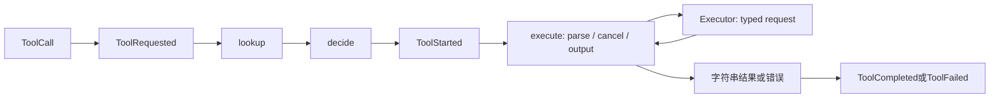

# 第 7 章：Tool 系统——从 JSON 建议到能力请求

## 1. 本章解决什么问题

模型发来 `{"name":"read","arguments":...}`，它不是可信函数调用。哪里判断工具存在、参数合法、输出能放入事件？read、edit、bash 为什么共享一个接口却各有一层验证？

## 2. 先理解设计思想

Tool 是面向模型的操作语义：read 的行号、edit 的精确替换、bash 的 command。Executor 是系统能力语义：读取字节、原子替换、启动进程。Policy 是第三个独立问题：允许这个调用开始吗？

## 3. 模块在整体架构中的位置



Ask/Deny 不经过 ToolStarted，具体审批在第 13 章。

## 4. 源码位置

- [spec.rs](https://github.com/nothiny/mini-harness/blob/1720acefc11fe38cfb9b3bb3d649832ef951d4a8/src/tools/spec.rs)：Tool、ToolSpec、RiskClass、ToolContext。
- [registry.rs](https://github.com/nothiny/mini-harness/blob/1720acefc11fe38cfb9b3bb3d649832ef951d4a8/src/tools/registry.rs)：register、specs、lookup。
- [read.rs](https://github.com/nothiny/mini-harness/blob/1720acefc11fe38cfb9b3bb3d649832ef951d4a8/src/tools/read.rs)：parse_input、execute、serialize_result。
- [edit.rs](https://github.com/nothiny/mini-harness/blob/1720acefc11fe38cfb9b3bb3d649832ef951d4a8/src/tools/edit.rs)：EditInput、execute。
- [bash.rs](https://github.com/nothiny/mini-harness/blob/1720acefc11fe38cfb9b3bb3d649832ef951d4a8/src/tools/bash.rs)：parse_input、execute、serialize_result。
- [tests/read_tool.rs](https://github.com/nothiny/mini-harness/blob/1720acefc11fe38cfb9b3bb3d649832ef951d4a8/tests/read_tool.rs)、[tests/edit_tool.rs](https://github.com/nothiny/mini-harness/blob/1720acefc11fe38cfb9b3bb3d649832ef951d4a8/tests/edit_tool.rs)、[tests/bash_tool.rs](https://github.com/nothiny/mini-harness/blob/1720acefc11fe38cfb9b3bb3d649832ef951d4a8/tests/bash_tool.rs)。

## 5. 从入口逐步分析源码

### 注册与模型可见 spec

main 的 `cli_components/run_demo`、protocol 的 `registry_from` 注册标准工具。`register` 只调用一次 spec，检查非空 name、重复名、序列化 spec <=16 KiB，然后放入 BTreeMap。specs 使用稳定排序输出；lookup 按名字返回共享 Tool，否则 Unknown 错误。

ToolSpec 包名称、描述、parameters JSON Schema 和 risk。schema 给模型提示格式，不会让 Registry 自动验证任意 arguments；每个 execute 必须再验证。risk 用于 Policy，不会阻止不守约的插件代码调用 OS。

`Tool::execute(input, ctx) -> Result<String,String>` 异步接口的字符串适合编码模型可读 JSON。`ToolContext<'a>` 借用 `&dyn Executor`，还携带 token、workspace、两个 ID、output_limit，不含 Session 或 store；借用生命周期保证 executor 引用有效。loop 的 task 拥有 Arc Executor，再借用到本次调用即可。

### read：先字节预算，再行窗口

parse_input 要求对象且只允许 path/start_line/end_line；path 非空，行号是正 u64，end 不小于 start。取消先检查，再 select 取消与 read_file；ReadFileRequest 的 max_bytes=min(tool.max_bytes, context.output_limit)。

Executor 返回 text、truncated、original_bytes、retained_bytes。Tool 将已保留 text 用 split_inclusive 切行，从 1-based start 开始，最多 200 行；显式 end 很大时 clamp，不直接拒绝。由于先有界读文件，start 指向很后面的行不意味着 executor 会 seek 到那里读取任意行。

结果中的 byte truncated 和 line_truncated 不是同一回事：字节截断来自读取预算，行截断来自窗口和文件尾；保留元数据描述 Executor 读取，再经 Tool 筛行/JSON 限长后，不一定等于最终 text 字节数。

serialize_result 检查 **JSON 编码后**长度，必要时按比例缩小 text，在 UTF-8 边界截断并标记 truncated。只限制原始字符数无法限制引号/换行转义后的 JSON 大小；连空 text 的 envelope 都放不下时返回 output_limit 错误。

### edit：精确替换与可取消提交

EditInput 用 deny_unknown_fields，接收 path/old_text/new_text/expected_hash。path 非空，old_text 非空，旧/新文字各 <=4 MiB。Tool 不自己找匹配或 rename，而调用 edit_file_with_cancel(request, child_token)。

`child_token` 随父取消，但可以独立向下传播。EditTool 没有用 select 随时 drop 文件事务，它 await Executor 走完取消检查和清理；Executor 负责 hash、锁、同目录临时文件、rename。结果是 old_hash/new_hash/replacements 的 JSON，不是新文件全文。

失败把 EditFileError 编成 `{"error":{"kind":"edit_failed",...}}`，取消则 kind=cancelled。该字符串是 Err，不会成为 Tool history，Loop 通常结束 Turn。

### bash：输入控制与执行结果

BashTool 校验 command 非空且 <=64 KiB；只允许 command/timeout_ms。显式 timeout_ms 要正整数且 <=10 分钟。默认 BashTool 是 30 秒，CLI/协议通过配置通常是 120 秒；配置默认值为零时这里采用 max_timeout（10 分钟），不是无穷时长。

execute 创建 ProcessRequest，stdout/stderr/combined 都用 context output_limit，调用 run_process(token.child_token)。结构化错误分 cancelled/concurrency_limited/process_failed。成功序列化 stdout/stderr/exit_code/signal/timed_out，JSON 超预算则缩最长输出，并更新对应保留字节字段。

命令 exit_code 非零或 timed_out=true 可以是 Ok result；它们不会自动触发 ToolFailed。模型需要读结果字段判断任务。这与参数错误/OS spawn 错误不同。

## 6. 完整运行示例

```bash
cargo test --test read_tool
cargo test --test edit_tool
cargo test --test bash_tool
cargo test --test integration_agent_loop
```

工具层 FakeExecutor 测试检查输入和结果；LocalExecutor 测试检查真实文件/进程。edit→bash 演示必须在临时目录运行：

```bash
cargo build --locked
TUTORIAL_BIN="$PWD/target/debug/mini-harness"
TUTORIAL_WORK="$(mktemp -d)"
printf 'before\n' > "$TUTORIAL_WORK/note.txt"
(cd "$TUTORIAL_WORK" && "$TUTORIAL_BIN" demo edit-bash note.txt --json > events.json)
cat "$TUTORIAL_WORK/note.txt"
```

观察 `after` 和两项 ToolCompleted；Demo 使用 AllowAllPolicy，没有演示审批。

## 7. 为什么这么设计

工具语义与系统能力分开，能复用一个 Executor 做多个 Tool，也能用 FakeExecutor 检查工具不会绕过预算。代价是输入/错误需要多次转换，且 Tool 信任约定不是 Rust 编译器提供的安全沙箱。对扩展工具，参数上限、取消、输出 envelope 都必须考虑。

## 8. 常见误解

- schema 不等于已经验证输入；parameters 是模型提示，execute 是运行检查。
- ToolFailed 的结构化错误当前不自动回模型继续修复。
- read 默认只给 200 行，文件大时“读取成功”不代表全文件已显示。

## 9. 本章总结

Registry 解决可见性与查找；Tool 解决参数和模型可读结果；Executor 处理真实副作用；Loop 负责事实和终态。

## 10. 自测问题

1. JSON Schema 会自动阻止未知字段吗？参考：不会，execute 自己校验。
2. 为何截断 JSON 后长度？参考：编码转义会膨胀。
3. edit 为何不用随时 select 掉 executor future？参考：保持提交/临时文件清理边界。
4. exit_code=7 对 Tool 是 Err 吗？参考：通常仍为 Ok(ProcessResult) 编码结果。

## 11. 下一章如何衔接

进入[Executor 系统](executor.md)，看本地文件和进程能力到底有何保证。

---

导航：上一章 [第 6 章：Model Provider 与模型 API 适配](08-openai-provider.md) · [首页](README.md) · 下一章 [第 8 章：Executor 系统与副作用边界](executor.md)
