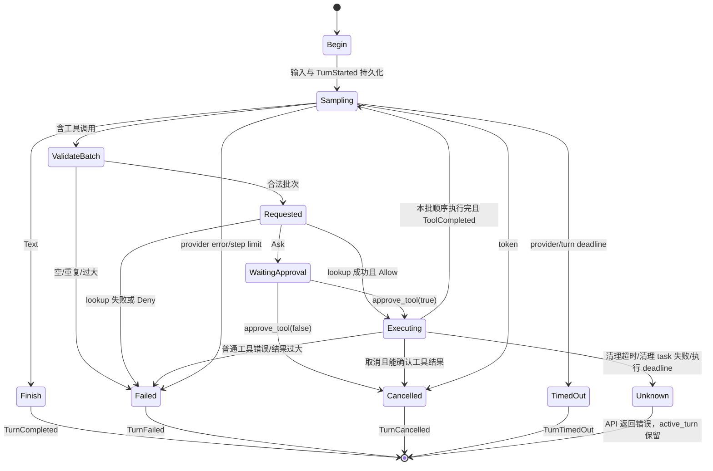
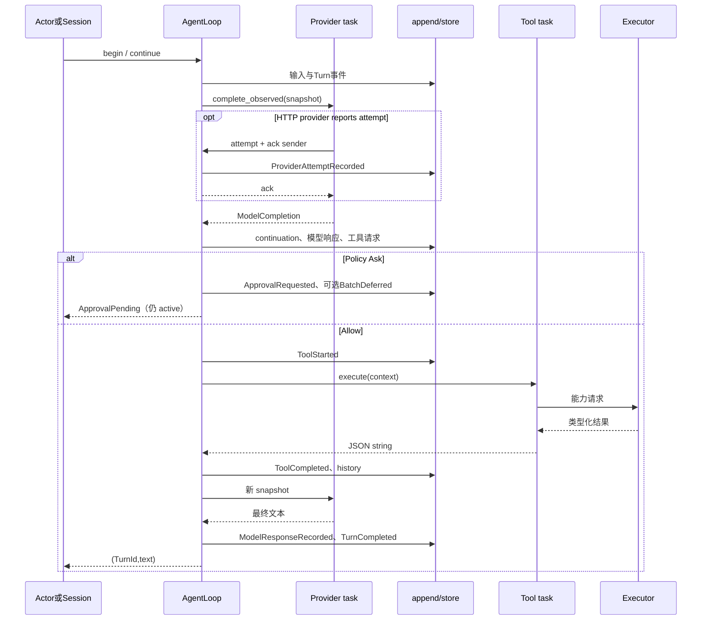

# 第 5 章：AgentLoop 的完整实现

## 1. 本章解决什么问题

用户要求读取文件，模型先返回 ToolCall，再给最终文本。把两次请求接起来很容易；难点是审批、错误、重复 call、取消、超时都必须留下与状态一致的事实。本章逐步阅读最重要的控制循环。

## 2. 先理解设计思想

循环是一位指挥者：它决定何时采样、何时授权执行、何时暂停或结束。它不自己编码 HTTP 或修改文件。每个可观察状态改变都经过 append；异步任务只返回数据或通过 observer 请求记账，不持有可变 SessionState。

## 3. 模块在整体架构中的位置



Unknown 是此图的执行函数出口，不是持久化 Turn 的终态。审批恢复也可能再次遇到 Ask。

## 4. 源码位置

- [agent_loop.rs](https://github.com/nothiny/mini-harness/blob/1720acefc11fe38cfb9b3bb3d649832ef951d4a8/src/runtime/agent_loop.rs)：AgentLoopConfig、append、run_turn_with_reason、begin_turn、continue_turn_with_reason、bounded_tool_deadline。
- [sampling.rs](https://github.com/nothiny/mini-harness/blob/1720acefc11fe38cfb9b3bb3d649832ef951d4a8/src/runtime/sampling.rs)：sample_model。
- [context.rs](https://github.com/nothiny/mini-harness/blob/1720acefc11fe38cfb9b3bb3d649832ef951d4a8/src/runtime/context.rs)：ContextSnapshot、history_start、bound_text。
- [agent_loop_approval.rs](https://github.com/nothiny/mini-harness/blob/1720acefc11fe38cfb9b3bb3d649832ef951d4a8/src/runtime/agent_loop_approval.rs)：approve_tool、cancel_active_after_shutdown。
- [agent_loop_setup.rs](https://github.com/nothiny/mini-harness/blob/1720acefc11fe38cfb9b3bb3d649832ef951d4a8/src/runtime/agent_loop_setup.rs)：new_with_config、from_state。
- [tests/context_snapshot.rs](https://github.com/nothiny/mini-harness/blob/1720acefc11fe38cfb9b3bb3d649832ef951d4a8/tests/context_snapshot.rs)、[tests/agent_loop_limits.rs](https://github.com/nothiny/mini-harness/blob/1720acefc11fe38cfb9b3bb3d649832ef951d4a8/tests/agent_loop_limits.rs)、[tests/integration_agent_loop.rs](https://github.com/nothiny/mini-harness/blob/1720acefc11fe38cfb9b3bb3d649832ef951d4a8/tests/integration_agent_loop.rs)、[tests/policy.rs](https://github.com/nothiny/mini-harness/blob/1720acefc11fe38cfb9b3bb3d649832ef951d4a8/tests/policy.rs)。

## 5. 从入口逐步分析源码

### 5.1 谁调用哪一个入口

```text
Session::start_turn → run_turn
  → run_turn_with_cancel → run_turn_with_reason
      → begin_turn → begin_queued_turn
      → continue_turn_with_reason
Actor: begin_turn → continue_turn → continue_turn_with_reason
审批: approve_tool → 执行待审批 call → continue_turn
```

直接 Session 接收输入并等最终结果；Actor 先 begin、回复 Start ack，再等 continue future。`run_turn_with_id` 接受调用方给的 TurnId；`run_turn_with_timeout` 用外层计时器触发 token，并把 Cancelled 返回映射为 Timeout。不要把它们误当成同一个超时来源。

`AgentLoop<P,E,S>` 持有共享组件 Arc 和独占 state，还持有非持久化的 turn_started_at、turn_steps、tool_time_used。`P: ModelProvider` 等 trait bound 表示“这个泛型类型必须具备此能力”，不是另一个运行时模块。

### 5.2 每轮采样前检查什么

`continue_turn_with_reason` 先算 turn_deadline，再进入 loop，依次检查 token、max_steps、墙钟预算、累计工具预算。时长为零关闭相应预算；max_steps 为零则第一轮前失败。超 step 追加 TurnFailed 并返回 Provider 错误；采样前时长超限追加 TurnTimedOut 并返回 Timeout。

通过检查后递增 steps，再 `ContextSnapshot::from_state(&state, tools.specs())`。system instructions 是 loop 的独立可选字段，经 snapshot 限长；CLI 主路径没有自动设置它。

快照拥有自己的 history/specs/continuation，因此 task 不必借用 state。单项模型可见文本限制 16 KiB，普通历史窗口目标 512 KiB；UTF-8 截断先退到字符边界。durable history 保留原值，且 reducer 有 1 MiB 硬上限；快照截短不能让会话历史无限增长。

`history_start` 对 continuation 有额外规则：保留 cursor 开始所需的 suffix，使用 `start.min(cursor)`，因此不能把 512 KiB 描述成所有 continuation 场景的绝对硬上限。转成 ModelRequest 后还序列化检查 max_context_bytes（默认 1 MiB），包含 tools 等字段。超限记录 TurnFailed。

### 5.3 sample_model 怎样同时等模型与控制信号

`sample_model(request, turn, token, turn_deadline, reason)` 创建容量 1 的 mpsc observer，clone provider/token，spawn `complete_observed`。拥有的数据可 move 进 task，`'static` 表示 task 不借用即将消失的栈变量，不表示对象永远不能释放。

`tokio::select!` 同时轮询四类 future：取消、`min(provider.request_timeout, turn_deadline)`、observer.recv、task 完成。这里有 `biased`，已就绪取消/timeout 优先于后面的结果分支。

observer 发送 `(ProviderAttempt, oneshot ack)`；loop 追加 ProviderAttemptRecorded 成功后才 `ack.send(())`。Provider 等 ack，再发 HTTP 或继续重试，所以这不是事后把 attempts Vec 复制进日志。容量与 ack 提供背压，也防止 Provider 绕过单写者直接 append。

取消/采样超时会 abort task 并 await 收尾，写取消/超时事件。Provider 返回 Err 时写 TurnFailed；task join 失败归为 ProviderError。普通 Mock 不报告 attempts，因此 Demo 不出现 attempt 事件。

### 5.4 ModelCompletion 如何变成事实

completion.continuation 与现有 cursor 不相同时，先追加 ProviderContinuationUpdated。它保存 native ID 映射和历史位置，随后才追加本次 ModelResponseRecorded。

Text 分支保存模型文本，再保存 TurnCompleted，返回 `(turn, text)`。持久化任何一步失败，会尽力追加 TurnFailed，但不能保证坏 store 还能接受这条终态；返回原错误，交给恢复检查。

ToolCall 归一成一项 Vec；ToolCalls 保留列表；TextWithToolCalls 保留文字并处理 calls。批次先验证非空、同批 ID 不重复、数量不超过 max_batch_tool_calls，默认 16。违规时失败，而且不会写该批 ToolRequested。跨 step 重复 ID 则由 reducer 的 ToolRequested 分支拒绝。

工具批次的 ModelResponseRecorded 使用真实混合文本（有文本时）或 `tool call: read` / `tool calls: ...` 摘要。它记录助手说了什么，不是 ToolResult，也没有保存原始 wire tool_calls。

### 5.5 工具生命周期按什么顺序走

对 calls 使用普通 `for`，每项等执行完再处理下一项：**本项目没有并行工具批次**。

1. append ToolRequested：保存 name/input，execution=Pending。
2. Registry.lookup：不存在则 ToolFailed+TurnFailed，不启动副作用。
3. policy.decide：Allow 继续；Deny 保存 ToolPolicyDenied+TurnFailed；Ask 保存 ToolApprovalRequested 后返回 ApprovalPending。
4. Allow 后新建 ExecutionId、append ToolStarted，execution=Running。
5. clone Executor/Tool，构造 ToolContext，spawn execute。
6. 等 task、token 或工具 deadline；普通成功检查结果字节数、append ToolCompleted，reducer 写入 Tool history。
7. 本批结束后重新采样。

Ask 中 `ToolBatchDeferred` 只记录后续 call 的 ID 和原因，它们尚未成为 ToolRequested，参数没有持久化到这些 deferred calls 的执行表。`approve_tool` 执行当前待审批工具后重新采样；**没有从原批次自动恢复剩余列表**。模型需重新提出后续动作。不能把 defer 解读成完整持久化批次任务队列。

### 5.6 工具结果与错误如何返回

Tool trait 是 `Result<String,String>`。成功的字符串进 ToolCompleted 和 history，成为下一次 ModelRequest；错误字符串（工具把类型错误编码为 JSON）进 ToolFailed，然后 TurnFailed，返回 HarnessError::Tool。当前普通 Err 路径没有下一次模型请求，不会自动让模型修复参数。

非零进程 exit_code 或 process.timed_out 则不同：Executor 可以返回 `Ok(ProcessResult)`，BashTool 把它作为成功字符串；模型可看到其状态字段，继续决定。区分 Rust 的 Ok/Err 和命令业务成功非常重要。

### 5.7 取消与 deadline 为何分支不同

工具 deadline 是 turn deadline 和剩余累计 tool budget 的较小值，累计时间包括工具 task 内等待 Executor 槽位。取消分支给 task 1 秒清理：

| 清理结果 | 追加事实 | Turn 状态 |
|---|---|---|
| 明确 Ok 且大小合法 | ToolCompleted，再取消/超时终态 | active_turn 清空 |
| 明确 Err 或结果过大 | ToolFailed，再取消/超时终态 | active_turn 清空 |
| JoinError / 超过 1 秒 | ToolOutcomeUnknown | active_turn 保留 |

正常执行的 deadline 分支当前直接 abort 工具 task，记录 ToolOutcomeUnknown，返回 Timeout，没有必然的 TurnTimedOut。批准工具的 deadline 也如此。已发生的文件写入/外部命令无法因为 future 被 drop 就撤销。

普通 task 完成分支的 JoinError 被转成 String，随后走 ToolFailed；不要声称所有 panic 都自动 Unknown。Unknown 的实现保证应按具体分支理解。

### 5.8 append 与异步执行如何保持一致

下面是**按真实实现简化的伪代码**，定位到 `AgentLoop::append`：

```text
next_seq = state.last_seq + 1
require store.last_seq == state.last_seq
event = Event::new(...); event.seq = next_seq
check serialized event size
next_state = clone(state)
reduce(next_state, event)
check serialized next_state.history size
persisted = store.append(event)
require persisted.seq == next_seq
state = next_state
```

它不会持有锁跨 Provider 调用；独占 loop 借用保证内存单写。若 store 返回意外 seq，代码尽力读取全日志重建 state，再返回 invariant error。precheck 与 append 间不是跨进程 CAS，所以仍要检查返回 seq。外部副作用已经发生的窗口也不在这个事务里。



## 6. 完整运行示例

```bash
cargo test full_mock_read_turn
cargo test --test context_snapshot
cargo test --test agent_loop_limits
cargo test --test integration_agent_loop
cargo test --test policy
```

`multiple_tool_calls_are_executed_in_event_order` 固定批次串行事实；`duplicate_tool_call_ids_fail_the_turn_before_execution` 固定早期拒绝；`oversized_tool_batch_fails_before_any_tool_requested_event` 检查过大批次无执行；`tool_failure_records_terminal_turn_failure` 检查普通错误结束 Turn。

## 7. 为什么这么设计

spawn task 让模型与工具可被 select 控制，并不授权它们改状态。统一 append 让每条合法事实进入同一顺序；副本 reduce 避免失败验证污染真实 state。代价是 clone/编码成本、无法原子地合并外部副作用与事件、以及一些资源故障只能尽力写终态。

顺序工具避免同一 Turn 的写入竞态和审批交叉，但吞吐受限。遇到 Ask 就返回 loop future，使 Actor 重新取得 state；相比无限 await 用户输入，这提供清晰暂停点，同时需要客户端识别 ApprovalPending。

## 8. 常见误解

- async 不等于工具并行；并发轮询也不等于多个状态写者。
- Err(Tool) 通常终止 Turn，结构化错误字符串并不会自动回模型。
- timeout 不总伴随 TurnTimedOut；执行中强制 abort 可能 Unknown。
- max_context_bytes 也约束 durable history，snapshot 截断不会自动滚动删除旧事实。

## 9. 本章总结

AgentLoop 的主线是有限快照采样、规范化响应、权限门、顺序工具、结果记账、再次采样。可靠性来自每个异常分支如何结束或保留状态，而不只是 while loop。

## 10. 自测问题

1. Observer ack 何时发？参考：attempt 事件持久化成功后。
2. Ask 后原批剩余工具会自动执行吗？参考：不会，记录 IDs 后重新采样。
3. 工具 Err 与 exit_code=7 有何区别？参考：前者 TurnFailed；后者可作为 ToolCompleted 结果回模型。
4. 为什么 Unknown 不能画成 TurnCancelled？参考：还不能确认副作用，active_turn 保留。
5. append 副本能保护什么？参考：状态与日志提交顺序；不能撤销外部副作用或消除跨进程写入竞态。

## 11. 下一章如何衔接

下一章进入[Model Provider](08-openai-provider.md)，看同一个 ModelRequest 如何变成两种 HTTP 格式。

---

导航：上一章 [第 4 章：Session 与生命周期](03-mock-provider-and-session.md) · [首页](README.md) · 下一章 [第 6 章：Model Provider 与模型 API 适配](08-openai-provider.md)
