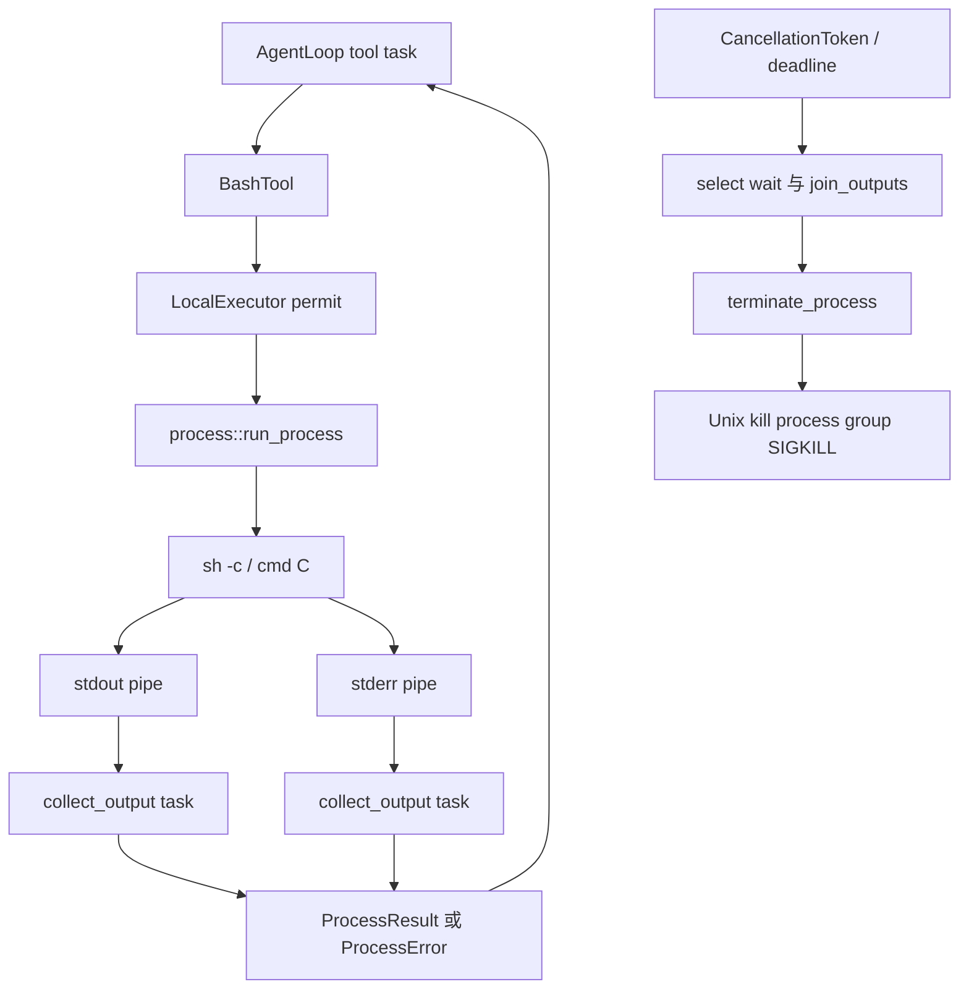

# 第 11 章：进程管理、输出与取消

## 1. 本章解决什么问题

命令 `(sleep 30; echo alive > marker) & wait` 会生成 shell 和后台子进程。只取消 Rust future，可能什么 OS 动作也没停止；只 kill shell，后台进程可能继续写 marker。本章按真实 process executor 解释收尾。

## 2. 先理解设计思想

进程执行由三条任务协作：父任务管理 child 等待/控制，两个 reader 排空 stdout/stderr。取消是信号传播，超时是 deadline，日志终态是结果判断；三者不能合并为一个布尔值。

## 3. 模块在整体架构中的位置



## 4. 源码位置

- [process.rs](https://github.com/nothiny/mini-harness/blob/1720acefc11fe38cfb9b3bb3d649832ef951d4a8/src/executor/process.rs)：run_process、collect_output、reserve_combined、terminate_process、finish_output_tasks、ProcessGroupGuard。
- [bash.rs](https://github.com/nothiny/mini-harness/blob/1720acefc11fe38cfb9b3bb3d649832ef951d4a8/src/tools/bash.rs)：execute。
- [agent_loop.rs](https://github.com/nothiny/mini-harness/blob/1720acefc11fe38cfb9b3bb3d649832ef951d4a8/src/runtime/agent_loop.rs)：取消/deadline select。
- [tests/process_executor.rs](https://github.com/nothiny/mini-harness/blob/1720acefc11fe38cfb9b3bb3d649832ef951d4a8/tests/process_executor.rs)、[tests/integration_agent_loop.rs](https://github.com/nothiny/mini-harness/blob/1720acefc11fe38cfb9b3bb3d649832ef951d4a8/tests/integration_agent_loop.rs)、[tests/cross_process_cancel.rs](https://github.com/nothiny/mini-harness/blob/1720acefc11fe38cfb9b3bb3d649832ef951d4a8/tests/cross_process_cancel.rs)。

## 5. 从入口逐步分析源码

### 5.1 创建进程及进程组

LocalExecutor 取得 permit 后把 root/request/token 传入 run_process。函数先检查 token，canonicalize root 并确认目录，shell_command 选择 Unix sh -c/Windows cmd /C，stdin null、stdout/stderr piped、kill_on_drop=true。

Unix configure_process_group 调 `process_group(0)`，新 child 以自身 PID 作为 PGID。进程组是一个可被信号一起选中的集合，进程树是父子关系；集合通常包含继承该组的后代，但后代可以调用 setsid/setpgid 脱离。`kill(-pid, SIGKILL)` 只选择仍在该组的进程，不能保证清理已换组、脱离 session 的后代。

spawn 成功后 ProcessGroupGuard armed，保存 PID；它补充 Child.kill_on_drop（主要针对 child）的组级清理。在 future 被 abort/drop 时 Guard 尽力 SIGKILL；正常完成输出收尾后 disarm。SIGKILL 杀掉 Harness 本身时 Rust Drop 不运行，不能靠 Guard 保证 crash 后所有进程都停。

### 5.2 stdout/stderr 如何并发排空

取出两条 pipe 后分别 tokio::spawn collect_output，共享 Arc<AtomicUsize> combined。每次读 8192 bytes，累加 original_bytes；stream 上限用 Vec.len 判断，combined 用 compare_exchange_weak 原子预留，避免两条流同时认为预算仍足。

达到保留上限继续读并丢弃，直至 EOF：停止保留不等于停止读取。否则一个 stderr 写满的 child 会卡住，即使 stdout reader 正常也无法 wait 完成。两流谁先取得 combined 预算取决于调度，不保证平均分配或恢复准确交错时序。

CollectedOutput 转 ProcessOutput 时处理 UTF-8：截断留下的不完整尾字符退回 valid_up_to，确定坏字节则 lossy 替代。普通文件 read 拒绝二进制，而进程输出采用 lossy 文本；二者保证不同。

### 5.3 wait 与输出收尾都受控制

父任务 pin child.wait，用 biased select 优先 token、deadline，再 child 退出。TimedOut 调 terminate_process、await child.wait，保留 timed_out=true；Cancelled 清理 child/readers 后返回 Err(ProcessError::Cancelled)；等待 IO 错也清理后返回错误。

child 退出后仍不能直接返回：后台进程可能继承 pipe，reader 等不到 EOF。代码再次 select token/deadline/join_outputs，因此 `sleep 30 &` 即使 shell 退出，也受到整个输出等待 deadline 约束。finish_output_tasks 最多再等 1 秒，超时 abort 两个 reader。

readers 一般 join 并返回保留文本；输出阶段 deadline 到时清理组，尽力收集，若收集失败 fallback 空输出，返回 timed_out=true。错误/drop 分支还有 guard 保险。正常快速完成且 pipe 已关时 disarm，不持续追踪之后可能存活的所有后台进程。

### 5.4 SIGTERM 和 SIGKILL 在当前代码中的位置

SIGTERM 可以让程序处理退出，SIGKILL 不给清理机会。很多系统采用 TERM—宽限—KILL；**当前 terminate_process 直接 SIGKILL**，不存在 TERM 阶段。Windows 用 taskkill /T /F，再 child.start_kill；Unix kill 失败则 fallback child.start_kill。

`reports_signal_termination` 测试命令自己执行 `kill -TERM $$`，结果 signal=SIGTERM；它证明结果能记录信号，不证明 Harness 发 TERM。不要由测试名推断未存在的宽限协议。

### 5.5 Cancel、process timeout、Turn timeout 的区分

| 触发 | process executor 返回 | loop 常见日志结果 |
|---|---|---|
| 用户 token | Err Cancelled，尽力杀组/回收 | ToolFailed 或明确完成后 cancel_requested/cancelled |
| ProcessRequest.timeout | Ok result，timed_out=true | 可以 ToolCompleted，模型决定下一步 |
| 采样 deadline / 采样前 Turn 预算 | 未启动或中断 Provider | TurnTimedOut |
| 工具执行中的 loop deadline | task abort | ToolOutcomeUnknown，active Turn 保留 |
| 取消后工具清理超时 | task abort | ToolOutcomeUnknown，active Turn 保留 |

取消不是回滚：echo/network 操作可能早已发生。ToolFailed 描述收到错误，不是证明无任何副作用。子 token 可随父取消；调用 token.cancel 本身不追加事件，循环负责记事实。

### 5.6 同进程取消与跨进程 CLI cancel

Actor.CancelTurn 操作 live token，可到达正在运行的 executor；回复在 run future 返回之后，且回复 Ok 不等于没有 unknown outcome，要看事件。

CLI `cancel` 是另一个 Session restore 后写 cancel_requested/cancelled，不共享原进程 token、不直接发 OS kill。原 runner 在下一次 append 发现 store seq 变化后停止，不覆盖他人事件；执行中的 bash 可能继续直到自身 deadline 或完成。

当前终态会清空 active_turn，后续 recovery classifier 可返回 clean，即使历史中工具先开始、现实副作用未能记录完整；源码注释“recover 会报告这个工具窗口”不是普遍保证。跨进程日志握手只证明并发追加停止，不能证明 OS 命令立即停或所有未知副作用都仍可被 classifier 看见。

## 6. 完整运行示例

```bash
cargo test --test process_executor
cargo test cancelling_bash_turn_kills_the_child_process_group
cargo test --test cross_process_cancel
```

进程测试在临时目录检查 child group、UTF-8、双流大输出、非零 exit、后台 pipe 继承。cross-process 测试实际创建两个 store/session 实例验证日志握手，使用慢 Provider；它不证明远端 CLI cancel 会杀正在执行的 OS 进程。

## 7. 为什么这么设计

独立 reader 防 pipe deadlock，有界保留防内存膨胀，group guard 防 future drop 时只杀父进程。直接 KILL 简单但不给 child 优雅退出机会；OS 环境、逃逸组、Harness 硬崩溃仍超出保证。所有取消描述都应同时写明“哪个信号、哪组进程、何时记录事实”。

## 8. 常见误解

- 进程组不是进程树，脱组后代不在 kill(-pgid) 保证内。
- SIGTERM 出现在测试中不等于 Harness 实现 TERM→KILL。
- output_limit 限保留，命令仍可以产生很多字节和消耗 CPU。
- `cancelled:true` 协议回复不等于跨进程 command 已在 OS 停止。

## 9. 本章总结

进程管理是一条完整生命周期：spawn、组、双流排空、wait、deadline、终止、回收、结果编码。取消和崩溃不能撤销已发生副作用。

## 10. 自测问题

1. 为什么 child.wait 完了还要等 readers？参考：后台进程可能仍持 pipe。
2. 达到 2 KiB 输出后为何继续读？参考：避免管道反压卡住 child。
3. 当前发 TERM 还是 KILL？参考：KILL，TERM 测试是命令自行发。
4. setsid 子进程能否保证被组取消？参考：不能，已脱离原组。
5. CLI cancel 如何通知原 runner？参考：改变日志 seq，在下次 append 被发现，不共享 token。

## 11. 下一章如何衔接

下一章进入[崩溃恢复与 Checkpoint](07-recovery.md)，分析没有可靠结果时如何避免危险重试。

---

导航：上一章 [第 10 章：Session Actor 与并发](session-actor.md) · [首页](README.md) · 下一章 [第 12 章：崩溃恢复、Checkpoint 与未知副作用](07-recovery.md)
