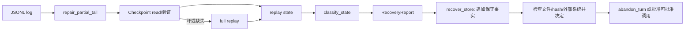
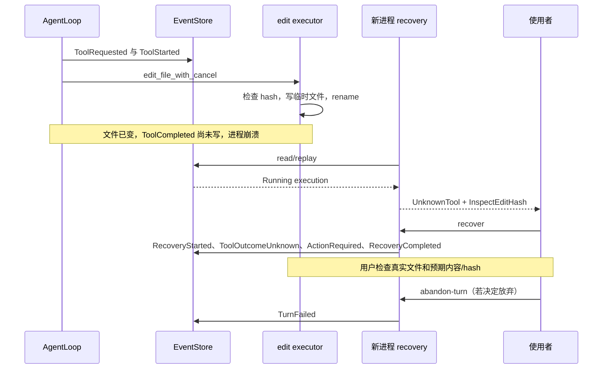

# 第 12 章：崩溃恢复、Checkpoint 与未知副作用

## 1. 本章解决什么问题

edit 已 rename 成功，但 Harness 在追加 ToolCompleted 前崩溃。日志只有 ToolStarted；重新执行可能再次修改文件。如何重建状态，又不假装知道外部操作的结果？

## 2. 先理解设计思想

恢复分三件事：repair 找回完整日志边界；replay 重建内存；classify/report 说明未完成工作。Checkpoint 是派生快照，recover 是保守记账，resume 是重建对象；它们都不是从上次机器指令自动续跑。

## 3. 模块在整体架构中的位置



## 4. 源码位置

- [recovery.rs](https://github.com/nothiny/mini-harness/blob/1720acefc11fe38cfb9b3bb3d649832ef951d4a8/src/durable/recovery.rs)：classify_events、classify_state、inspect_store、recover_store、policy_for_tool、abandon_turn。
- [checkpoint.rs](https://github.com/nothiny/mini-harness/blob/1720acefc11fe38cfb9b3bb3d649832ef951d4a8/src/durable/checkpoint.rs)：Checkpoint::read/write_atomic、create_checkpoint、replay_from_checkpoint、replay_with_checkpoint_fallback。
- [agent_loop_setup.rs](https://github.com/nothiny/mini-harness/blob/1720acefc11fe38cfb9b3bb3d649832ef951d4a8/src/runtime/agent_loop_setup.rs)：restore、restore_with_checkpoint、from_state。
- [event_log.rs](https://github.com/nothiny/mini-harness/blob/1720acefc11fe38cfb9b3bb3d649832ef951d4a8/src/durable/event_log.rs)：repair_partial_tail。
- [tests/recovery_classify.rs](https://github.com/nothiny/mini-harness/blob/1720acefc11fe38cfb9b3bb3d649832ef951d4a8/tests/recovery_classify.rs)、[tests/recovery_cli.rs](https://github.com/nothiny/mini-harness/blob/1720acefc11fe38cfb9b3bb3d649832ef951d4a8/tests/recovery_cli.rs)、[tests/checkpoint.rs](https://github.com/nothiny/mini-harness/blob/1720acefc11fe38cfb9b3bb3d649832ef951d4a8/tests/checkpoint.rs)。

## 5. 从入口逐步分析源码

### 5.1 崩溃时日志可能停在哪里

| 日志尾部 | 能知道什么 | classify_state finding |
|---|---|---|
| TurnStarted，无模型文本 | 一轮已开始，模型阶段未有可靠响应 | ActiveTurn + PendingModelResponse |
| ToolRequested，无 Started | 请求已接受，尚无开始事实 | PendingTool + 保守 policy |
| ToolApprovalRequested | 已持久化等待人类 | PendingApproval 优先 |
| ToolStarted，无结果 | 进入副作用窗口，外部结果不确定 | UnknownTool，带 ExecutionId |
| ToolOutcomeUnknown | 已显式确认缺乏可靠结果 | UnknownTool，execution_id=None |
| 工具已完成、Turn 无终态 | 工具结果知道，Turn 未结束 | 至少 ActiveTurn |
| TurnCancelled/Completed/Failed/TimedOut | active_turn 已清空 | 当前 classifier 可 clean |

PendingModelResponse 由 last_model_response 是否 None 推断，不是“每一次模型请求都有 durable started ID”的精确探测；最后一轮采样也可能仅留下 ActiveTurn。classifier 只看重建的 active Turn，不重新审计所有过去终态工具窗口。

### 5.2 inspect 与 recover 的执行步骤

库 inspect_store 读取 EventSeq(1)，classify_events 逐条 reduce，最后 classify_state；不执行工具。CLI open_referenced_log 在此之前可 repair 半行，因此 CLI inspect 不是严格零写入的字节操作。

recover_store 先读取/分类。clean 直接返回；同 Turn 已有 recovery completed marker 则不重复批次。没有开放 recovery batch 时写 RecoveryStarted，然后处理每个 finding：

- Running unknown：先写 ToolOutcomeUnknown，原 Running 转 Unknown；再 ActionRequired。
- 已 Unknown、PendingTool、PendingApproval、PendingModelResponse：必要时只写 ActionRequired。
- 只有 ActiveTurn finding：写无 call 的 ActionRequired。

ActionRequired 的 call/policy 去重，最后写 RecoveryCompleted，再重新 inspect。`recovery.completed` 意味着**分类记账完成**，不是业务 Turn 完成；action_required 仍可 true。

policy_for_tool 按名字：read→RetryRead，edit→InspectEditHash，其他→RequireUserDecision。这些只是建议枚举；recover 不会自动重读、查 hash、重跑 bash。新 Tool 若有读语义也不会自动获得 RetryRead，除非扩展这个映射。

### 5.3 一次编辑故障时间线



rename 的原子性说明文件内容通常是旧版或新版；它不能回答事件没写时究竟是哪一版，也不能让外部副作用恰好一次。bash 可能部分执行多个动作；工具返回 error 也不必然证明什么都没做。

abandon_turn 先 inspect，要求给定 TurnId 正是 active Turn，写 TurnFailed，不撤销文件、不删除历史。之后新 UserInputRecorded 可把 Failed 迁移回 Idle。Unknown 不能通过 approve_tool 强行启动：该 API 要 Pending approval，并且 ToolStarted 要 Pending execution。

### 5.4 Checkpoint 如何创建

create_checkpoint(store,state,path) 检查 store seq。相等则追加 CheckpointCreated；若 store 只领先一条且恰好是同 Session 的 checkpoint marker，复用它（处理上次 marker durable、快照失败的窗口）。否则拒绝不同步。

在 state 副本 reduce marker，Checkpoint::from_state 包 session_id/last_seq/state/schema=2/created_at/state_digest。digest 把 JSON 对象 key 排序后做 SHA-256，避免 HashMap 迭代顺序影响摘要。digest 是一致性检查，不是签名认证。

write_atomic 对 checkpoint path 文件锁串行写，create_new 临时文件、size<=16 MiB、write/flush/sync_all、rename。失败尽力删除临时文件；没有普遍同步 parent directory。marker 先 durable，快照后写，崩溃中间仍可回退日志。

Loop.create_checkpoint 最后把内存 state 更新到 marker 后状态；协议 pump 通过 Actor 发 Checkpoint，避免辅助任务自行 append 干扰单写者。

### 5.5 恢复为什么仍必须相信日志

Checkpoint::read 检查 schema 1/2、状态与 envelope 的 ID/seq 一致、重建 history_bytes、摘要。v1 可规范化缺少的 continuation/tool_inputs；读本身不迁移写文件，成功 restore_with_checkpoint 才可写升级快照。当前空 digest 会用重新计算值填补，不能把 digest 检查单独当成防篡改证明。

replay_from_checkpoint 实际执行：

1. read checkpoint，确认 store_last_seq>=checkpoint.last_seq。
2. **读取全部日志**，找到 marker 的位置，验证 session/无 Turn/CheckpointCreated。
3. 从空 SessionState **reduce 整个 marker 前缀**，要求 replayed==checkpoint.state。
4. 取快照 state，再 reduce marker 后缀。

因此当前 Checkpoint 结构支持“快照+后缀”的接口，但冷启动还重放前缀作可信性验证，不能承诺减少主要重放成本或 O(suffix) 启动。原教程“跳过前缀”已修正；future 若优化需另有可信前缀校验设计。

replay_with_checkpoint_fallback 在任意快照错误时尝试全日志；坏日志本身不能被快照掩盖。restore/restore_with_checkpoint 最后检查 state.last_seq==store.last_seq，再 from_state。恢复 active Turn 时 fresh Instant、steps=0、tool_time_used=0，停机时间和旧预算不继续累计。

### 5.6 恢复的明确限制

resume 只还原 state，不自动 sample；recover 只记保守事实，不自动 retry。Actor queue 的输入文本 replay，预分配 Turn ID/waiters 不还原。跨进程 cancel 若已写终态，classifier 可能 clean，不能保证发现所有历史 OS 副作用窗口。OutcomeUnknown 没有一个通用“人工已确认结果”的新事件/API；通常需检查后 abandon 或设计新的恢复协议。

## 6. 完整运行示例

```bash
cargo test --test recovery_classify
cargo test --test recovery_cli
cargo test --test checkpoint
cargo test checkpoint_round_trips_and_replays_later_events
cargo test repair_partial_tail
```

recovery_cli 组在临时日志构造 ToolStarted 尾部，实际运行 inspect/recover/abandon-turn，断言 UnknownTool、保守 policy、Unknown 事件与 Failed 状态。它是故障日志 fixture，不假称测试真的在 rename 窗口 kill 了进程。Checkpoint 模块内测试覆盖损坏/不一致/legacy/marker 重试。

## 7. 为什么这么设计

盲目把未知当失败并重试，对发消息、转账、追加记录等操作可能造成重复。显式 Unknown 增加人类处理成本，却不伪造 certainty。Checkpoint 便于快照兼容与校验，但当前严格验证牺牲冷启动加速；日志仍是唯一退路。

## 8. 常见误解

- RecoveryCompleted 不是 TurnCompleted。
- RetryRead 枚举不是已经调用 ReadTool。
- Checkpoint 删除可以回退，但 event log 损坏不能靠任意快照免检继续。
- 普通工具 Err 也可能伴随部分副作用；Unknown 表示缺可靠结果，而非副作用是否发生的唯一判断。

## 9. 本章总结

恢复保留可证明事实，并把未证明的现实结果留给显式决策。它恢复的是状态与证据，不是自动恢复所有执行进度。

## 10. 自测问题

1. Started 后无 Completed 为什么不能宣称未执行？参考：外部动作可能已发生。
2. recover read 会重读吗？参考：不会，只记录 RetryRead 建议。
3. 快照摘要为何 key 排序？参考：不同 map 顺序应有相同 canonical digest。
4. 当前 Checkpoint 是否跳过前缀计算？参考：不会，前缀重放验证后才应用后缀。
5. abandon 有什么副作用？参考：写 TurnFailed，释放 active Turn；不回滚真实文件。

## 11. 下一章如何衔接

下一章讲[Policy 与安全边界](policy.md)，把执行前审批与执行后未知结果的决策明确区分。

---

导航：上一章 [第 11 章：进程管理、输出与取消](06-process-cancellation.md) · [首页](README.md) · 下一章 [第 13 章：Policy、审批与安全边界](policy.md)
