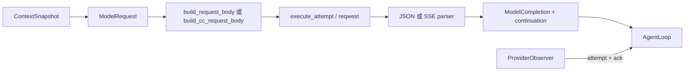

# 第 6 章：Model Provider 与模型 API 适配

## 1. 本章解决什么问题

把 Mock 换为真实服务后，为什么 AgentLoop 仍只处理 Text 和 ToolCall？模型的原生 call ID 如何穿过一次文件读取，再正确作为工具结果回传？

## 2. 先理解设计思想

Provider 把内部请求翻译成线上格式，再把线上响应翻回内部数据。它不授权工具、不写 SessionState。wire 的兼容性和 Harness 的执行语义应分开测试；本章讲当前适配器，不承诺外部服务今日所有模型能力。

## 3. 模块在整体架构中的位置



## 4. 源码位置

- [provider.rs](https://github.com/nothiny/mini-harness/blob/1720acefc11fe38cfb9b3bb3d649832ef951d4a8/src/model/provider.rs)：ModelProvider、ModelCompletion、ProviderObserver::record。
- [mock.rs](https://github.com/nothiny/mini-harness/blob/1720acefc11fe38cfb9b3bb3d649832ef951d4a8/src/model/mock.rs)：complete、complete_with_metadata、mock_continuation。
- [configured.rs](https://github.com/nothiny/mini-harness/blob/1720acefc11fe38cfb9b3bb3d649832ef951d4a8/src/model/configured.rs)：ConfiguredProvider 枚举与分派。
- [openai.rs](https://github.com/nothiny/mini-harness/blob/1720acefc11fe38cfb9b3bb3d649832ef951d4a8/src/model/openai.rs)：OpenAiProviderConfig、WireStyle、from_config、complete_request、execute_attempt、read_body。
- [openai_protocol.rs](https://github.com/nothiny/mini-harness/blob/1720acefc11fe38cfb9b3bb3d649832ef951d4a8/src/model/openai_protocol.rs)：build/parse/make continuation 系列函数。
- [tests/provider_contract.rs](https://github.com/nothiny/mini-harness/blob/1720acefc11fe38cfb9b3bb3d649832ef951d4a8/tests/provider_contract.rs)、[tests/openai_provider.rs](https://github.com/nothiny/mini-harness/blob/1720acefc11fe38cfb9b3bb3d649832ef951d4a8/tests/openai_provider.rs)。

## 5. 从入口逐步分析源码

### 5.1 trait 与 Mock 的实际行为

最低接口 `complete(request, cancel)` 返回 ModelResponse。默认 complete_with_metadata 包装它，默认 complete_observed 调 metadata；OpenAiProvider override observed 以报告 attempts。只实现 complete 的新 Provider 可以运行，但不会自动获得正确的 native ID cursor 或 attempt 日志。

Mock 将 requests 复制到 Mutex<Vec> 供断言，按 script 顺序取响应。Delay 内 select token/sleep；脚本耗尽返回 ProviderError；repeating 用于普通 CLI Mock（永远 Text("mock response")）。Mutex 只在短暂复制/弹出时持有，不跨 Delay await。Mock metadata 为工具响应构造 cursor/native ID，Text 时清空，支撑离线续传契约。

ConfiguredProvider 是具体枚举，Mock/OpenAi/Deepseek 分支都实现相同 trait。Deepseek 分支使用同一个 OpenAiProvider，但 WireStyle=ChatCompletions。这样 generic loop 不需要每个分支用不同具体类型。

### 5.2 从配置到 HTTP

`from_config` 检查非空 model/key/endpoint、重试最多 5、timeout 非零。公共 endpoint 要 HTTPS，禁止 URL 凭证、query、fragment；loopback 允许本地测试 HTTP。reqwest 禁止自动重定向，loopback 关闭代理，避免测试意外走外部代理。Debug 用 `<redacted>` 替代 key。

`complete_request` 先编码一次 body，再做 `1..=max_retries+1` 有限尝试。每次新建 `mini-harness-UUID` client request ID；有 observer 时先 record started 并等 ack，然后 `execute_attempt`。

execute_attempt POST endpoint，Bearer key 只用于 HTTP header，设置 x-client-request-id。响应 request ID 做字符/长度筛选，read_body 分块收集，超过 1 MiB 拒绝；即使配置 stream=true，也先收集完整 body，再解析 SSE。此实现没有逐 token UI 输出。

HTTP 408、一般 429、5xx 和部分 transport 错误可重试；quota 型 429 不重试，401/403、解析失败不重试。Retry-After 支持秒数/日期并最多 30 秒，未提供则指数退避最多 30 秒。每次结束 record completed/retry/failed，等持久化 ack 后继续；取消也覆盖 HTTP 与退避。runtime 外层 deadline 约束整个 sample，不保证把每次 120 秒和全部重试都放宽执行。

HTTP 400 分支提取 server error.message 并用于错误/日志。因而“密钥在 Debug 中脱敏”不等于任意服务错误消息都已经清洗；不要把适配器描述成通用秘密过滤器。

### 5.3 Responses 的 read 往返

第一次 `build_request_body` 用 effective model（request.model 优先），history → input，tools → function 定义，store=true，parallel_tool_calls=false。system instructions 放 instructions。

`parse_response_value` 要求 id、status=completed、output；收集 output_text 与 function_call。`parse_tool_call` 要求 arguments 是 JSON 字符串且解码为对象、name 非空、native ID 合法；生成新的 ToolCallId。重复 native ID 或超过 32 个调用由该解析器拒绝；Loop 另有默认 16 个上限。

make_continuation 保存 endpoint/model/response_id、内部 call → native call 映射及 `history_cursor=request.history.len()`。循环保存 cursor 后再记助手摘要/工具结果。

第二次 body 在 provider/model/endpoint/response ID 匹配时使用 previous_response_id；`build_input` 从 cursor 后取 history，忽略已在服务端响应中的 Assistant 摘要，把 Tool result 编成 `function_call_output` 并使用 native ID。配置不匹配时用规范化历史回放，Tool 被表述为 user 内容，因为新服务不知道旧 native calls。

以下是**按当前编码器字段简化的 wire 示例**，不是声称此次访问了真实 API：

```json
{"model":"example-model","input":[{"role":"user","content":"read README.md"}],"tools":[{"type":"function","name":"read","description":"...","parameters":{"type":"object"},"strict":false}],"store":true,"stream":false,"parallel_tool_calls":false}
```

续传的关键片段：

```json
{"previous_response_id":"resp_1","input":[{"type":"function_call_output","call_id":"native_read_1","output":"{\"text\":\"hello\"}"}]}
```

### 5.4 Chat Completions 的差别与限制

| 行为 | Responses | Chat Completions 当前实现 |
|---|---|---|
| 请求字段 | input / instructions | messages / system |
| 工具定义 | function 字段平铺 | function 对象嵌套 |
| 续传 | previous_response_id | 无服务端响应链，重编码 request.history |
| Tool 回传 | function_call_output | assistant.tool_calls 后接 role:tool |
| arguments 回放 | 使用 native response 链 | history 未保留参数，合成 `{}` |
| request.model | 覆盖 config.model | build_cc_request_body 仍使用 config.model |
| reasoning | 此实现不使用 reasoning_content | 非流式保留并回放到最后 assistant；流式不积累 |

`build_cc_messages` 暂存 Assistant 文字；遇 Tool history 时合成含 tool_calls 的 assistant，再添 tool message。native ID 有映射就用，否则 fallback runtime ID。它回放的是**请求快照**，不是直接读取所有 durable events，也不是原始对话的逐字重建。

CC 非流式只看第一 choice，解析 content/tool_calls/usage；它与 Responses 的校验不完全相同，例如不强制相同的 completed status 或 arguments 对象检查。流式按 delta index 拼 name/arguments/id，当前没有 reasoning/usage，也没有与 Responses 相同的 response.completed 终帧约束。不要把“支持两种 wire”讲成所有校验与高级功能一致。

### 5.5 错误到 runtime 的返回

编码失败直接 ProviderError；HTTP/解析失败按重试规则处理，最终错误返回 sample_model，由其写 TurnFailed。成功把 ParsedResponse 转为四种 ModelResponse，再包 metadata。Provider 永远不调用 ReadTool；只有 loop 可以依据统一响应启动工具。

## 6. 完整运行示例

```bash
cargo test --test provider_contract
cargo test --test openai_provider
```

契约组让 Mock、Responses、CC 通过文本、单调用、多调用、错误、取消、工具结果回传六场景。HTTP 测试启动本地 TcpListener，断言实际 POST body 和 cursor/native ID，不需要 API key或外网。关注 `openai_continues_tool_output_with_native_call_id` 与 `deepseek_round_trips_tool_results_as_chat_messages`。

## 7. 为什么这么设计

把 build/parse 放纯函数，HTTP 放另一个层，既能定位编码问题，也能用本地 fixture 测重试和取消。持久化 native 映射使恢复后还能回传结果；代价是 runtime state 保存部分 provider 细节。SSE 聚合易于复用统一响应，但牺牲实时增量和部分流式元数据。

## 8. 常见误解

- stream=true 只改变 wire 与解析，未产生逐 token Event。
- request_id、response_id、call_id 属于不同身份，不能混用。
- CC 的全历史回放指 snapshot 中历史，不代表完整 wire transcript。
- 当前代码支持 DeepSeek 不代表 doctor 已实现其分支。

## 9. 本章总结

Provider 的工作是协议翻译、HTTP 控制与 metadata；Tool 执行和状态记账仍由 Harness 掌握。

## 10. 自测问题

1. native ID 为什么需要映射？参考：服务端要求原 call ID，内部 ID 使用自身类型。
2. attempts Vec 会自动写事件吗？参考：实际由 observed+ack 路径写，默认 Provider 不报告。
3. SSE 是否让 UI 实时显示 token？参考：当前不会，先收完整 body。
4. CC 是否完整保留工具 arguments？参考：history 不保留，回放合成 `{}`。
5. model override 哪条路径生效？参考：Responses；CC 当前仍用 config。

## 11. 下一章如何衔接

模型提出建议以后，接下来读[Tool 系统](04-first-tool.md)，看 JSON 参数怎样变成能力请求。

---

导航：上一章 [第 5 章：AgentLoop 的完整实现](05-agent-loop.md) · [首页](README.md) · 下一章 [第 7 章：Tool 系统](04-first-tool.md)
