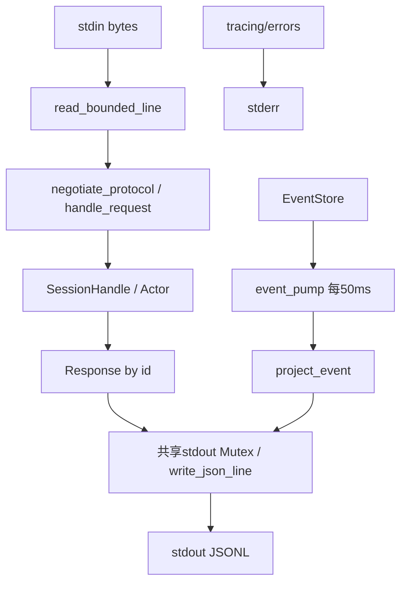

# 第 14 章：CLI 与 JSONL 控制协议

## 1. 本章解决什么问题

外部程序要启动会话、查看进度、取消和批准，不能共享 Rust 内存。如何在 stdout 上同时区分自己的命令回复与后台通知？坏 JSON 或超长行是否会破坏下一条请求？

## 2. 先理解设计思想

CLI 装配组件，协议建立进程边界。请求回复回答一次操作，event 通知描述后续事实；一条回复不是事件日志。stdout 只能输出 JSONL，stderr 放诊断，否则客户端的 JSON parser 会把普通日志当协议失败。

## 3. 模块在整体架构中的位置



## 4. 源码位置

- [main.rs](https://github.com/nothiny/mini-harness/blob/1720acefc11fe38cfb9b3bb3d649832ef951d4a8/src/main.rs)：run_cli、cli_components、run_cli_turn/resume/cancel、run_inspect/recover、init_tracing。
- [protocol/jsonl.rs](https://github.com/nothiny/mini-harness/blob/1720acefc11fe38cfb9b3bb3d649832ef951d4a8/src/protocol/jsonl.rs)：run_stdio、handle_request、negotiate_protocol、create_session、start_turn、wait_turn、respond_approval、event_pump、advance_cursor。
- [jsonl_transport.rs](https://github.com/nothiny/mini-harness/blob/1720acefc11fe38cfb9b3bb3d649832ef951d4a8/src/protocol/jsonl_transport.rs)：read_bounded_line、write_json_line。
- [event_projection.rs](https://github.com/nothiny/mini-harness/blob/1720acefc11fe38cfb9b3bb3d649832ef951d4a8/src/protocol/event_projection.rs)：project_event、summarize_tool_input。
- [tests/cli.rs](https://github.com/nothiny/mini-harness/blob/1720acefc11fe38cfb9b3bb3d649832ef951d4a8/tests/cli.rs)、[tests/stdio_protocol.rs](https://github.com/nothiny/mini-harness/blob/1720acefc11fe38cfb9b3bb3d649832ef951d4a8/tests/stdio_protocol.rs)、[tests/protocol_compat.rs](https://github.com/nothiny/mini-harness/blob/1720acefc11fe38cfb9b3bb3d649832ef951d4a8/tests/protocol_compat.rs)。

## 5. 从入口逐步分析源码

### CLI 如何装配与选择存储

`run_cli` 先初始化 tracing（stderr），clap 解析全局 --config 和 subcommand，加载当前目录 mini-harness.toml 或显式文件。普通 run 选择 workspace（flag > config > cwd）、新 SessionId、log/checkpoint 路径；ensure_new_event_log 拒绝非空历史，cli_components 注册工具/Provider/LocalExecutor，使用 ConfiguredPolicy 与配置 limits。

run 直接 Session.start_turn，成功后 create_checkpoint 并输出 session_id/turn_id/text/event_log。ApprovalPending 会让命令返回错误并留下未完成日志，没有 CLI 交互批准入口；用 serve/UI 处理审批。resume 先 repair、restore，空 prompt 只快照并报告 resumed；有 prompt 开新 Turn，已有 active Turn 会拒绝。

显式 events.jsonl 对应 events.checkpoint.json；默认布局则 `<durable.root>/sessions/<id>/events.jsonl` 与 `checkpoints/latest.json`。`inspect/recover/abandon-turn` 接受 Session ID 或 log path，默认显示脱敏报告，raw-json 更详细。events/tui 通过子进程 serve，不等同于普通 run。

### serve 生命周期与一连接一会话

run_stdio 创建共享 stdout writer、event cursor、handle slot，spawn event_pump，再串行读取请求。每个连接只维护一个 active SessionHandle；第二次 create/resume 返回 session_exists；shutdown 可以清槽，stdin EOF 会 shutdown actor、await actor、停止事件泵，然后退出。

create_session 选择 path/workspace/provider，repair tail，spawn_session 检查空 store，**先写 SessionCreated**，再 restore Actor；因此 create 响应前已有 durable session identity。协议 workspace 参数省略时用服务器 cwd，当前不会像 run 那样读取 config.session.workspace。

resume_session_actor 还原 state，不自动执行未完成 loop。v2 默认不回放旧事件，next_event 从 log 尾后开始；replay_events=true 可一次返回历史，但事件数组最多 128 项且受字节预算，并不是无限历史补齐 API。

### 版本与消息形状

JSON-RPC 的 jsonrpc="2.0" 与项目 protocol_version=1/2 是两回事。未带 jsonrpc 的第一次旧请求被视为 v1；现代 JSON-RPC 默认 v2；版本协商后不能中途切换。

下面请求可实际发送；ID 来自客户端，不是 EventId：

```json
{"jsonrpc":"2.0","protocol_version":2,"id":1,"method":"protocol.negotiate","params":{"version":2}}
{"jsonrpc":"2.0","id":2,"method":"session.create","params":{"provider":"mock","workspace":".","event_log":"/tmp/unique-tutorial-events.jsonl"}}
```

路径仅示格式，实际应使用新临时路径；重复同路径 create 会被拒绝。后续消息应替换为服务器返回的有效 ID，例如：

```json
{"jsonrpc":"2.0","id":3,"method":"turn.start","params":{"prompt":"hello","session_id":"sess_00000000-0000-0000-0000-000000000001"}}
{"jsonrpc":"2.0","id":4,"method":"turn.wait","params":{"turn_id":"turn_00000000-0000-0000-0000-000000000002","timeout_ms":100}}
{"jsonrpc":"2.0","id":5,"method":"approval.respond","params":{"turn_id":"turn_00000000-0000-0000-0000-000000000002","call_id":"call_00000000-0000-0000-0000-000000000003","approved":true}}
```

这些零值 UUID 是**消息结构示例，不是本次实测返回值**。Start response.result 包 turn_id/accepted/queued；wait 成功有 text/completed/events，超时等候返回 code=turn_pending（不会取消 Turn）。Ask 返回 approval_pending；当前协议 error.code 是字符串，不是标准 JSON-RPC 数字错误码；客户端要遵循本项目协议。

通知无 id，method=event，params 包 seq/session_id/turn_id/event。event.type 用 `tool.completed` 等点分名称，保留 event_id/timestamp/schema_version；完整 durable Event.payload.type 是 snake_case。v2 不含完整 tool input/output/模型文本，ToolRequested 保留 input_summary；最终文本通过 wait/approval 响应获得。v1 回放完整 payload，信任边界更宽。

### 后台通知、Checkpoint 与串行请求

event_pump 每 50ms poll store，从 next_event 每批最多 128 条，推进 shadow reducer、project，输出与 request response 共用 writer Mutex。不会把两条 JSON 字节交错；响应/通知仍可以前后穿插，客户端必须按 id 路由。

到 Turn 终态或每 N events 达到阈值，pump 在 shadow 无 active Turn 时通过 Actor.create_checkpoint；不在工具中途随意快照。无法执行时设置 checkpoint_pending，下轮重试。N=0 关闭周期阈值，但终态仍可触发快照。

请求 loop 是串行的：没有 timeout 的 turn.wait 或 await 完整批准后续执行，会阻塞此连接处理后面 cancel/start 请求。独立 event_pump 仍发通知。交互客户端使用 bounded wait（Rust 100ms、Ink 300ms）让 request loop 返回，再送取消/输入；一个 background pump 不等于请求全并行。

wait response 的事件列表与通知可能重复，客户端要按 seq 去重；不是 exactly-once 推送或有确认重传的订阅服务。安全投影也不能用于完整 SessionState replay。

### 传输错误如何隔离

read_bounded_line 使用 fill_buf/consume，最多 1 MiB 行，过大后不继续保存但排空到换行；TooLarge 回复后可读下一条。JSON 错误回复 invalid_json；错误版本、params、method 分别有结构化错误。write_json_line 检查编码+换行上限、write_all、flush。诊断 init_tracing/主错误写 stderr，child stdout 的任意 println 都会破坏协议。

## 6. 完整运行示例

下面是可执行客户端，创建新临时 log，动态使用真实返回的 Session/Turn ID，并读取所有穿插通知：

```bash
cargo build --locked
python3 - <<'PYCODE'
import json, pathlib, subprocess, tempfile
binary = pathlib.Path('target/debug/mini-harness').resolve()
work = pathlib.Path(tempfile.mkdtemp(prefix='mini-harness-jsonl-'))
p = subprocess.Popen([str(binary),'serve','--stdio'], stdin=subprocess.PIPE,
                     stdout=subprocess.PIPE, text=True)
def request(i, method, params):
    p.stdin.write(json.dumps(dict(jsonrpc='2.0',protocol_version=2,
                                 id=i,method=method,params=params))+'\n')
    p.stdin.flush()
    while True:
        line = p.stdout.readline()
        if not line: raise RuntimeError('server closed stdout')
        message = json.loads(line)
        if message.get('id') == i:
            if 'error' in message: raise RuntimeError(message['error'])
            return message['result']
        if message.get('method') == 'event':
            print('event',message['params']['seq'],message['params']['event']['type'])
request(1,'protocol.negotiate',{'version':2})
s = request(2,'session.create',{'provider':'mock','workspace':str(work),
                              'event_log':str(work/'events.jsonl')})
t = request(3,'turn.start',{'session_id':s['session_id'],'prompt':'hello'})
r = request(4,'turn.wait',{'turn_id':t['turn_id']})
print('final',r['text'],r['completed'])
request(5,'session.shutdown',{})
p.stdin.close()
# 清空可能已排队的通知，避免父进程不读造成输出背压。
for line in p.stdout: json.loads(line)
assert p.wait(timeout=5) == 0
PYCODE
cargo test --test stdio_protocol
cargo test --test protocol_compat
```

普通 Mock 的 final 是 `mock response`，不调用 read。工具协议审批由 stdio_approval 测试的持久化 fixture 验证；不能依靠 Mock 自己读懂 prompt 触发工具。

## 7. 为什么这么设计

stdio 易嵌入编辑器/终端，通知与结果分开便于长任务进度；代价是长请求占据单连接请求循环、stdout 背压、需要去重和版本兼容。当前没有 socket 多客户端共享会话/认证服务，也不支持无限 replay 分页。

## 8. 常见误解

- JSON-RPC 2.0 不等于项目协议 v2。
- turn_pending 是等待本次超时，不是 TurnTimedOut。
- v2 events 不是原始日志；摘要可能显示敏感命令片段。
- UI 退出后服务器没有保证继续常驻，EOF 会关闭会话 actor。

## 9. 本章总结

CLI 负责装配，协议负责可关联回复和有限通知；事实仍在 EventStore，显示与传输只是投影。

## 10. 自测问题

1. 通知如何区别回复？参考：method=event、无 id；回复按请求 id。
2. 为什么 blocking wait 会妨碍取消？参考：请求 loop 串行 await。
3. stderr 为什么必须分开？参考：避免非 JSON 污染 stdout。
4. replay_events=true 是否返回任意长完整日志？参考：不是，批次/字节有界。
5. wait timeout 会杀进程吗？参考：不会，只返回 turn_pending。

## 11. 下一章如何衔接

下一章读[Rust TUI 与 Ink UI](10-ui.md)，看真实客户端如何处理同一协议。

---

导航：上一章 [第 13 章：Policy、审批与安全边界](policy.md) · [首页](README.md) · 下一章 [第 15 章：Rust TUI、Ink UI 与显示状态](10-ui.md)
