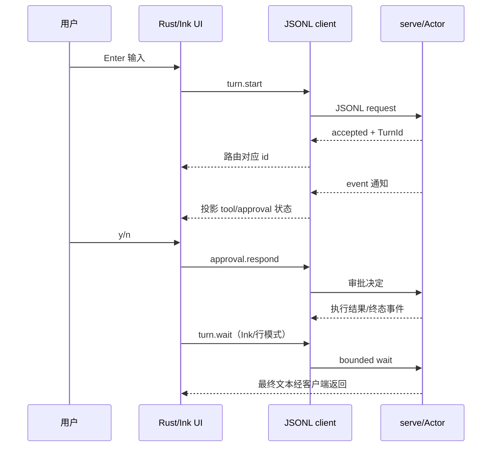

# 第 15 章：Rust TUI、Ink UI 与显示状态

## 1. 本章解决什么问题

用户按 Enter、看到 tool 状态、收到审批提示并按 y，怎样最终进入 runtime？滚动位置、输入框和 persistent SessionState 是否同样可恢复？两种 TUI 的 Ctrl-C 是否一样？

## 2. 先理解设计思想

UI 保存本地显示状态，通过协议驱动 Rust server。它不直接调用 Provider/Executor，也不拥有完整 durable state。显示可以改变或丢弃，审批决定和工具执行必须由 server 保存。

## 3. 模块在整体架构中的位置



Rust 全屏主要使用事件通知展示状态，不沿最后一条 wait 取文本，不能泛化为所有 UI 都逐字显示最终回答。

## 4. 源码位置

- [jsonl_client.rs](https://github.com/nothiny/mini-harness/blob/1720acefc11fe38cfb9b3bb3d649832ef951d4a8/src/ui/jsonl_client.rs)：JsonlClient、JsonlRequester、into_split、WaitMode、read_wire_response。
- [tui.rs](https://github.com/nothiny/mini-harness/blob/1720acefc11fe38cfb9b3bb3d649832ef951d4a8/src/ui/tui.rs)：run、run_line_mode、run_turn、wait_with_ctrl_c、respond_to_approval。
- [screen.rs](https://github.com/nothiny/mini-harness/blob/1720acefc11fe38cfb9b3bb3d649832ef951d4a8/src/ui/screen.rs)：run_screen、open_session、track、submit_line、Screen、keys。
- [terminal.rs](https://github.com/nothiny/mini-harness/blob/1720acefc11fe38cfb9b3bb3d649832ef951d4a8/src/ui/terminal.rs)：RawMode::enter/Drop、size、resize_signals。
- [event_viewer.rs](https://github.com/nothiny/mini-harness/blob/1720acefc11fe38cfb9b3bb3d649832ef951d4a8/src/ui/event_viewer.rs)：drive_protocol、print_events。
- [ui/src/main.tsx](https://github.com/nothiny/mini-harness/blob/1720acefc11fe38cfb9b3bb3d649832ef951d4a8/ui/src/main.tsx)、[client.ts](https://github.com/nothiny/mini-harness/blob/1720acefc11fe38cfb9b3bb3d649832ef951d4a8/ui/src/client.ts)、[ChatApp.tsx](https://github.com/nothiny/mini-harness/blob/1720acefc11fe38cfb9b3bb3d649832ef951d4a8/ui/src/ChatApp.tsx)。
- [tests/tui_line_mode.rs](https://github.com/nothiny/mini-harness/blob/1720acefc11fe38cfb9b3bb3d649832ef951d4a8/tests/tui_line_mode.rs)、[tests/events_viewer.rs](https://github.com/nothiny/mini-harness/blob/1720acefc11fe38cfb9b3bb3d649832ef951d4a8/tests/events_viewer.rs)、screen 模块内测试。

## 5. 从入口逐步分析源码

### Rust 客户端怎样路由

JsonlClient::spawn 启动 current_exe 的 serve --stdio，stdin/stdout pipe，stderr inherit。request 分配递增 ID、写一行、读到 matching response；中途 event 存 events Vec。read_wire_response 不把通知当回复。wait_turn(Poll) 请求 timeout_ms=100，识别 turn_pending/approval_pending/cancelled。

全屏把客户端 into_split：requester 保存 stdin/next_id/pending Map；reader task 独占 stdout，把 ID 对应响应发 oneshot，其他消息发容量 256 的 mpsc。注册 waiter 在写 request 前，避免快速响应到来时丢失。该 receiver 是单消费者 channel，注释中的 broadcast 不表示 tokio::broadcast 多订阅。

### Rust 行模式与事件查看器

tui::run 在 Unix stdin TTY 时走 screen，否则 line mode。行模式 negotiate/create 或 resume+replay，输入 prompt 后 start，轮询 wait并收通知、最终文本。Ctrl-C 在运行中转 turn.cancel；空闲 Ctrl-C 退出；审批 EOF/Ctrl-C 默认拒绝。read_line 被取消可能丢正在键入的部分字节，源码明确允许这种行模式行为。

事件查看器 events 只跑一次 prompt，blocking wait 后按 seq BTreeMap 去重输出元数据；不能互动批准，ApprovalPending 会报错。它不读 event log 原始 payload。

### Rust 全屏 UI

RawMode 关闭 ICANON/ECHO/ISIG 等，进入 alternate screen、隐藏 cursor，Drop 恢复 termios 和屏幕。SIGWINCH 触发重绘；key decoder 处理逃逸序列、UTF-8、箭头/Page键。Screen 最多 5000 logical lines，按 unicode-width 折行、折叠和滚动，不保存会话业务事实。

run_screen select stdin/messages/resize；submit_line 发 turn.start；track 从 tool/turn 事件推导显示状态，y/n 发批准。Ctrl-C 运行时发 turn.cancel，空闲退出；它与 Ink 的双击退出不同。请求在键盘分支 await（例如批准或 delayed Start ack）时，UI 主 select 也会等返回；split reader 可继续收消息，不保证所有键一直立即处理。

v2 通知不含模型全文、工具结果，Rust 全屏本身主要是事件/生命周期查看器；`event_line` 有 result 显示兼容代码不代表正常 v2 会拿到完整 stdout。UI 本地 queued 计数是显示估算，不可取代 durable pending_inputs。

### Ink 的三层与完整交互

main.tsx parseArgs（provider 默认 mock）、检查 stdin TTY、findBinary（显式/debug/release/PATH）、每次创建唯一临时 log；negotiate、session.create 后 render ChatApp。它当前没有 session.resume 参数，没有原注释暗示的 --event-log 选项；退出调用 client.shutdown。

HarnessClient spawn serve，stdout readline JSON.parse，pending Map 按 id resolve Promise，method=event 用 EventEmitter 通知；exit/error reject pending。request 只把 wire error 放 response，ChatApp 负责处理 response.error。onEvent 返回 unsubscribe 函数。

ChatApp.sendPrompt 清输入、turn.start，按 queued 放本地排队显示，pendingRef 是本地等待/显示顺序。pump 顺序 waitForTurn，300ms bounded wait保证 server 回到请求循环；approval_pending 等事件设置审批，不当普通失败。

ToolRequested 通知保存 toolName/inputSummary；ApprovalRequested 用 turn/call ID 和前一工具摘要构造提示。handleApproval 发 approval.respond，后续 again approval_pending 等新提示；最终文本由 wait pump 统一加 chat，避免批准响应与 wait 各加一次。

Ink 当前 useInput 的 Ctrl-C 只做双击退出，**没有 turn.cancel 调用**；shutdown/EOF 的 server 收尾可以取消 active 工作，但不是一次 Ctrl-C 立即取消当前 Turn。Ctrl-D 退出，审批时拦截 y/n。不要沿文件顶端旧键盘注释猜实现。

### UI 生命周期与配置边界

客户端 spawn 的 server随它管理，session.shutdown 后 stdin end，server EOF 退出；durable events 保留，内存 UI 与 pending callbacks 不保留。终端本身被强杀时 graceful shutdown 不保证执行。

Rust client 没把父 CLI --config 参数转发给子进程；子 server 自行按 cwd 默认 config 加载。create 显式传 workspace/provider/model，其他设置不能概括为父进程配置全部原样传下。Ink 也显式 provider 默认 mock，可能覆盖 server TOML provider。Rust resume 的路径 fallback 使用 PID 临时 log，并未自动采用标准 session layout；恢复示例应明确 --event-log。

## 6. 完整运行示例

```bash
cargo test --test events_viewer
cargo test --test tui_line_mode
cargo test tracks_lifecycle_from_event_projections
cargo test wraps_double_width_characters_by_cell
```

可在非 TTY 实测行模式（使用独立日志）：

```bash
cargo build --locked
TUTORIAL_WORK="$(mktemp -d)"
printf 'hello\n/quit\n' | target/debug/mini-harness tui --provider mock --event-log "$TUTORIAL_WORK/ui.jsonl" --workspace "$TUTORIAL_WORK"
```

Ink 在交互终端运行 `npm ci` 后 `npm run typecheck`、`npm start -- --provider mock --workspace ..`。本次在临时复制的 ui 工程做 typecheck，不宣称完成真人终端所有按键/布局验收。完整记录见[验证](validation.md)。

## 7. 为什么这么设计

stdio 客户端让换 UI 不需要换执行算法；Rust split 支持多个输入源，Ink React 管显示。代价是事件/回应的关联、版本/去重、UI 子进程生命周期和配置转发细节；不能只说“UI 是投影”就假设每个显示字段完全等同 reducer。

## 8. 常见误解

- Rust TUI 和 Ink 键盘控制不同。
- 本地 chat/scroll/queue 不等于 SessionState。
- UI 不拿完整工具结果，是投影字段边界，不是 Executor 没执行。
- UI重连的 seq 可帮助去重，但当前没有无限历史补齐或自动 reconnect 服务。

## 9. 本章总结

UI 是协议客户端，输入和审批由 server落实，显示由本地状态呈现；当前两种实现的生命周期和能力需要分别理解。

## 10. 自测问题

1. 同时收到 reply/event 怎么处理？参考：id → waiter，method=event → 显示通道。
2. Ink 单次 Ctrl-C 取消 Turn 吗？参考：不，当前是双击退出逻辑。
3. RawMode Drop 保存什么？参考：原 termios 并恢复屏幕，不保存业务 Session。
4. 为什么审批响应后不再次添加 assistant？参考：wait pump 会添加，避免重复。
5. UI 可以重放安全事件为完整 state 吗？参考：不行，原参数和结果等字段缺失。

## 11. 下一章如何衔接

下一章讲[Scheduler、队列与预算](11-scheduler.md)，区分 UI 排队显示与 runtime 实际资源限制。

---

导航：上一章 [第 14 章：CLI 与 JSONL 控制协议](09-cli-and-protocol.md) · [首页](README.md) · 下一章 [第 16 章：Scheduler、队列与资源限制](11-scheduler.md)
