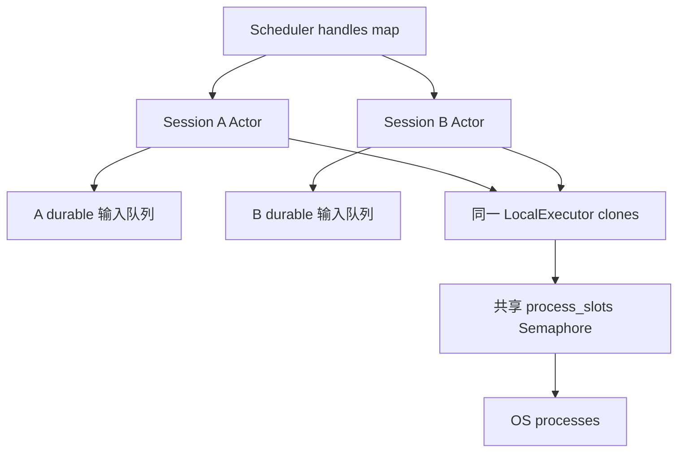

# 第 16 章：Scheduler、队列与资源限制

## 1. 本章解决什么问题

三个会话同时运行 bash，每个会话只有一个工具，也可能占用三个进程。什么地方限制单会话输入，什么地方限制所有共享会话的进程？Scheduler 是否又保存了一份 history？

## 2. 先理解设计思想

Scheduler 是多会话 handle 门面。每个 Actor 负责输入 FIFO 和一轮执行；Executor Semaphore 负责共享进程资源。不要把“任务禁止”“队列满”“等待槽位超时”“用户取消”混成一个失败理由。

## 3. 模块在整体架构中的位置



如果 A/B 各创建新 Executor，则不是这张图中的共享信号量；不同 serve 进程也不会共享它。

## 4. 源码位置

- [scheduler/mod.rs](https://github.com/nothiny/mini-harness/blob/1720acefc11fe38cfb9b3bb3d649832ef951d4a8/src/scheduler/mod.rs)：SchedulerConfig、Scheduler、register_session、submit、wait、cancel、respond_approval、spawn_scheduled_session。
- [scheduler/task.rs](https://github.com/nothiny/mini-harness/blob/1720acefc11fe38cfb9b3bb3d649832ef951d4a8/src/scheduler/task.rs)：SchedulerTask。
- [runtime/state.rs](https://github.com/nothiny/mini-harness/blob/1720acefc11fe38cfb9b3bb3d649832ef951d4a8/src/runtime/state.rs)：run_state、SessionRunState。
- [session_actor.rs](https://github.com/nothiny/mini-harness/blob/1720acefc11fe38cfb9b3bb3d649832ef951d4a8/src/runtime/session_actor.rs)：queue、drain_queued_turns。
- [local.rs](https://github.com/nothiny/mini-harness/blob/1720acefc11fe38cfb9b3bb3d649832ef951d4a8/src/executor/local.rs)：with_process_limits、with_slot_wait、acquire_slot。
- [tests/scheduler.rs](https://github.com/nothiny/mini-harness/blob/1720acefc11fe38cfb9b3bb3d649832ef951d4a8/tests/scheduler.rs)、[tests/agent_loop_limits.rs](https://github.com/nothiny/mini-harness/blob/1720acefc11fe38cfb9b3bb3d649832ef951d4a8/tests/agent_loop_limits.rs)、[tests/actor_queue_edges.rs](https://github.com/nothiny/mini-harness/blob/1720acefc11fe38cfb9b3bb3d649832ef951d4a8/tests/actor_queue_edges.rs)。

## 5. 从入口逐步分析源码

register_session 将 SessionId → SessionHandle 放 Mutex<HashMap>。handle 方法 clone handle后释放锁；submit 调 start_turn_with_status，返回 SchedulerTask{session,turn}，wait 调 wait_turn，cancel只支持 active Turn，respond_approval/查询/关闭也只是委托。

Scheduler 不构建模型、不存 history、没有优先级/后台任务/信号合并，也没有排队输入取消事件。普通 CLI/serve 没有直接使用 Scheduler，server 一连接一会话依然使用 Actor。

SchedulerConfig.max_queued_inputs 当前只保存在 config()，**不会自动应用到注册 Actor**；spawn_scheduled_session 接受单独 AgentLoopConfig，真实 limit 来自它。这个 helper 的 `_actor` JoinHandle 被 drop（task 仍运行），没有返回给调用方；不能照其注释声称 helper 会把 join handle 交给调用者。

Actor queue 在第 10 章已展开：非满时 input durable 后 ack，queue FIFO，TurnStarted 消费 pending_inputs，已运行/批准结束均 drain；future 持有 loop 时输入延迟。durable 只恢复文本，不自动重建所有 task身份。

run_state 检查 active_turn，无则 Idle；有 Pending approval 优先 WaitingApproval；有 Running execution 为 RunningTool；否则 RunningTurn。这个投影不写新事件，Failed session 无 active 也可能 Idle。未知 execution 若仍 active，投影通常 RunningTurn，不能拿它当完整 recovery结论；Actor query 在 busy future 时也可能延迟。

LocalExecutor process_slots 是 Option<Arc<Semaphore>>；new 无限，with_process_limits(0) 无限，正数设上限。run_process 获取 owned permit，等待预算默认 30 秒；结束/drop 释放。多个 clones 共享同一 Arc 才是“全局”；独立实例/进程不是全系统限额。槽位等待函数不直接选择 token，不过父 Tool task有取消/deadline控制。

### 资源预算在哪生效

| 资源 | 默认/位置 | 超限行为 |
|---|---|---|
| step 次数 | AgentLoop 默认32；CLI TOML 默认20 | 采样前 TurnFailed |
| Turn墙钟 | Loop默认10分钟 | 采样/轮前 TurnTimedOut；工具中可能 Unknown |
| 累计工具时间 | Loop默认5分钟；config映射到Turn时限 | deadline，执行中可能 Unknown |
| 模型批次数量 | Loop默认16；HTTP解析器部分路径32 | 超 Loop限额先失败，无 ToolRequested |
| 已接收输入队列 | Actor从AgentLoopConfig默认16 | QueueLimitExceeded，拒绝先于追加 |
| 单输入/文本 | 输入16KiB，snapshot item16KiB | 输入拒绝；snapshot文本截断 |
| 历史/ModelRequest/Event | history硬1MiB，Loop默认1MiB限制 | 拒绝迁移/记录失败，可能无法写终态 |
| 工具结果 | Loop默认200000字节，context最多该值 | Tool层截断或Loop ToolFailed |
| 单process输出 | stream与combined请求值 | 继续排空，仅停止保留 |
| 进程并发 | CLI默认8，共享Executor范围 | 等槽位超预算ConcurrencyLimit |
| Protocol/HTTP body | 各1MiB | TooLarge/Provider错误 |
| log/checkpoint | 128MiB/16MiB | DurableError限额 |

时长0通常关闭预算，但 Bash default timeout0改用10分钟，Provider request_timeout0配置拒绝。计数0也不同：max_steps/batch拒绝，max_concurrent_processes=0关闭并发限制。不能用一句“所有零计数都拒绝”概括。

## 6. 完整运行示例

```bash
cargo test --test scheduler
cargo test --test actor_queue_edges
cargo test --test agent_loop_limits
```

`queue_rejects_beyond_the_configured_bound_without_appending` 对比拒绝前后的事件数；`shared_executor_limits_global_process_concurrency` 共享同一 Executor，短slot_wait 后明确 ConcurrencyLimit；`zero_duration_limits_disable_the_budgets` 验证时间零的主循环语义。

## 7. 为什么这么设计

进程资源放 Executor，因为多个会话可以共享能力层；输入队列放 Actor，因为与 Session事实/顺序相关。Scheduler 只组合，避免第二个 state副本。代价是接线者必须真正共享 Executor并设置 loop_config，不能只改 SchedulerConfig 就期待全局生效。

## 8. 常见误解

- Scheduler 不等于独立任务执行引擎。
- Semaphore “全局”是 shared instance 范围，不是所有 Harness进程。
- queued=true说明输入已记录，不说明已经执行。
- 等资源不是 Policy Deny，wait超时不是用户取消。

## 9. 本章总结

每类资源应在拥有它的层限制；测试要检查拒绝是否有副作用以及事实是否已经确认。

## 10. 自测问题

1. 两个新 LocalExecutor 自动共享8槽吗？参考：不，只有共享clones同信号量。
2. SchedulerConfig能直接限制注册Actor吗？参考：当前不行，以AgentLoopConfig为准。
3. 取消queued输入如何实现？参考：当前不支持，需要新durable丢弃/身份协议。
4. 输出上限是否限制产生输出总量？参考：只限制保留，继续排空。
5. 超工具deadline为何不总是TurnTimedOut？参考：已进入副作用窗口，abort可能Unknown。

## 11. 下一章如何衔接

下一章进入[配置、测试与 Benchmark](config-tests-benchmarks.md)，学习如何验证实际接线与任务结果。

---

导航：上一章 [第 15 章：Rust TUI、Ink UI 与显示状态](10-ui.md) · [首页](README.md) · 下一章 [第 17 章：配置、测试与 Benchmark](config-tests-benchmarks.md)
