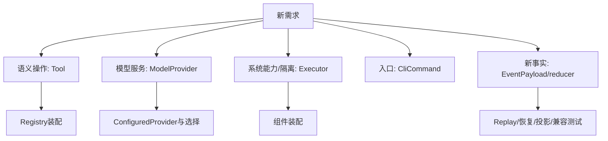

# 第 20 章：如何扩展 mini-harness

## 1. 本章解决什么问题

你要加一个小工具、换模型、做远程执行、加CLI命令或新增事件，应从哪里开始，怎样证明没有绕过原有权限/记账/恢复？本章是扩展路线，不实际实现新业务功能。

## 2. 先理解设计思想

先明确新增行为在哪个边界，再增加最小接口和对应失败契约。扩展必须考虑成功路径之外的取消、未知副作用、编码兼容和资源限制。尽可能复用现有Loop与append，不让新工具或UI变成第二个Runtime。

## 3. 模块在整体架构中的位置



## 4. 源码位置

- [tools/spec.rs](https://github.com/nothiny/mini-harness/blob/1720acefc11fe38cfb9b3bb3d649832ef951d4a8/src/tools/spec.rs)、[tools/mod.rs](https://github.com/nothiny/mini-harness/blob/1720acefc11fe38cfb9b3bb3d649832ef951d4a8/src/tools/mod.rs)、[tools/registry.rs](https://github.com/nothiny/mini-harness/blob/1720acefc11fe38cfb9b3bb3d649832ef951d4a8/src/tools/registry.rs)。
- [model/provider.rs](https://github.com/nothiny/mini-harness/blob/1720acefc11fe38cfb9b3bb3d649832ef951d4a8/src/model/provider.rs)、[model/configured.rs](https://github.com/nothiny/mini-harness/blob/1720acefc11fe38cfb9b3bb3d649832ef951d4a8/src/model/configured.rs)、[model/mod.rs](https://github.com/nothiny/mini-harness/blob/1720acefc11fe38cfb9b3bb3d649832ef951d4a8/src/model/mod.rs)。
- [executor/trait.rs](https://github.com/nothiny/mini-harness/blob/1720acefc11fe38cfb9b3bb3d649832ef951d4a8/src/executor/trait.rs)、[executor/mod.rs](https://github.com/nothiny/mini-harness/blob/1720acefc11fe38cfb9b3bb3d649832ef951d4a8/src/executor/mod.rs)、[executor/local.rs](https://github.com/nothiny/mini-harness/blob/1720acefc11fe38cfb9b3bb3d649832ef951d4a8/src/executor/local.rs)。
- [main.rs](https://github.com/nothiny/mini-harness/blob/1720acefc11fe38cfb9b3bb3d649832ef951d4a8/src/main.rs)：CliCommand/run_cli/cli_components/run_demo/run_doctor。
- [protocol/jsonl.rs](https://github.com/nothiny/mini-harness/blob/1720acefc11fe38cfb9b3bb3d649832ef951d4a8/src/protocol/jsonl.rs)：registry_from/configured_provider/spawn_session/resume_session_actor。
- [durable/event.rs](https://github.com/nothiny/mini-harness/blob/1720acefc11fe38cfb9b3bb3d649832ef951d4a8/src/durable/event.rs)、[durable/reducer.rs](https://github.com/nothiny/mini-harness/blob/1720acefc11fe38cfb9b3bb3d649832ef951d4a8/src/durable/reducer.rs)、[durable/checkpoint.rs](https://github.com/nothiny/mini-harness/blob/1720acefc11fe38cfb9b3bb3d649832ef951d4a8/src/durable/checkpoint.rs)。

## 5. 从入口逐步分析源码

### 5.1 添加简单Tool：以受限文件预览为例

选一个只需要现有read_file能力的工具，比如“预览文件前10行”。保留path参数，以符合当前Read风险策略的workspace判断；输出应明确来自有界读取，不暗示全文件计数。推荐步骤：

1. 在tools目录新增模块，参考ReadTool的spec/parse_input/execute。schema给path约束，risk=Read；参数未知字段、空path与取消必须拒绝。源码路径命名属于你的未来改动，本教程不引用尚不存在的文件为当前实现。
2. execute只通过ctx.executor.read_file(ReadFileRequest)读取，使用min(本工具限制,ctx.output_limit)，处理类型化错误，再从返回的有界text取10行。JSON编码后仍受输出限制，提供truncated等元数据。
3. tools/mod.rs声明并导出类型。Registry.register注册，检查名称唯一和spec<=16KiB。
4. 更新main::cli_components、protocol::registry_from。若希望Demo/doctor也看到新工具，还更新run_demo/run_doctor；只在某一个入口注册会导致该工具在其它入口Unknown。
5. 新增小型工具测试（按tests/read_tool.rs的FakeExecutor模式）：未知字段、路径、取消、长JSON、输入实际传到Executor；集成用Mock ToolCall→Text检查ToolRequested/Started/Completed和后续history。
6. 使用临时workspace做一次只读运行，检查Policy范围与Executor路径错误；更新教程工具表与说明。

这里不需要改AgentLoop。它已按名字lookup、调用trait、统一记账。若新工具需要网络/写入，应重新明确risk与权限，不能只给一个Read标签；DefaultPolicy/ConfiguredPolicy的Read/Write当前还要求path，非路径工具需专门设计策略接口。

概念执行骨架（**伪代码，不是新增实现**）：

```text
parse并校验input
if token已取消: 返回结构化Err
result = await ctx.executor.read_file(有界请求)
选前10行，保留截断信息
按编码后字节预算返回JSON字符串
```

若你希望工具失败后模型重试，当前Err会终止Turn；改变该行为需要明确新结果契约及Loop/History/Provider测试，不是新Tool顺手吞掉错误即可。

### 5.2 添加ModelProvider

以provider.rs为接口，先实现complete和request_timeout；若原生ToolCall ID需要续传，实现complete_with_metadata，保存native映射、endpoint/model/cursor。若要durable HTTP attempts，实现complete_observed，并通过observer.record等ack，不能自持store写事件。

纯编码/解析与网络代码分开，使用有界响应、取消、有限重试、endpoint/key日志处理。返回TextWithToolCalls保留混合响应，批次不能只取第一项。若使用新的配置选择，还需model/mod.rs导出、ConfiguredProvider加variant与三个trait方法分派，main ProviderChoice/cli_components与protocol configured_provider更新，相关config/doctor/UI参数说明同步。

测试接入tests/provider_contract.rs的六场景；参考tests/openai_provider.rs本地HTTP验证native ID、请求body、重试、超时、取消、无内容/重复/过大批次和Debug不含key。不以单次生产API成功取代fixture合同。注意当前CC不全支持request.model/流式元数据，不把这些限制复制为新Provider理想约定。

### 5.3 添加Executor

实现read_file以及实际支持的run_process/edit_file_with_cancel，workspace_root说明真实范围。默认Unsupported可表示未支持能力，不能假返回空成功；默认edit_file_with_cancel不自动取消，必须override才提供保证。

在executor/mod.rs导出，替换main/serve装配中的LocalExecutor；如果要运行时按配置选择不同类型，可参考ConfiguredProvider做ConfiguredExecutor枚举，保持Generic Loop接口。UI无需直接知道文件/进程后端，但应能观察适当错误/限制。

远程执行时，必须回答取消到远程如何确认、transport断线是否Unknown、side effect是否有幂等key、并发permit范围、输出何时停止保留/何时排空。现有Tool错误字符串路径通常TurnFailed，若远程需要把“未知”保留为active，应设计运行时可识别的结果/错误协议，不能靠一个文本kind自动让Loop知道。

测试参考executor_read、process_executor、edit_tool和integration_agent_loop：路径逃逸/非普通文件/UTF-8/输出预算、timeout/child清理、hash冲突、取消。OS sandbox是此层新增后端能力，只有接口说明不算隔离已实现。

### 5.4 添加CLI命令

在main.rs添加Clap Args和CliCommand variant，run_cli分派到一个明确库入口。先决定输入/输出、是否需要new session、如何选择workspace/log、是否可恢复、是否可能Ask。输出给程序时用稳定JSON；在serve路径不得stdout写诊断，tracing/eprintln走stderr。

如果命令只检查状态，复用inspect_store而不是复制reducer；若执行Turn，复用Session或Actor并沿用Policy/limits。新的交互控制可能需要协议method，修改Request params/handle_request/客户端，而不是CLI读取别人live Session内存。

测试tests/cli.rs与stdio_protocol风格：--help、缺参数、未知字段/值、成功输出、错误exit、临时路径不会复用非空日志。更新配置优先级说明，不让doctor给未验证能力报成功。

### 5.5 添加事件类型

这是兼容性影响最大的扩展。先写“发生了什么、谁产生、哪个前置状态、是否改变history/active、恢复怎么解释”，再动代码。

| 修改点 | 必须决定的问题 |
|---|---|
| EventPayload、kind | wire字段和稳定展示名是什么？无字段/有data？ |
| Event schema/from_json/migrate | 老日志可读吗？旧读者对新variant怎么办？是否需要升版本？ |
| reducer::reduce | 合法前置、状态迁移、ID/seq、失败验证是否在副本？ |
| SessionState/TurnState | 是否新增派生字段？serde default、history_bytes、legacy快照如何处理？ |
| Checkpoint | canonical digest与旧schema归一化/前缀比较是否仍有效？ |
| Recovery/classify | crash停在新事件后知道什么？不能假设副作用失败 |
| project_event/协议 | v2暴露哪些字段，v1/raw是否兼容，是否有敏感内容？ |
| UI/Scheduler | 是否需要改变投影和命令，还是可以忽略新的观测事件？ |

事件必须从Loop/Actor的正常append路径发出；Provider通过observer、Tool通过返回值，不直接拿store。若需要外部管理命令append，要遵守同一session/seq/前置检查并说明跨进程协议。

测试更新every_core_event_round_trips、reducer合法/非法序列、property脚本覆盖、checkpoint前缀/fallback/legacy、recovery/classifier、protocol投影和兼容。仅给枚举加一个variant使编译过，不等于持久化协议升级完成。字段添加可能保持旧variant表示，新增variant也可能需schema version；具体取决于读写兼容，不机械“加一即可”。

## 6. 完整运行示例

本次只读验证扩展的现有契约，未新增Tool或改变测试：

```bash
cargo test --test read_tool
cargo test --test provider_contract
cargo test --test executor_read
cargo test --test cli
cargo test every_core_event_round_trips
bash scripts/check-docs.sh
```

真正实施扩展时，只运行与改动相匹配的测试，再执行CI所要求的format/clippy/test/docs。文档任务本次没有改Rust/TS源文件。

## 7. 为什么这么设计

扩展点对应能力边界，让简单新Tool复用Loop。越靠近Event/state协议，影响面越大；先定义事件和未知结果能避免事后到处补状态字段。替代方案“一个大函数直接完成一切”短期方便，长期绕过授权、预算和恢复证据。

## 8. 常见误解

- 只在cli注册Tool，serve就自动知道：不会，两处装配独立。
- 默认Executor方法会实现真实能力：不会，Unsupported或无取消保证。
- 新事件只影响event.rs：还影响replay/checkpoint/projection/compat。
- ToolContext是OS sandbox：只是可信代码能力约定。

## 9. 本章总结

可以从Tool扩展开始练习，保持输入、权限、能力、结果、事实、恢复这条链。复杂扩展先定义边界与测试，再写实现。

## 10. 自测问题

1. 新Tool通常需要改Loop吗？参考：已有能力足够时无需，注册和trait即可。
2. 新Tool怎样在CLI/serve均可用？参考：更新cli_components与registry_from，必要时Demo/doctor。
3. 远程断线为何不能直接确定失败？参考：请求可能已在远端执行，需未知结果协议。
4. 新事件为何影响Checkpoint？参考：派生状态/摘要/前缀重放兼容都会变化。
5. 想支持非路径Read工具遇到什么策略问题？参考：当前Read策略要求workspace/path，需明确新授权规则。

## 11. 下一章如何衔接

正文结束。回到[教材首页](README.md)选择专题复读，用[术语表](glossary.md)定位边界，用[验证记录](validation.md)判断哪些命令已实测，再沿第18章独立追踪一次请求。

---

导航：上一章 [第 19 章：架构设计决策与取舍](design-decisions.md) · [首页](README.md) · 下一章 [验证记录](validation.md)
