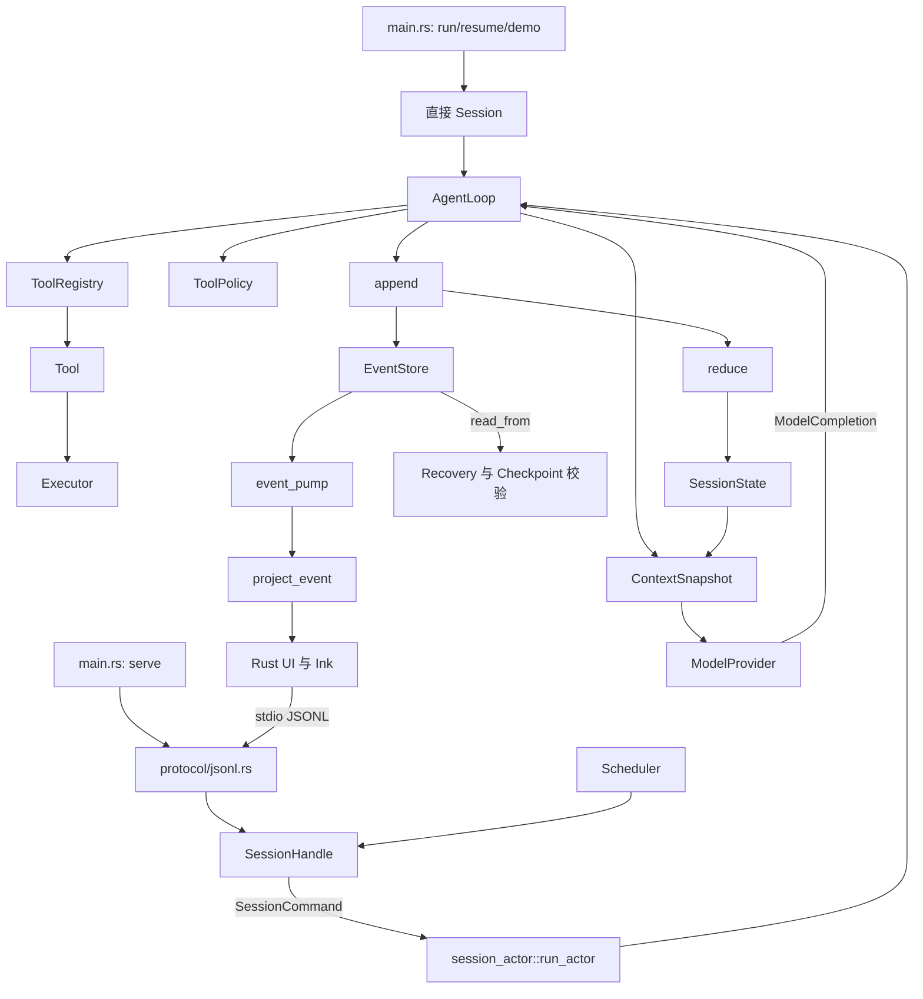

# 第 1 章：项目整体架构

## 1. 本章解决什么问题

打开仓库时，目录看起来像十几块独立积木。本章回答：从用户提交消息，到文件被读取，再到最终回答，各块怎样连接？哪些依赖只是共享类型，哪些是真正的运行调用？

## 2. 先理解设计思想

先把系统按四种工作理解：Provider 做模型调用；Executor 做外部副作用；AgentLoop/reducer 管状态；EventStore/Checkpoint 做持久化。CLI 和 UI 是入口与展示，不能代替这些工作。目录结构见本章末尾的完整文件树。

## 3. 模块在整体架构中的位置



箭头展示真实调用/数据供给，不能读成源码 import 的 DAG。Rust 中 durable 的事件引用 runtime 类型，runtime 又调用 durable；共享类型跨模块出现，不等于双方都能执行副作用。

## 4. 源码位置

| 模块 | 主要责任与入口 | 读完输入/输出 |
|---|---|---|
| [main.rs](https://github.com/nothiny/mini-harness/blob/1720acefc11fe38cfb9b3bb3d649832ef951d4a8/src/main.rs) | clap、配置、`cli_components`、`run_demo` | 参数 → 装配好的库调用 |
| [runtime](https://github.com/nothiny/mini-harness/tree/1720acefc11fe38cfb9b3bb3d649832ef951d4a8/src/runtime/) | `Session`、Actor、`AgentLoop`、上下文 | 用户输入 → 事件与 Turn 结果 |
| [model](https://github.com/nothiny/mini-harness/tree/1720acefc11fe38cfb9b3bb3d649832ef951d4a8/src/model/) | `ModelProvider`、Mock、HTTP 两种 wire | ModelRequest → ModelCompletion |
| [tools](https://github.com/nothiny/mini-harness/tree/1720acefc11fe38cfb9b3bb3d649832ef951d4a8/src/tools/) | Tool schema、参数、模型可读结果 | JSON 参数 → 字符串结果/错误 |
| [executor](https://github.com/nothiny/mini-harness/tree/1720acefc11fe38cfb9b3bb3d649832ef951d4a8/src/executor/) | 路径、读写、进程与资源 | 能力请求 → 类型化结果/错误 |
| [policy](https://github.com/nothiny/mini-harness/blob/1720acefc11fe38cfb9b3bb3d649832ef951d4a8/src/policy/mod.rs) | `ToolPolicy::decide` | spec/input/workspace → Allow/Ask/Deny |
| [durable](https://github.com/nothiny/mini-harness/tree/1720acefc11fe38cfb9b3bb3d649832ef951d4a8/src/durable/) | Event、store、reduce、recovery、checkpoint | 事实 ↔ 日志，事实 → 状态 |
| [protocol](https://github.com/nothiny/mini-harness/tree/1720acefc11fe38cfb9b3bb3d649832ef951d4a8/src/protocol/) | `run_stdio`、事件泵、投影 | JSONL 命令 ↔ 回复/通知 |
| [scheduler](https://github.com/nothiny/mini-harness/tree/1720acefc11fe38cfb9b3bb3d649832ef951d4a8/src/scheduler/) | SessionHandle 多会话门面 | session/input → SchedulerTask |
| [config.rs](https://github.com/nothiny/mini-harness/blob/1720acefc11fe38cfb9b3bb3d649832ef951d4a8/src/config.rs) | TOML 默认与映射、ConfiguredPolicy | 文件/参数 → 有效配置 |
| [ui](https://github.com/nothiny/mini-harness/tree/1720acefc11fe38cfb9b3bb3d649832ef951d4a8/src/ui/) 与 [ui/src](https://github.com/nothiny/mini-harness/tree/1720acefc11fe38cfb9b3bb3d649832ef951d4a8/ui/src/) | 协议客户端与终端显示 | 通知/键盘 → 显示/请求 |
| [error.rs](https://github.com/nothiny/mini-harness/blob/1720acefc11fe38cfb9b3bb3d649832ef951d4a8/src/error.rs) | 模块边界的错误类型 | 区分执行、工具、持久化与控制错误 |

`src/lib.rs` 导出这些模块，`src/main.rs` 是二进制入口，`ui/` 是另一个 Node 客户端工程；它们不是三个不同的 Harness Core。

## 5. 从入口逐步分析源码

**控制流**决定下一步运行谁。`run_demo` 直接 `Session::start_turn`；`serve` 的 `start_turn` 发 `SessionCommand::StartTurn`，Actor 调 `begin_turn` 和 `continue_turn`。模型有工具建议时，循环先查 Registry 和 Policy，允许后才启动 Tool；有最终文本时结束 Turn。

**数据流**决定下一步知道什么。`UserInputRecorded` 经 reducer 加入 history；每次 snapshot 拷贝有限 history 和 tool specs；Provider 返回文本/工具参数；Tool 返回文件或进程信息；`ToolCompleted` 经 reducer 加入 `HistoryItem::Tool`，下一次请求才看到它。模型原生 call ID 在 ProviderContinuation 中映射，不直接占用 runtime ID。

**持久化流**贯穿所有阶段。`append` 先在副本 reduce，再 store.append，最后提交内存。工具实际副作用位于 `ToolStarted` 和 `ToolCompleted` 之间；这段空隙无法靠一次 Rust 内存赋值消除。

**显示流**由 EventStore → event_pump → project_event → UI 构成。UI 只收到部分字段，不能从安全投影重建完整 SessionState；其显示状态允许丢弃重建。

### Cargo.toml 中的工程选择

[Cargo.toml](https://github.com/nothiny/mini-harness/blob/1720acefc11fe38cfb9b3bb3d649832ef951d4a8/Cargo.toml) 声明 Rust 2024 edition、最低版本 1.85。Tokio 提供 task、channel、process、IO、time、signal，`tokio-util` 提供 CancellationToken；`async-trait` 让异步 trait 支持项目的调用方式，包括 `dyn Executor/Tool`。`serde/serde_json/toml` 处理持久化和配置；`clap` 解析 CLI；`thiserror` 定义错误；`uuid/chrono` 生成身份和时间；`fs2` 提供协作式文件锁；`sha2` 做编辑 hash 与快照摘要；`libc/windows-sys` 对接平台能力；`reqwest` 采用 rustls TLS 且关闭默认功能；tracing 记录 stderr 诊断；unicode-width 服务 Rust TUI；tempfile 仅用于测试。没有引入 Actor 框架、数据库或 property-test 框架。

## 6. 完整运行示例

```bash
cargo test full_mock_read_turn
cargo test --test stdio_protocol
```

第一个直接从 Session 穿过工具闭环；第二组启动真实二进制并验证 JSONL、通知、审批、恢复和快照。两者都使用同一 AgentLoop，差别是入口和存储。

## 7. 为什么这么设计

把网络和 OS 细节排除在主循环之外，能用 Mock 和临时 workspace 测 Harness 的行为；但接口不是安全隔离，Tool/Provider 仍是可信的进程内代码。泛型 `AgentLoop<P,E,S>` 在编译时选择具体 Provider、Executor、Store；Registry 中的 `Arc<dyn Tool>` 在运行时按名字选择不同工具。前者适合组件组装，后者适合工具集合。

## 8. 常见误解

- 不是每条 CLI 命令都经过 JSONL；Demo 和普通 run 使用直接 facade。
- Actor 没有取代 EventStore 的锁；一个安排状态变更，一个保护存储追加。
- event_pump 的 shadow_state 是通知/快照辅助视图，不是第二个执行主循环。

## 9. 本章总结

沿“入口—控制循环—模型—工具—副作用—事实—状态—下一次模型输入”阅读，目录就会成为运行故事中的具体位置。

## 10. 自测问题

1. Control Flow 与 Data Flow 有何区别？参考：谁先运行，与谁拿到哪些数据。
2. 为什么 tools 不 import Session 来写 history？参考：它只返回结果，由主循环统一记账。
3. CLI 和 Ink 共用什么？参考：Rust 库运行语义；Ink 通过 serve 的协议使用它。
4. Tool 为什么采用 dyn，而 loop 用泛型？参考：运行时异构集合与装配时固定组件。

## 11. 下一章如何衔接

接下来按[第一次完整运行](first-run.md)逐调用展开图中的主路径。完整目录树如下，省略构建产物、`.git`、空 `.gitkeep` 和用户未跟踪文件。

```text
mini-harness/
├── .github/
│   └── workflows/
│       ├── ci.yml
│       └── tutorial.yml
├── .gitignore
├── Cargo.lock
├── Cargo.toml
├── LICENSE
├── Makefile
├── README.md
├── book.toml
├── comments.js
├── custom.css
├── docs/
│   ├── SUMMARY.md
│   └── tutorial/
│       ├── 00-overview.md
│       ├── 01-ids-and-events.md
│       ├── 02-event-store-and-reducer.md
│       ├── 03-mock-provider-and-session.md
│       ├── 04-first-tool.md
│       ├── 05-agent-loop.md
│       ├── 06-process-cancellation.md
│       ├── 07-recovery.md
│       ├── 08-openai-provider.md
│       ├── 09-cli-and-protocol.md
│       ├── 10-ui.md
│       ├── 11-scheduler.md
│       ├── 12-next-steps.md
│       ├── README.md
│       ├── architecture.md
│       ├── call-chain-cases.md
│       ├── config-tests-benchmarks.md
│       ├── design-decisions.md
│       ├── executor.md
│       ├── first-run.md
│       ├── glossary.md
│       ├── policy.md
│       ├── session-actor.md
│       ├── source-audit.md
│       └── validation.md
├── scripts/
│   └── check-docs.sh
├── src/
│   ├── config.rs
│   ├── durable/
│   │   ├── checkpoint.rs
│   │   ├── event.rs
│   │   ├── event_log.rs
│   │   ├── memory.rs
│   │   ├── mod.rs
│   │   ├── recovery.rs
│   │   ├── reducer.rs
│   │   └── store.rs
│   ├── error.rs
│   ├── executor/
│   │   ├── filesystem.rs
│   │   ├── filesystem_secure.rs
│   │   ├── local.rs
│   │   ├── mod.rs
│   │   ├── process.rs
│   │   └── trait.rs
│   ├── lib.rs
│   ├── lib_tests.rs
│   ├── main.rs
│   ├── model/
│   │   ├── configured.rs
│   │   ├── mock.rs
│   │   ├── mod.rs
│   │   ├── openai.rs
│   │   ├── openai_protocol.rs
│   │   └── provider.rs
│   ├── policy/
│   │   └── mod.rs
│   ├── protocol/
│   │   ├── event_projection.rs
│   │   ├── jsonl.rs
│   │   ├── jsonl_transport.rs
│   │   └── mod.rs
│   ├── runtime/
│   │   ├── agent_loop.rs
│   │   ├── agent_loop_approval.rs
│   │   ├── agent_loop_setup.rs
│   │   ├── context.rs
│   │   ├── ids.rs
│   │   ├── mod.rs
│   │   ├── sampling.rs
│   │   ├── session.rs
│   │   ├── session_actor.rs
│   │   ├── state.rs
│   │   └── types.rs
│   ├── scheduler/
│   │   ├── mod.rs
│   │   └── task.rs
│   ├── tools/
│   │   ├── bash.rs
│   │   ├── edit.rs
│   │   ├── mod.rs
│   │   ├── read.rs
│   │   ├── registry.rs
│   │   └── spec.rs
│   ├── ui/
│   │   ├── event_viewer.rs
│   │   ├── jsonl_client.rs
│   │   ├── screen.rs
│   │   ├── terminal.rs
│   │   └── tui.rs
│   └── ui.rs
├── tests/
│   ├── actor_queue_edges.rs
│   ├── agent_loop_limits.rs
│   ├── bash_tool.rs
│   ├── checkpoint.rs
│   ├── cli.rs
│   ├── common/
│   │   └── mod.rs
│   ├── context_snapshot.rs
│   ├── cross_process_cancel.rs
│   ├── edit_tool.rs
│   ├── events_viewer.rs
│   ├── executor_local.rs
│   ├── executor_read.rs
│   ├── integration_agent_loop.rs
│   ├── jsonl_cross_process.rs
│   ├── openai_provider.rs
│   ├── policy.rs
│   ├── process_executor.rs
│   ├── property_replay.rs
│   ├── protocol_compat.rs
│   ├── provider_contract.rs
│   ├── read_tool.rs
│   ├── recovery_classify.rs
│   ├── recovery_cli.rs
│   ├── reducer_turn_terminal.rs
│   ├── scheduler.rs
│   ├── session_cancel.rs
│   ├── stdio_protocol.rs
│   └── tui_line_mode.rs
├── theme/
│   └── head.hbs
└── ui/
    ├── .gitignore
    ├── package-lock.json
    ├── package.json
    ├── src/
    │   ├── ChatApp.tsx
    │   ├── client.ts
    │   └── main.tsx
    └── tsconfig.json
```

---

导航：上一章 [第 0 章：mini-harness 到底是什么？](00-overview.md) · [首页](README.md) · 下一章 [第 2 章：第一次完整运行](first-run.md)
