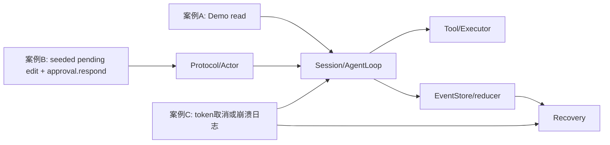
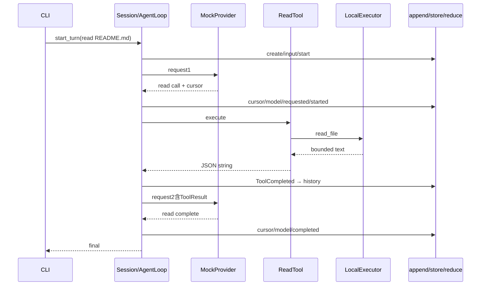
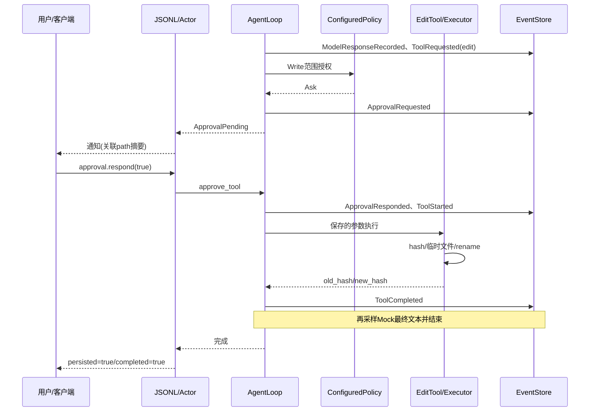
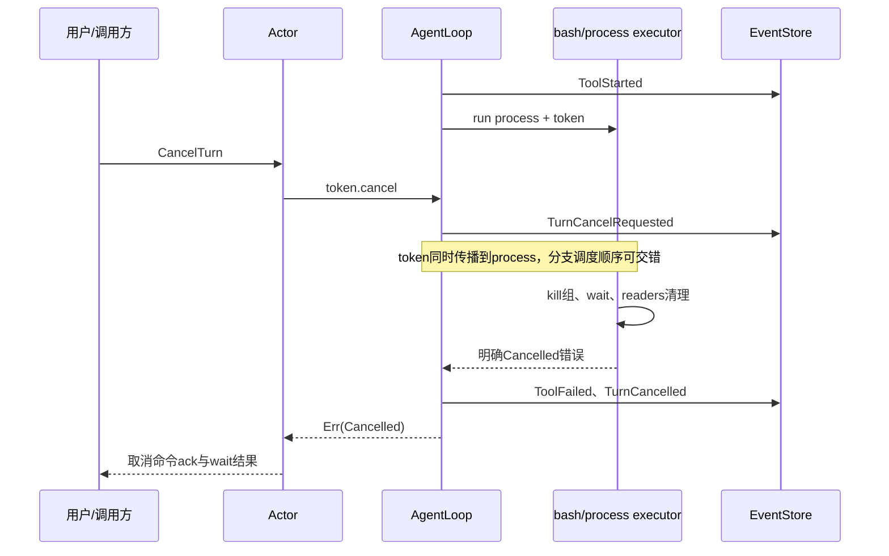
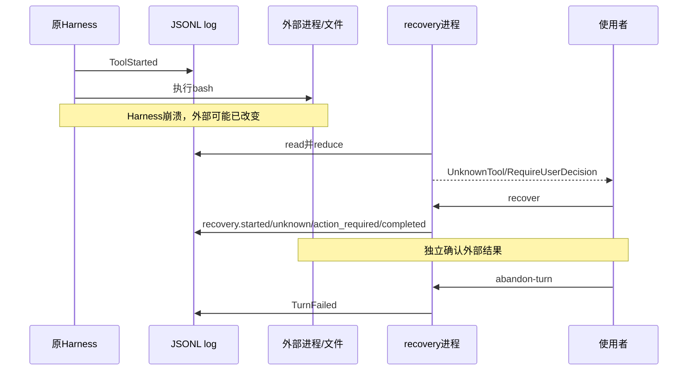

# 第 18 章：三个完整源码调用链复盘

## 1. 本章解决什么问题

你已经认识每块模块，现在不借助单独定义，完整追踪三件事：读取文件、批准编辑、执行中取消/崩溃。每个案例都要回答入口、调用、状态、事实、副作用和验证依据。

## 2. 先理解设计思想

同一系统有三条互补故事：成功闭环把结果回模型；审批闭环把人类决定变成事实；恢复闭环只承认日志能证明的事情。它们共用append/reducer，但入口、返回值、终态与外部动作不同。

## 3. 模块在整体架构中的位置



## 4. 源码位置

核心入口：[main.rs](https://github.com/nothiny/mini-harness/blob/1720acefc11fe38cfb9b3bb3d649832ef951d4a8/src/main.rs)的run_demo，[session.rs](https://github.com/nothiny/mini-harness/blob/1720acefc11fe38cfb9b3bb3d649832ef951d4a8/src/runtime/session.rs)的Session/Handle，[agent_loop.rs](https://github.com/nothiny/mini-harness/blob/1720acefc11fe38cfb9b3bb3d649832ef951d4a8/src/runtime/agent_loop.rs)的begin/continue/append，[agent_loop_approval.rs](https://github.com/nothiny/mini-harness/blob/1720acefc11fe38cfb9b3bb3d649832ef951d4a8/src/runtime/agent_loop_approval.rs)的approve_tool，[protocol/jsonl.rs](https://github.com/nothiny/mini-harness/blob/1720acefc11fe38cfb9b3bb3d649832ef951d4a8/src/protocol/jsonl.rs)的respond_approval，[recovery.rs](https://github.com/nothiny/mini-harness/blob/1720acefc11fe38cfb9b3bb3d649832ef951d4a8/src/durable/recovery.rs)的recover_store。

下游：[tools/read.rs](https://github.com/nothiny/mini-harness/blob/1720acefc11fe38cfb9b3bb3d649832ef951d4a8/src/tools/read.rs)、[tools/edit.rs](https://github.com/nothiny/mini-harness/blob/1720acefc11fe38cfb9b3bb3d649832ef951d4a8/src/tools/edit.rs)、[tools/bash.rs](https://github.com/nothiny/mini-harness/blob/1720acefc11fe38cfb9b3bb3d649832ef951d4a8/src/tools/bash.rs)，[executor/local.rs](https://github.com/nothiny/mini-harness/blob/1720acefc11fe38cfb9b3bb3d649832ef951d4a8/src/executor/local.rs)、[filesystem.rs](https://github.com/nothiny/mini-harness/blob/1720acefc11fe38cfb9b3bb3d649832ef951d4a8/src/executor/filesystem.rs)、[process.rs](https://github.com/nothiny/mini-harness/blob/1720acefc11fe38cfb9b3bb3d649832ef951d4a8/src/executor/process.rs)。对应测试逐案例列出。

## 5. 从入口逐步分析源码

### 案例 A：read后返回结果

真实入口是`demo read README.md --json`，固定Mock脚本，不需要联网。完整调用链：

```text
main → run → run_cli → run_demo
 → Session::new_with_policy → AgentLoop::new_with_policy
 → Session::start_turn → run_turn → run_turn_with_cancel
 → run_turn_with_reason → begin_turn → begin_queued_turn
 → continue_turn_with_reason
 → ContextSnapshot::from_state → into_model_request → sample_model
 → complete_observed(默认) → MockProvider::complete_with_metadata → complete
 → ToolRequested → ToolRegistry::lookup → DefaultPolicy::decide
 → ToolStarted → ReadTool::execute → parse_input
 → LocalExecutor::read_file → resolve → open_workspace_file
 → ReadTool::serialize_result → ToolCompleted/reduce写history
 → 第二次sample_model → Text → ModelResponseRecorded → TurnCompleted
 → (TurnId,text)返回 → read_from(1) → print_events或JSON
```

事件时间线：

```text
1 session.created
2 user.input.recorded       history有User，pending=[input]
3 turn.started              pending消费，active=Running
4 provider.continuation.updated
5 model.response.recorded   Assistant("tool call: read")
6 tool.requested            Pending + name/input
7 tool.started              Running + execution_id
8 tool.completed            Completed + Tool history
9 provider.continuation.updated   清cursor
10 model.response.recorded  Assistant最终文本
11 turn.completed           active=None，Idle，最终文本不重复
```

这里唯一外部动作是打开并读取文件；EventStore在内存。read成功不说明完整文件已全部提供（200行/字节预算）。最终脚本文本也不提供语义正确性。



测试证据是[src/lib_tests.rs](https://github.com/nothiny/mini-harness/blob/1720acefc11fe38cfb9b3bb3d649832ef951d4a8/src/lib_tests.rs)的full_mock_read_turn：检查两次request、11事件、history内容和Idle。命令见第2章与本章第6节。

### 案例 B：用户请求编辑，等待批准再执行

从真实模型入口开始时，`turn.start → Actor.begin_turn/continue_turn → Provider ToolCall(edit)`，随后同一loop保存模型响应/请求。ConfiguredPolicy的Write默认Ask，产生ApprovalRequested，active Turn与Pending execution保留。客户端必须按call_id绑定待审批参数。

离线Demo edit-bash使用AllowAllPolicy，不能充当审批例子。为可重复验证，这里用**合法事件fixture**构造“模型已提出edit且等待批准”的日志，再通过真实serve恢复和批准；fixture不是一段真实模型推理输出。

完整运行调用链：

```text
session.resume → resume_session → resume_session_actor
 → AgentLoop::restore_with_checkpoint → replay fallback → spawn_actor
approval.respond → respond_approval → SessionHandle::queue_approval
 → SessionCommand::ApproveTool → run_actor → run_approved_turn
 → AgentLoop::approve_tool
 → 校验Turn与Pending approval，取TurnState保存的name/input
 → append ToolApprovalResponded(true)
 → lookup(edit) → append ToolStarted
 → EditTool::execute → LocalExecutor::edit_file_with_cancel
 → filesystem::edit_file_with_cancel
 → resolve/lock/read/hash/exact match/temp/sync/recheck/rename
 → ToolCompleted → continue_turn → Mock Text
 → ModelResponseRecorded → TurnCompleted
 → 审批响应persisted=true/completed=true → 后续wait结果
```

事件时间线（本节fixture无provider cursor，编号只针对fixture）：

| seq | 事实 | 状态/外部动作 |
|---|---|---|
| 1–3 | SessionCreated、UserInputRecorded、TurnStarted | 开始编辑Turn |
| 4 | ModelResponseRecorded(tool call: edit) | 保存Assistant摘要 |
| 5 | ToolRequested(edit, old/new/path) | Pending，保存完整调用参数 |
| 6 | ToolApprovalRequested | Pending approval，文件仍before |
| 7 | ToolApprovalResponded(true) | Approved，尚不是完成 |
| 8 | ToolStarted | Running，开始现实副作用窗口 |
| 外部 | 原子替换note.txt | before→after，事件可能尚未写 |
| 9 | ToolCompleted(hashes) | Completed，Tool history |
| 10–11 | ModelResponseRecorded(mock response)、TurnCompleted | Idle，文件改动与结果都可观察 |
| 可选后续 | CheckpointCreated | 辅助快照，取决于pump时机 |

若用户拒绝：ApprovalResponded(false)→TurnCancelled，不出现ToolStarted，不编辑文件；API返回Policy error，protocol明确返回denied结果。



对应现有测试分层支持该路径：

- [tests/policy.rs](https://github.com/nothiny/mini-harness/blob/1720acefc11fe38cfb9b3bb3d649832ef951d4a8/tests/policy.rs)：default_policy_persists_approval_without_starting_execute_tool、approval_executes_the_pending_tool_and_keeps_the_turn_budget（使用bash）。
- [tests/session_cancel.rs](https://github.com/nothiny/mini-harness/blob/1720acefc11fe38cfb9b3bb3d649832ef951d4a8/tests/session_cancel.rs)：Actor审批恢复。
- [tests/stdio_protocol.rs](https://github.com/nothiny/mini-harness/blob/1720acefc11fe38cfb9b3bb3d649832ef951d4a8/tests/stdio_protocol.rs)：stdio_approval_response_persists_and_completes_the_pending_turn（恢复bash fixture）。
- [tests/edit_tool.rs](https://github.com/nothiny/mini-harness/blob/1720acefc11fe38cfb9b3bb3d649832ef951d4a8/tests/edit_tool.rs)：编辑hash/边界/并发，和[tests/integration_agent_loop.rs](https://github.com/nothiny/mini-harness/blob/1720acefc11fe38cfb9b3bb3d649832ef951d4a8/tests/integration_agent_loop.rs)的edit→bash闭环。

没有把“现有测试使用bash审批”误写成“已有edit审批同名测试”；下面实际运行脚本补充跨层观察，不新增业务代码或测试语义。

### 案例 C1：正在执行bash时同进程取消

以`(sleep 30; echo alive > marker) & wait`为例，选择AllowAllPolicy测试，隔离审批问题。

```text
Actor.CancelTurn 或调用方token.cancel
 → live CancellationToken
 → AgentLoop工具select（写cancel_requested，等1秒清理）
 → BashTool child_token → LocalExecutor → process::run_process
 → terminate_process → kill(-pgid,SIGKILL)
 → child.wait + finish_output_tasks
 → Err(ProcessError::Cancelled)
 → BashTool Err(JSON cancelled)
 → Loop ToolFailed → TurnCancelled（确认收尾时）
 → API Err(Cancelled)，active=None/Idle
```

外部动作不回滚，marker尚未执行场景测试检查它不存在。若Tool task不协作或清理失败，Loop记录ToolOutcomeUnknown并保留active，不能画成必然TurnCancelled。



证据：[tests/integration_agent_loop.rs](https://github.com/nothiny/mini-harness/blob/1720acefc11fe38cfb9b3bb3d649832ef951d4a8/tests/integration_agent_loop.rs)的cancelling_bash_turn_kills_the_child_process_group，[tests/process_executor.rs](https://github.com/nothiny/mini-harness/blob/1720acefc11fe38cfb9b3bb3d649832ef951d4a8/tests/process_executor.rs)的cancellation_kills_process_group_and_returns_cancelled及pipe继承取消。测试证明该组里的子进程场景；不证明脱组后代或硬crash后的清理。

### 案例 C2：bash开始后Harness崩溃

假设bash已经创建文件或发请求，ToolCompleted还没写。没有live token的恢复进程只读到Running execution：

```text
CLI inspect → open_referenced_log（可repair半行）
 → inspect_store → classify_events → reduce → classify_state
 → ActiveTurn + UnknownTool(ExecutionId, RequireUserDecision)
CLI recover → recover_store
 → RecoveryStarted
 → ToolOutcomeUnknown（Running→Unknown）
 → RecoveryActionRequired
 → RecoveryCompleted（只是分类完成）
 → inspect report仍action_required
用户检查外部状态 → abandon-turn → TurnFailed
 → 新用户输入才开始新Turn
```

这里recover不会kill旧进程组，也不重跑bash。硬crash的Drop不一定执行；旧进程是否存活、外部动作是否发生需要独立检查。



证据：[tests/recovery_classify.rs](https://github.com/nothiny/mini-harness/blob/1720acefc11fe38cfb9b3bb3d649832ef951d4a8/tests/recovery_classify.rs)的classifies_running_tool_as_unknown_with_conservative_policy，[tests/recovery_cli.rs](https://github.com/nothiny/mini-harness/blob/1720acefc11fe38cfb9b3bb3d649832ef951d4a8/tests/recovery_cli.rs)的recovery_commands_inspect_mark_unknown_and_abandon。它们构造崩溃尾部fixture，不声称真的注入SIGKILL在精确指令窗口。

跨进程CLI cancel另走终态日志握手，可能使classifier clean，且不杀live executor；见第11章，不能合并进上述同进程token/保留active的崩溃时间线。

## 6. 完整运行示例

A与C使用已有测试：

```bash
cargo test full_mock_read_turn
cargo test --test integration_agent_loop
cargo test --test recovery_cli
cargo test --test process_executor
```

B的完整离线edit审批实验（仓库根运行，全部文件在临时目录）：

```bash
cargo build --locked
python3 - <<'PYCODE'
import datetime, json, pathlib, subprocess, tempfile, uuid
work = pathlib.Path(tempfile.mkdtemp(prefix='mini-harness-approval-'))
(work/'note.txt').write_text('before\n')
def ident(prefix): return prefix+str(uuid.uuid4())
session,turn,call = ident('sess_'),ident('turn_'),ident('call_')
payloads = [
 {'type':'session_created'},
 {'type':'user_input_recorded','data':{'input':'edit note.txt'}},
 {'type':'turn_started'},
 {'type':'model_response_recorded','data':{'text':'tool call: edit'}},
 {'type':'tool_requested','data':{'call_id':call,'name':'edit',
    'input':{'path':'note.txt','old_text':'before','new_text':'after'}}},
 {'type':'tool_approval_requested','data':{'call_id':call}},
]
log = work/'events.jsonl'
with log.open('w') as f:
 for i,payload in enumerate(payloads,1):
  f.write(json.dumps(dict(schema_version=2,event_id=ident('evt_'),seq=i,
   timestamp=datetime.datetime.now(datetime.timezone.utc).isoformat(),
   session_id=session,turn_id=turn if i>=3 else None,payload=payload))+'\n')
binary = pathlib.Path('target/debug/mini-harness').resolve()
p = subprocess.Popen([str(binary),'serve','--stdio'],stdin=subprocess.PIPE,
                     stdout=subprocess.PIPE,text=True)
def req(i,method,params):
 p.stdin.write(json.dumps(dict(jsonrpc='2.0',protocol_version=2,id=i,
                               method=method,params=params))+'\n');p.stdin.flush()
 while True:
  line=p.stdout.readline()
  if not line: raise RuntimeError('server stopped')
  message=json.loads(line)
  if message.get('id')==i:
   if 'error' in message: raise RuntimeError(message['error'])
   return message['result']
req(1,'session.resume',{'session_id':session,'event_log':str(log),
                      'workspace':str(work),'provider':'mock'})
assert (work/'note.txt').read_text()=='before\n'
r=req(2,'approval.respond',{'turn_id':turn,'call_id':call,'approved':True})
assert r['persisted'] and r['completed']
assert (work/'note.txt').read_text()=='after\n'
req(3,'session.shutdown',{})
p.stdin.close()
for line in p.stdout: json.loads(line)
assert p.wait(timeout=5)==0
print('edited:',(work/'note.txt').read_text().strip(),'final:',r['text'])
for line in log.read_text().splitlines():
 e=json.loads(line);print(e['seq'],e['payload']['type'])
PYCODE
```

本次实测`edited: after final: mock response`，审批之前文件仍before；末尾允许pump添加CheckpointCreated，不固定其调度位置为事件11之后唯一一步。

## 7. 为什么这么设计

三个案例共享事件语义，但权限暂停和未知结果需要不同控制协议。固定Mock/合法fixture验证接线，不用依赖真实模型碰巧提出同一call；代价是业务推理质量不在这些实验的证明范围。

## 8. 常见误解

- edit-bash Demo不是审批Demo。
- ToolStarted之后崩溃不等于确定失败。
- 取消日志的正常序列与Unknown分支不能混成一张必然时间线。
- clean report不等于所有历史外部动作已经独立确认。

## 9. 本章总结

从入口、事实、状态和副作用四个角度复盘，才能准确区分“做完”“等待决定”“尚不知道”。

## 10. 自测问题

1. A的第二次request由谁加结果？参考：ToolCompleted经reducer写history。
2. B批准时参数从哪里取？参考：replayed TurnState.tool_inputs，非客户端再发new_text。
3. C恢复为什么不执行bash？参考：副作用可能已发生，缺可靠结果时不能盲重试。
4. C取消正常终态前要等什么？参考：Tool明确收尾结果，失败/超时则可Unknown。
5. B脚本fixture证明真实模型会选edit吗？参考：不，它证明恢复审批执行链。

## 11. 下一章如何衔接

下一章[总结架构决策](design-decisions.md)，分析这些接线背后的收益、代价与替代方案。

---

导航：上一章 [第 17 章：配置、测试与 Benchmark](config-tests-benchmarks.md) · [首页](README.md) · 下一章 [第 19 章：架构设计决策与取舍](design-decisions.md)
