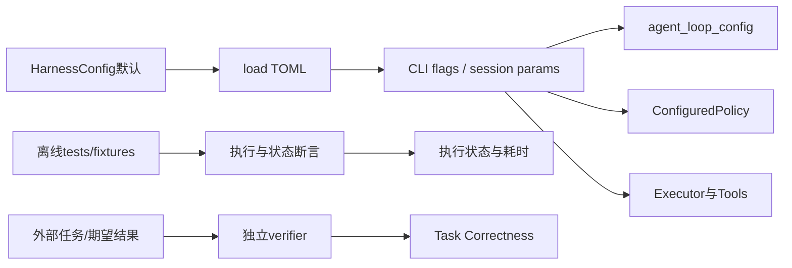

# 第 17 章：配置、测试与 Benchmark 的真实边界

## 1. 本章解决什么问题

README的默认值是否等于库默认？`cargo test`通过是否说明Agent完成了用户任务？如何知道一条配置真的传到了Loop/Executor，而不是只出现在TOML？

## 2. 先理解设计思想

配置必须追到消费点；测试必须读断言；评估必须区分Harness执行正确和业务任务正确。当前仓库没有内置benchmark程序，本章以可运行的测试/耗时测量讲工程验证，再明确外部任务评估的接入边界。

## 3. 模块在整体架构中的位置



## 4. 源码位置

- [config.rs](https://github.com/nothiny/mini-harness/blob/1720acefc11fe38cfb9b3bb3d649832ef951d4a8/src/config.rs)：HarnessConfig::load/to_toml/agent_loop_config、各section default、resolve_event_log。
- [main.rs](https://github.com/nothiny/mini-harness/blob/1720acefc11fe38cfb9b3bb3d649832ef951d4a8/src/main.rs)：ProviderArgs::resolve、run_cli_turn、run_init/config_show/doctor、cli_components。
- [Cargo.toml](https://github.com/nothiny/mini-harness/blob/1720acefc11fe38cfb9b3bb3d649832ef951d4a8/Cargo.toml)、[CI](https://github.com/nothiny/mini-harness/blob/1720acefc11fe38cfb9b3bb3d649832ef951d4a8/.github/workflows/ci.yml)、[check-docs.sh](https://github.com/nothiny/mini-harness/blob/1720acefc11fe38cfb9b3bb3d649832ef951d4a8/scripts/check-docs.sh)。
- [tests/common/mod.rs](https://github.com/nothiny/mini-harness/blob/1720acefc11fe38cfb9b3bb3d649832ef951d4a8/tests/common/mod.rs)：fixture辅助；[tests/property_replay.rs](https://github.com/nothiny/mini-harness/blob/1720acefc11fe38cfb9b3bb3d649832ef951d4a8/tests/property_replay.rs)、[tests/provider_contract.rs](https://github.com/nothiny/mini-harness/blob/1720acefc11fe38cfb9b3bb3d649832ef951d4a8/tests/provider_contract.rs)。

## 5. 从入口逐步分析源码

### 默认、文件、参数的实际优先级

run_cli寻找显式 --config，否则只在cwd有mini-harness.toml时加载。load(None)或不存在路径使用默认；存在但非法文件报ConfigError。所有section deny_unknown_fields；数字用显式serde默认，缺section也使用其Default。

普通 run/resume 的workspace为flag > config.session.workspace > cwd；ProviderArgs::resolve为flag > modelsection。serve session provider/model参数覆盖模型section，workspace省略用cwd；UI的父config不全转发。优先级应按具体入口讲，不能自动扩展到每个命令/参数。

| 选项 | HarnessConfig默认 | 库构造默认/使用位置 |
|---|---|---|
| model.provider/name | mock/None | ConfiguredProvider::mock重复文本 |
| max_steps | 20 | AgentLoopConfig::default为32 |
| max_turn_time_ms | 600000 | Loop默认10分钟 |
| max_tool_time | 无独立TOML字段 | agent_loop_config映射为max_turn_time；库默认5分钟 |
| max_batch_tool_calls | 16 | Loop默认16 |
| max_queued_inputs | **无TOML字段** | Loop默认16，库可改 |
| max_output_bytes | 200000 | ToolContext还cap到200000，结果检查用配置 |
| default_timeout_ms | 120000 | BashTool::default为30000 |
| max_concurrent_processes | 8 | LocalExecutor::new默认无限 |
| flush | buffered | JsonlEventStore::new默认synced |
| checkpoint_every_events | 50 | protocol pump，终态也触发；run成功总写快照 |
| permissions | read allow/edit ask/bash ask | ConfiguredPolicy，区别DefaultPolicy命令规则 |

这是可加载配置示例（已移除README中不能解析的queue字段）：

```toml
[model]
provider = "mock"

[session]
max_steps = 20
max_turn_time_ms = 600000
max_batch_tool_calls = 16

[execution]
max_output_bytes = 200000
default_timeout_ms = 120000
max_concurrent_processes = 8

[durable]
root = "~/.mini-harness"
flush = "buffered"
checkpoint_every_events = 50

[permissions]
read_workspace = "allow"
edit_workspace = "ask"
bash = "ask"
```

durable root展开首组件`~`，不对任意字符串做shell expansion。key只由Provider读环境，不入HarnessConfig；model.name不等于secret。`config`打印所加载配置，不附带其它子命令flag的最终合并结果；tracing配置摘要也先于某些入口覆盖，不宜当完整请求级有效配置证明。

doctor会写probe检查durable root、检查mock/openai环境/工具/平台；当前没有deepseek分支，不做真实API连通性和模型能力验证。README“检查DeepSeek key”与源码不一致，使用run/provider测试判断其支持。

### 测试按哪条保证阅读

| 测试层 | 文件 | 关键断言/关注点 |
|---|---|---|
| ID/事件/reducer/store单元 | src/lib_tests.rs、durable模块内tests | round trip、顺序拒绝、错误保留、半行/版本 |
| 单工具与执行器 | tests/read_tool.rs、edit_tool.rs、bash_tool.rs、executor_read.rs、executor_local.rs | fake能力请求、真实路径/hash/输出 |
| Loop集成 | tests/integration_agent_loop.rs、context_snapshot.rs、agent_loop_limits.rs | 工具结果回模型、去重、串行、预算 |
| Actor/调度 | tests/actor_queue_edges.rs、session_cancel.rs、scheduler.rs | ack时机、FIFO、steer、shutdown、共享槽位 |
| Provider合同 | tests/provider_contract.rs | Mock/Responses/CC同六场景 |
| HTTP适配 | tests/openai_provider.rs | TcpListener捕获wire、usage/native ID/retry/SSE |
| Property | tests/property_replay.rs | 24种子脚本、各prefix合法、完整重放两次相同 |
| 恢复/快照 | tests/recovery_classify.rs、recovery_cli.rs、checkpoint.rs | findings、幂等、repair、abandon、fallback |
| 协议/CLI/UI | tests/cli.rs、stdio_protocol.rs、protocol_compat.rs、events_viewer.rs、tui_line_mode.rs | 二进制真实请求、回复/通知、v1/v2、去重 |
| 多store/跨进程边界 | tests/jsonl_cross_process.rs、cross_process_cancel.rs | suffix缓存、cancel日志握手，部分使用独立实例模拟 |
| 终态 | tests/reducer_turn_terminal.rs | failed工具不能TurnCompleted，最终文本不丢 |

Property测试不用proptest；类型名Lcg但算法实际xorshift64*。随机脚本不覆盖所有控制路径，不能把注释“arbitrary valid sequence”视为无限数学证明。Provider合同是本地fixture，证明适配器行为，不证明生产服务所有模型都接受同样格式。

### Benchmark怎么做，什么目前不存在

当前git文件树、Cargo.toml、main CliCommand都没有benchmark命令、Harbor适配器、task dataset或结果schema。不能提供不存在的`mini-harness benchmark`或伪造execution_status/task_result结果。本次没有运行外部任务benchmark。

可运行的**开发耗时测量**（不是业务benchmark）：

```bash
cargo build --locked
TUTORIAL_BIN="$PWD/target/debug/mini-harness"
TUTORIAL_WORK="$(mktemp -d)"
cp README.md "$TUTORIAL_WORK/README.md"
(cd "$TUTORIAL_WORK" && time "$TUTORIAL_BIN" demo read README.md > /dev/null)
```

先build使测量排除编译；Mock排除HTTP，可观察工具/事件循环开销。但只有一个样本、有OS缓存、Debug编译、README窗口截断，不能推广成吞吐指标。真正性能研究需固定revision/机器/profile/workspace、warmup/重复样本、输出量、flush模式、并发与p50/p95、errors。

如果接外部任务评估，应每任务保存prompt、期望、环境、事件、返回错误、工具exit/timeouts/unknown和独立verifier输出。**Harness Execution Success**只表示控制循环得到合法终态；**Task Correctness**要求文件/测试/产物满足期望。Demo可返回固定成功文本，bash exit=7也可ToolCompleted，外部runner exit0更不能替代每任务verifier。Harbor等外部系统如以后接入，应单独验证其runner与任务结果，当前没有这种实现。

## 6. 完整运行示例

```bash
cargo test --locked
bash scripts/check-docs.sh
cargo test config_file_round_trips_and_rejects_unknown_fields
cargo test --test provider_contract
cargo test --test property_replay
```

创建配置请用`target/debug/mini-harness init --path "$TUTORIAL_WORK/mini-harness.toml"`，再显式`--config ... config`查看；doctor也只在该临时root配置下运行，避免写用户默认durable目录。本次结果与实际命令见[验证记录](validation.md)。

## 7. 为什么这么设计

离线fixture让测试快、可重复、无需key；相同合同压缩Provider替换风险。代价是无法证明真实服务当前能力或业务任务质量。配置strict能快速发现拼写错误，却要求文档每个字段都与解析器一致。

## 8. 常见误解

- README列出字段不代表Config支持它。
- cargo test通过不等于给真实模型任务的答案正确。
- doctor通过不等于HTTP已连通。
- synced/buffered、CLI/library默认不能混用。

## 9. 本章总结

验证从配置消费点、具体断言、真实终态到独立任务结果，逐层扩大证据范围；每层都说明未证明什么。

## 10. 自测问题

1. CLI怎样设置max_queued_inputs？参考：当前无TOML/flag；库AgentLoopConfig可设。
2. Library max_steps和CLI相等吗？参考：32与20不同。
3. bash exit7是否一定Harness失败？参考：不一定，可作为正常ToolResult。
4. 当前benchmark入口在哪？参考：不存在，只有测试与可自行执行的开发测量。
5. Provider合同是否使用生产key？参考：不，Mock/本地HTTPfixture。

## 11. 下一章如何衔接

下一章做[三个完整源码案例复盘](call-chain-cases.md)，把执行、审批和故障路径逐事件连接。

---

导航：上一章 [第 16 章：Scheduler、队列与资源限制](11-scheduler.md) · [首页](README.md) · 下一章 [第 18 章：三个完整源码调用链复盘](call-chain-cases.md)
