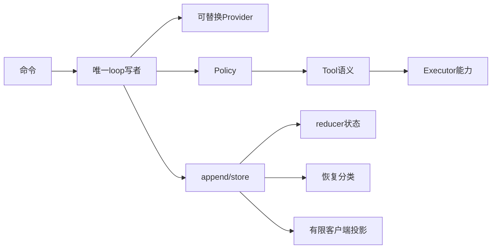

# 第 19 章：架构设计决策与取舍

## 1. 本章解决什么问题

一个小项目为什么要这么多边界？你准备扩展时，哪些决定应该保持，哪些可以改变但必须付出新的协议/测试成本？本章将具体实现还原成工程决策。

## 2. 先理解设计思想

设计不是“某模式永远最好”。每个选择回应某个故障或扩展需求，同时新增成本。区分已经实现的收益和未来可提供的能力，才能避免把一个简单扩展变成隐含的第二套Runtime。

## 3. 模块在整体架构中的位置



## 4. 源码位置

[AgentLoop::append](https://github.com/nothiny/mini-harness/blob/1720acefc11fe38cfb9b3bb3d649832ef951d4a8/src/runtime/agent_loop.rs)、[run_actor](https://github.com/nothiny/mini-harness/blob/1720acefc11fe38cfb9b3bb3d649832ef951d4a8/src/runtime/session_actor.rs)、[Tool](https://github.com/nothiny/mini-harness/blob/1720acefc11fe38cfb9b3bb3d649832ef951d4a8/src/tools/spec.rs)、[Executor](https://github.com/nothiny/mini-harness/blob/1720acefc11fe38cfb9b3bb3d649832ef951d4a8/src/executor/trait.rs)、[ModelProvider](https://github.com/nothiny/mini-harness/blob/1720acefc11fe38cfb9b3bb3d649832ef951d4a8/src/model/provider.rs)、[reduce](https://github.com/nothiny/mini-harness/blob/1720acefc11fe38cfb9b3bb3d649832ef951d4a8/src/durable/reducer.rs)、[recover_store](https://github.com/nothiny/mini-harness/blob/1720acefc11fe38cfb9b3bb3d649832ef951d4a8/src/durable/recovery.rs)、[project_event](https://github.com/nothiny/mini-harness/blob/1720acefc11fe38cfb9b3bb3d649832ef951d4a8/src/protocol/event_projection.rs)。这些就是决策的落实点，详细执行已在前面章节说明。

## 5. 从入口逐步分析源码

### 事件溯源：先承认发生什么，再推导现在是什么

背景是审批/取消/崩溃需要因果证据。append的candidate reduce→store→commit让执行与恢复共用合法规则；同日志可确定重建，这是收益。成本是clone、编码、额外事件、history/log限额和schema兼容。替代方案是直接快照SessionState或数据库事务：快照更短但缺历史原因，数据库可改善CAS/索引，却仍不能把任意OS操作并入事务。证据：property_replay、reducer_turn_terminal、JSONL损坏测试。

### Session Actor：把多入口变成一位状态写者

背景是请求/审批/取消同进程交错。Actor持有loop，命令和oneshot明确ack，让不同调用者不共享可变状态。成本是channel/缓存/延迟命令处理，且queue ID未完整durable化。替代方案Arc<Mutex<Session>>容易理解，但若start持锁跨await，cancel无法取得锁；拆锁又需保证状态/store顺序。证据：actor_queue_edges和session_cancel。

### Tool/Executor分离：语义与能力分工

背景是read行号、edit文本语义不应复制平台打开/进程清理。Tool参数/输出面向模型，Executortyped request/error面向OS，FakeExecutor可验证接线。成本是多层结构和JSON转换，trait还不能隔离恶意代码。替代方案工具直接用std::fs/Command，简单但路径、预算和取消规则分散；远程/sandbox后端更难替换。证据：read_tool/bash_tool请求断言，executor_read/process_executor实际行为。

### Provider抽象：Harness不依赖某家wire

背景是Responses和CC字段/续传不同。ModelRequest/ModelCompletion归一，build/parse纯函数让本地fixture可测试，Mock维持确定性闭环。成本是规范化history不能保留完整wire，cursor/native ID引入provider细节，两种路径高级能力并不全同。替代方案Loop直接操作HTTP JSON，减少一层但重试、cancel、ToolCall解析散布控制流。证据：provider_contract、openai_provider。

### Unknown outcome：拒绝伪造确定性

背景是OS副作用和日志追加之间有crash窗口。Running无可靠result分类Unknown，recover只记录建议，不盲retry；避免重复现实动作是收益。成本是人工检查/放弃、当前无通用结果确认协议。替代方案失败后一律重试，只对明确幂等操作安全；完整外部幂等key/事务服务可以增强保证，但不能从本地event log凭空获得。证据：recovery_classify与recovery_cli；终态清active导致历史窗口不再classified也是限制。

### Checkpoint校验：优化不能覆盖事实

背景是希望保存派生状态且不能信任损坏快照。marker、digest、前缀重放比较、fallback保护日志权威。成本是当前冷启动仍读取/重放前缀，不能据此宣称大幅加速。替代方案只信快照摘要速度快，但摘要可随内容一起改；可信索引/前缀签名需额外设计。证据：checkpoint模块内损坏、prefix mismatch、legacy、写失败重试测试。

### UI/Runtime分离：显示不能偷偷执行

背景是CLI/Rust屏幕/Ink希望共用控制语义。JSONL请求+安全投影减少原始参数外传、UI可替换，runtime仍统一审批/副作用。成本是响应关联、投影缺文本、bounded wait、历史批次限额、子进程配置/退出接线。替代方案UI直接嵌入Loop省进程传输，但Node客户端不能共享Rust类型，工具授权也可能走多条实现。证据：stdio_protocol/protocol_compat/tui_line_mode。

### 顺序工具与共享进程信号量：先限制竞态

背景是同Turn写文件与审批需要明确先后。for+await令批次串行，Executor共享Semaphore控制跨Session资源，按层限额易诊断。成本是工具无法并行、一个executor实例范围才共享、等待槽位有时延。替代方案并行批次需重新定义结果顺序、独立取消、审批、多副作用Unknown；不能仅把for改为join_all。证据：multiple_tool_calls_are_executed_in_event_order与shared_executor_limits_global_process_concurrency。

## 6. 完整运行示例

```bash
cargo test --test property_replay
cargo test --test actor_queue_edges
cargo test --test provider_contract
cargo test --test recovery_classify
cargo test --test scheduler
```

阅读每个决策时，找至少一个“若删掉这项机制会失败”的断言。例如移除ToolCompleted写history会破坏闭环测试；移除group output收尾deadline会破坏后台pipe测试。这是理解设计，不是在本次任务修改业务代码。

## 7. 为什么这么设计

这些选择围绕一个目标：每次现实动作都有清晰授权、预算、记录与未知结果边界。它们不提供万能可靠性；对于更大规模应用，需要新的持久化任务身份、日志索引、外部幂等协议和OS隔离，而不能只在旧类型上添加几个字段就声称实现。

## 8. 常见误解

- 用Actor就完全没有锁/竞态：store跨进程仍需锁和seq。
- 用事件溯源就exactly-once：外部动作不在同事务。
- 可替换trait就是所有后端都已实现：当前主要是本地executor与两种wire。
- UI分离就服务器永远常驻：当前子进程EOF会退出。

## 9. 本章总结

每个边界都应有具体故障动机、落实函数、验证断言和限制。理解这些，扩展才能保持同一系统语义。

## 10. 自测问题

1. 数据库替换EventStore能消除edit未知窗口吗？参考：不能，OS与数据库仍非同事务。
2. 并行工具改动为何影响恢复？参考：多项副作用状态/取消结果交错需要新规则。
3. 快照摘要是不是认证？参考：不是，前缀比较才验证与事实一致。
4. 同进程并发和跨进程并发保护是否相同？参考：Actor/&mut与fs2/seq各管不同范围。

## 11. 下一章如何衔接

最后进入[扩展指南](12-next-steps.md)，用这些决策明确修改点、测试点和风险。

---

导航：上一章 [第 18 章：三个完整源码调用链复盘](call-chain-cases.md) · [首页](README.md) · 下一章 [第 20 章：如何扩展 mini-harness](12-next-steps.md)
