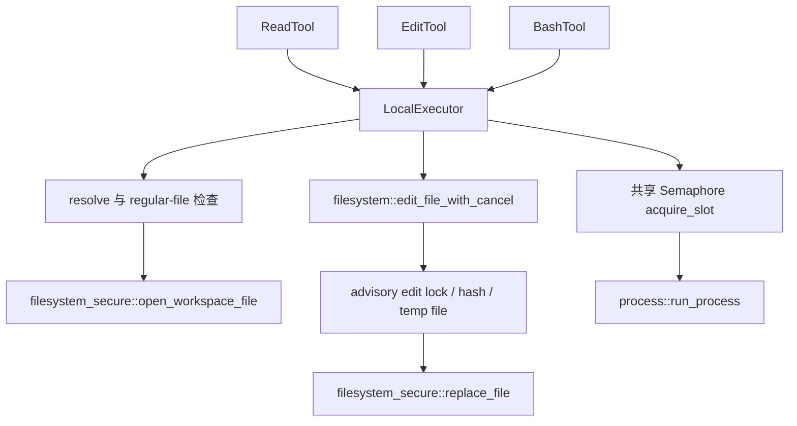

# 第 8 章：Executor 系统与副作用边界

## 1. 本章解决什么问题

read 的 `../` 或 symlink 会越出 workspace；edit 与编辑器并发时会覆盖新内容；bash 可能开进程并输出很多字节。把这些细节散落在每个 Tool 中，很难保持同一套规则。本章追到真实 OS 操作。

## 2. 先理解设计思想

Executor 集中文件/进程能力和类型化错误，Tool 只解释模型参数。这样的“不能让 Tool 随意访问 OS”是架构约定：trait/context 没有给 Session 写权限，但进程内 Tool 仍能调用 std::fs，Rust 模块组织不能物理隔离恶意代码。

## 3. 模块在整体架构中的位置



## 4. 源码位置

- [trait.rs](https://github.com/nothiny/mini-harness/blob/1720acefc11fe38cfb9b3bb3d649832ef951d4a8/src/executor/trait.rs)：Executor 与三类 Request/Result。
- [local.rs](https://github.com/nothiny/mini-harness/blob/1720acefc11fe38cfb9b3bb3d649832ef951d4a8/src/executor/local.rs)：resolve、read_file、run_process、acquire_slot。
- [filesystem.rs](https://github.com/nothiny/mini-harness/blob/1720acefc11fe38cfb9b3bb3d649832ef951d4a8/src/executor/filesystem.rs)：edit_file_with_cancel、read_workspace_file、acquire_edit_lock、find_occurrences、TempFileGuard。
- [filesystem_secure.rs](https://github.com/nothiny/mini-harness/blob/1720acefc11fe38cfb9b3bb3d649832ef951d4a8/src/executor/filesystem_secure.rs)：open_file_linux/open_file_unix、replace_file_linux/replace_file_unix。
- [process.rs](https://github.com/nothiny/mini-harness/blob/1720acefc11fe38cfb9b3bb3d649832ef951d4a8/src/executor/process.rs)：run_process、ProcessGroupGuard，下一章组的进程专题会深入。
- [tests/executor_read.rs](https://github.com/nothiny/mini-harness/blob/1720acefc11fe38cfb9b3bb3d649832ef951d4a8/tests/executor_read.rs)、[tests/executor_local.rs](https://github.com/nothiny/mini-harness/blob/1720acefc11fe38cfb9b3bb3d649832ef951d4a8/tests/executor_local.rs)、[tests/edit_tool.rs](https://github.com/nothiny/mini-harness/blob/1720acefc11fe38cfb9b3bb3d649832ef951d4a8/tests/edit_tool.rs)、[tests/process_executor.rs](https://github.com/nothiny/mini-harness/blob/1720acefc11fe38cfb9b3bb3d649832ef951d4a8/tests/process_executor.rs)。

## 5. 从入口逐步分析源码

### 5.1 能力 trait 输入与缺省行为

Executor 必须实现 read_file，run_process/edit_file 默认 Unsupported；edit_file_with_cancel 默认委托 edit_file，**并不自动支持取消**，新后端应 override。workspace_root 默认 None，会使标准路径工具在默认策略下拒绝。返回 ReadFileError/EditFileError/ProcessError，而不掺入模型消息格式。

LocalExecutor::new 保存 WorkspaceRoot，不立即证明路径有效。文件/进程操作各自 canonicalize root 并要求目录；因此无效 root 在执行时产生明确错误。

### 5.2 一次 read 的路径和字节处理

`LocalExecutor::read_file` 由 Tool 的能力请求进入：

1. resolve canonicalize root，词法归一化用于路径错误归类；candidate canonicalize 后必须 starts_with(root)。允许 root 内绝对路径和不逃逸的 parent segments。
2. 检查路径不是目录；调用 secure open，随后以实际打开 file 的 metadata 再验证普通文件，拒绝 FIFO/设备等。
3. 请求字节数与 16 MiB 上限取 min，再多读 1 字节作 lookahead；不会把整个大文件读入内存。
4. NUL 或确定的非法 UTF-8 报 BinaryFile；若只有截断造成末尾不完整 UTF-8，则退到 valid_up_to。
5. 返回 text、truncated、original_bytes（metadata 与观察到字节数的较大值）、retained_bytes。

size 是执行时观察，不是文件内容的永久快照；文件被别的非协作进程改动时，不能仅凭 metadata 长度证明完整一致读取。

### 5.3 安全打开怎样缩小检查—使用窗口

`open_workspace_file` 用 spawn_blocking 执行平台文件操作，再包装成 Tokio File。阻塞 syscall 不占用 async worker 等待。

Linux 使用 root descriptor 与 `openat2` 的 RESOLVE_BENEATH/RESOLVE_NO_MAGICLINKS；路径相对 root，拒绝越界和 magic link。这里没有配置 RESOLVE_NO_XDEV，所以不要根据旧注释声称所有 mount crossing 都被禁止；依赖支持 openat2 的内核，没有普通 open 的自动降级。

其他 Unix（本次验证是 macOS）逐组件 `openat`，目录用 O_DIRECTORY/O_NOFOLLOW，最后文件也 O_NOFOLLOW。Windows 当前 `File::open(path)`，仍依赖之前的 canonical path 检查；不能宣称三个平台拥有完全相同的竞态防护。

### 5.4 edit 的完整事务

EditTool 委托 `edit_file_with_cancel`，函数接收 root/request/token，返回 hash 元数据，主要过程是：

```text
前置取消/参数限额 → resolve → acquire_edit_lock
→ 有界读取原文件 → old_hash → expected_hash 检查
→ UTF-8 与恰好一次 old_text 匹配 → 构造 replacement/new_hash
→ 再 resolve/读取/hash 检查
→ 同目录 create_new 临时文件
→ write_all、flush、sync_all、恢复 permissions
→ 再 resolve/读取/hash 检查、取消检查
→ 安全 rename 替换 → guard.commit → 返回 hashes
```

读写文字各最多 4 MiB，读取文件最多 16 MiB。expected_hash 不提供时，仍会检查准备写入过程中原文件是否改变。find_occurrences 按字符边界推进来识别重叠匹配（例如 `aaa` 中 `aa` 多于一次），不会随意替换多个位置。

锁以 canonical path 的 hash 命名，位于系统临时目录的 mini-harness-edit-locks。acquire_edit_lock 用 try_lock_exclusive，忙时 5 ms 轮询并响应取消；持有的 Arc<File> drop 释放锁。它约束遵守同一锁协议的 Harness，普通编辑器可以不遵守，因此还有多次内容 hash 检查。

临时文件 create_new 防止覆盖同名文件；TempFileGuard 在失败/drop 时尽力删除。replace_file 在 Linux/Unix 通过受约束 parent directory descriptor 做 renameat，Windows 用 MoveFileExW。rename 让读者看旧文件或新文件，不会看到本实现逐段写半个目标文件；它不是文件和 EventStore 的联合事务，也没有为外部编辑器提供原子 compare-and-swap。rename 前最后检查后仍有竞态窗口；实现也没有普遍的 parent-directory fsync 承诺。

取消由 token 在关键边界检查，进程被 kill 时 Drop 不保证运行；残留临时文件可能存在。rename 后、ToolCompleted 前崩溃则文件可能已变更，日志却只证明开始。

### 5.5 命令与资源

LocalExecutor.run_process 先 acquire_slot，再交 process::run_process。Semaphore 仅在 `with_process_limits` 设置，new 默认无限；CLI/协议通常设置配置默认 8。等待默认 30 秒，超时返回 ConcurrencyLimit；permit 随函数返回/drop 释放。等待槽位不直接 select 传入 token，活跃 Tool 的外层控制还会限制它。

process 层在 root cwd 用 Unix `sh -c` 或 Windows `cmd /C` 启动，stdin=null，输出 pipe。它不是 literal 参数数组执行，也没有 OS sandbox；绝对宿主路径、网络和环境仍可访问。输出、deadline、取消在第 11 章详解。

## 6. 完整运行示例

```bash
cargo test --test executor_read
cargo test --test executor_local
cargo test --test edit_tool
cargo test --test process_executor
```

阅读 `read_rejects_symlink_that_resolves_outside_root`、`serializes_concurrent_hash_guarded_edits`、`preserves_existing_file_permissions`。这些测试分别验证路径、协作并发、权限保持；它们不证明恶意 OS 环境的一切竞态已排除。

## 7. 为什么这么设计

能力接口便于替换成本地、受隔离或远程实现；typed error 能让 Tool 选择模型可读包装。secure open 补 canonicalize 后的路径竞态，advisory lock 补同类执行器并发，hash guard 补内容变化，rename 补半写；每种机制回答一个不同问题。代价是平台代码和多次读文件，仍不能宣称 exactly-once 或全宿主隔离。

## 8. 常见误解

- workspace_root 不是 chroot，也不是 sandbox。
- 原子 rename 不等于 edit 完成事件已 durable。
- expected_hash 与文件锁不能互相代替。
- 新 Executor 的默认 edit_file_with_cancel 不会凭空取消底层编辑。

## 9. 本章总结

Executor 的价值是统一能力与明确限制，而不是一个“安全执行所有代码”的万能盒子。

## 10. 自测问题

1. Policy 检查后为何仍需 Executor 检查路径？参考：词法授权不能防止 symlink 和执行时变化。
2. 读 limit+1 为何有用？参考：判断超限并检查边界字节。
3. rename 后 crash 日志可否确定文件没改？参考：不行，需要 Unknown 与外部检查。
4. 文件锁保护普通编辑器吗？参考：advisory，只约束协作者。
5. shared process 上限共享到哪里？参考：共享同一 Semaphore 的 executor clones，不跨独立实例/进程。

## 11. 下一章如何衔接

副作用边界已经明确，下一章讲[事件溯源与 reducer](02-event-store-and-reducer.md)，解释这些事实如何保存并演算状态。

---

导航：上一章 [第 7 章：Tool 系统](04-first-tool.md) · [首页](README.md) · 下一章 [第 9 章：Event Sourcing、EventStore 与 Reducer](02-event-store-and-reducer.md)
