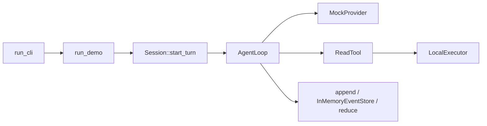
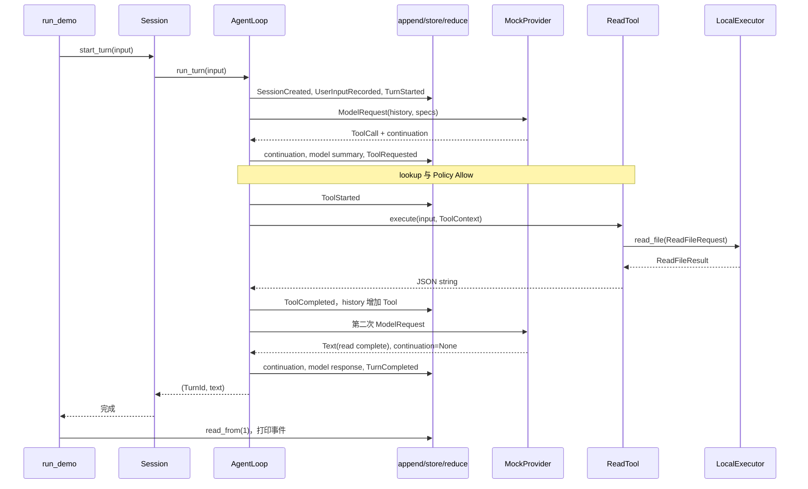

# 第 2 章：第一次完整运行

## 1. 本章解决什么问题

我们执行 `cargo run -- demo read README.md`。本章从命令解析追到 OS 文件读取，再回到模型和终态，解释每一条事件的来源。该 Demo 是固定脚本的真实执行，不是假想模型自动选工具。

## 2. 先理解设计思想

第一次先用 InMemoryEventStore：它保留同样的事件顺序和 reducer 规则，排除 HTTP、磁盘日志和审批交互的噪声。`DefaultPolicy` 对 workspace 内 read 允许执行；不要一开始把 Ask 分支混进来。

## 3. 模块在整体架构中的位置



此图没有 Actor，也没有 JSONL 协议服务器。

## 4. 源码位置

- [src/main.rs](https://github.com/nothiny/mini-harness/blob/1720acefc11fe38cfb9b3bb3d649832ef951d4a8/src/main.rs)：`run_cli`、`run_demo`、`print_events`。
- [src/runtime/session.rs](https://github.com/nothiny/mini-harness/blob/1720acefc11fe38cfb9b3bb3d649832ef951d4a8/src/runtime/session.rs)：`new_with_policy`、`start_turn`。
- [src/runtime/agent_loop.rs](https://github.com/nothiny/mini-harness/blob/1720acefc11fe38cfb9b3bb3d649832ef951d4a8/src/runtime/agent_loop.rs)：`begin_turn`、`begin_queued_turn`、`continue_turn_with_reason`、`append`。
- [src/runtime/sampling.rs](https://github.com/nothiny/mini-harness/blob/1720acefc11fe38cfb9b3bb3d649832ef951d4a8/src/runtime/sampling.rs)：`sample_model`。
- [src/model/mock.rs](https://github.com/nothiny/mini-harness/blob/1720acefc11fe38cfb9b3bb3d649832ef951d4a8/src/model/mock.rs)：`complete_with_metadata`、`complete`。
- [src/tools/read.rs](https://github.com/nothiny/mini-harness/blob/1720acefc11fe38cfb9b3bb3d649832ef951d4a8/src/tools/read.rs) 与 [src/executor/local.rs](https://github.com/nothiny/mini-harness/blob/1720acefc11fe38cfb9b3bb3d649832ef951d4a8/src/executor/local.rs)：`execute`、`read_file`。
- [src/lib_tests.rs](https://github.com/nothiny/mini-harness/blob/1720acefc11fe38cfb9b3bb3d649832ef951d4a8/src/lib_tests.rs)：`full_mock_read_turn`。

## 5. 从入口逐步分析源码

### 阶段一：命令装配

`main → run → run_cli` 初始化 stderr tracing、解析 clap 与配置，然后分派 `CliCommand::Demo → run_demo`。Demo 要求 path 非空且相对当前目录；真正路径边界随后由 Policy 与 Executor 检查。

`run_demo` 生成一个新的 ToolCallId，脚本第一项参数是 `{"path":"README.md"}`，第二项文本是 `read complete`。Registry 注册三个工具，但本次只有 read 被 lookup。Executor root 使用 `current_dir()`；store 是内存 Vec。Demo 不采用普通 run 的配置 limits/ConfiguredPolicy，而使用 Session 的默认 loop 配置和 DefaultPolicy。

### 阶段二：接收输入并创建 Turn

`Session::start_turn("read README.md") → run_turn → run_turn_with_cancel → run_turn_with_reason`。后者生成 TurnId、创建取消 token，并先调用 `begin_turn`。

`begin_turn` 检查没有 active turn、输入不超过 16 KiB。新 Session 没有事件时追加 SessionCreated；接着追加 UserInputRecorded，reducer 把它写入 history 和 pending_inputs。`begin_queued_turn` 消费队首，追加 TurnStarted，设置进程内开始时间、step 与工具累计时间计数。

每个“追加”都是 `append`：计算预期 seq、检查 store.last_seq、在状态副本 reduce、store.append、确认返回 seq，最后替换 loop.state。此时内存与日志共同认识到 Turn 已开始。

### 阶段三：第一次模型请求

`continue_turn_with_reason` 检查取消和预算，增加 step，`ContextSnapshot::from_state` 拷贝用户 history 和 specs，转成 ModelRequest。`sample_model` spawn Provider task，等待完成、取消、deadline 或 attempt observer。Mock 不发 HTTP attempts，所以这里没有 `provider.attempt.recorded`。

实际调用为 `complete_observed` 的默认实现 → Mock 的 `complete_with_metadata` → `complete`。`complete` 把请求记入 requests，再弹出 read call；metadata 为它生成 mock continuation。循环先追加 ProviderContinuationUpdated，再记录助手摘要 `tool call: read`。

### 阶段四：工具执行

循环追加 ToolRequested，reducer 把 call 置 Pending 并保存 name/input。`lookup("read")` 返回 `Arc<dyn Tool>`，`DefaultPolicy::decide` 看到 workspace 内 Read，返回 Allow。接着生成 ExecutionId、追加 ToolStarted，Pending → Running。

Tool task 接收参数和 ToolContext。`ReadTool::execute` 验证 JSON、取消与行窗口，再调用 `Executor::read_file`。`LocalExecutor::read_file` 规范化 root/path、拒绝 root 外文件、经 `open_workspace_file` 打开普通文件、有界读取并校验 UTF-8，返回 ReadFileResult。Tool 再按行截取（默认最多 200 行），将 text 与截断元数据编码为 JSON 字符串。

循环 await 到 `Ok(value)`，检查最终字符串字节数，追加 ToolCompleted。reducer 同时更新 execution 和添加 Tool history。Executor 从不接触 EventStore，这条事件由循环产生。

### 阶段五：第二次模型请求与结束

循环回到开头，第二次 request 的 history 包含用户输入、助手工具摘要和 ToolResult。Mock 返回固定文本并清除 continuation。循环追加 continuation 更新、ModelResponseRecorded、TurnCompleted。reducer 清空 active_turn，SessionStatus 回到 Idle；匹配的最终文本不会重复加入 history。

结果返回给 `run_demo`。它读取 11 条事件；普通输出通过 `print_events` 展示摘要，`--json` 输出完整 JSON 数组。模型失败/工具失败则保留已发生的事件，但命令最终返回错误。

## 6. 完整运行示例

只读 Demo 可以在仓库根运行；推荐统一用临时 workspace，以下命令仍由本仓库二进制读取 README 副本：

```bash
cargo build --locked
TUTORIAL_BIN="$PWD/target/debug/mini-harness"
TUTORIAL_WORK="$(mktemp -d)"
cp README.md "$TUTORIAL_WORK/README.md"
(cd "$TUTORIAL_WORK" && "$TUTORIAL_BIN" demo read README.md --json > read-events.json)
python3 - "$TUTORIAL_WORK/read-events.json" <<'PYCODE'
import json, sys
for e in json.load(open(sys.argv[1])):
    print(e['seq'], e['payload']['type'])
PYCODE
cargo test full_mock_read_turn
```

本次验证观察到的顺序（UUID 与时间每次不同）：

| seq | payload.type | 意义 |
|---|---|---|
| 1–3 | session_created / user_input_recorded / turn_started | 新会话、输入、Turn |
| 4–5 | provider_continuation_updated / model_response_recorded | Mock cursor 与工具摘要 |
| 6–8 | tool_requested / tool_started / tool_completed | Pending → Running → Completed |
| 9–11 | provider_continuation_updated / model_response_recorded / turn_completed | 清 cursor、最终文本、结束 |

序列图中的 `append` 始终包含校验、存储、状态提交：



## 7. 为什么这么设计

两次模型调用之间必须持久化工具结果，否则模型输入和恢复日志可能描述不同事实。工具开始也要先记账，否则崩溃日志可能完全看不出进入了副作用窗口。代价是每一步都经过事件编码、状态 clone 和 reducer，这换来可验证的执行故事。

## 8. 常见误解

- `payload.type` 是 snake_case，`payload.kind()` 的人类名称是 `tool.completed`；它们不是同一个字段。
- 第二次 request 不只有 user 和 tool，还有第一次助手摘要。
- Demo 的 EventStore 在内存；它证明事件语义，没有验证磁盘 sync。

## 9. 本章总结

这条 11 事件链是全书参照物。接下来把其输入、状态、调用身份与异常路径逐一解释。

## 10. 自测问题

1. 为什么 read 有两次模型请求？参考：先提出工具，再消费工具结果。
2. 谁写 ToolCompleted？参考：AgentLoop，Executor 只返回结果。
3. 第二次请求多出什么？参考：Assistant 摘要、Tool history 与 continuation。
4. 最终回答重复存了吗？参考：ModelResponseRecorded 加 history，TurnCompleted 检查相同文本避免重复。

## 11. 下一章如何衔接

进入[核心数据结构](01-ids-and-events.md)，解释上述同一条链中的 Session、Turn、Step 和两个工具身份。

---

导航：上一章 [第 1 章：项目整体架构](architecture.md) · [首页](README.md) · 下一章 [第 3 章：核心数据结构与身份](01-ids-and-events.md)
