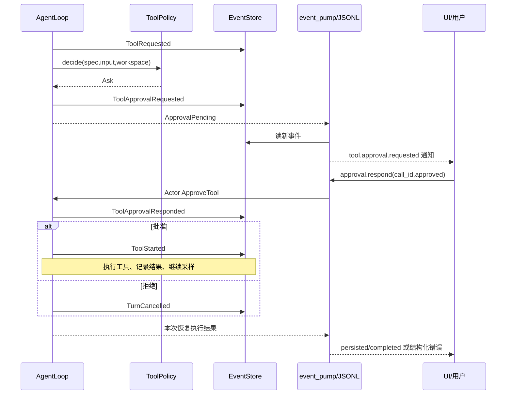

# 第 13 章：Policy、审批与安全边界

## 1. 本章解决什么问题

模型建议修改 `note.txt`，应当直接执行、问用户，还是拒绝？批准通过后，文件路径是否就完全安全了？本章沿审批消息的往返讲清授权与隔离。

## 2. 先理解设计思想

Policy 返回一个决定，不执行工具、不修改日志。Runtime 负责把决定落实为事实；客户端负责将人类决定送回；Executor 仍要验证路径和资源。Policy 的 Ask 是事前授权，RecoveryActionRequired 是事后不确定结果的决策，不能互相替代。

## 3. 模块在整体架构中的位置



## 4. 源码位置

- [policy/mod.rs](https://github.com/nothiny/mini-harness/blob/1720acefc11fe38cfb9b3bb3d649832ef951d4a8/src/policy/mod.rs)：ToolPolicy、PolicyDecision、DefaultPolicy、AllowAllPolicy、path_is_within_workspace、is_readonly_command。
- [config.rs](https://github.com/nothiny/mini-harness/blob/1720acefc11fe38cfb9b3bb3d649832ef951d4a8/src/config.rs)：PermissionMode 配置与 ConfiguredPolicy::decide。
- [agent_loop.rs](https://github.com/nothiny/mini-harness/blob/1720acefc11fe38cfb9b3bb3d649832ef951d4a8/src/runtime/agent_loop.rs)：Allow/Ask/Deny 分支。
- [agent_loop_approval.rs](https://github.com/nothiny/mini-harness/blob/1720acefc11fe38cfb9b3bb3d649832ef951d4a8/src/runtime/agent_loop_approval.rs)：approve_tool。
- [protocol/jsonl.rs](https://github.com/nothiny/mini-harness/blob/1720acefc11fe38cfb9b3bb3d649832ef951d4a8/src/protocol/jsonl.rs)：respond_approval、approval_error。
- [tests/policy.rs](https://github.com/nothiny/mini-harness/blob/1720acefc11fe38cfb9b3bb3d649832ef951d4a8/tests/policy.rs)、[tests/stdio_protocol.rs](https://github.com/nothiny/mini-harness/blob/1720acefc11fe38cfb9b3bb3d649832ef951d4a8/tests/stdio_protocol.rs)、[tests/recovery_classify.rs](https://github.com/nothiny/mini-harness/blob/1720acefc11fe38cfb9b3bb3d649832ef951d4a8/tests/recovery_classify.rs)。

## 5. 从入口逐步分析源码

### 决策输入与两种常用策略

ToolPolicy 接收 spec、input、可选 WorkspaceRoot，返回 Allow/Ask/Deny。risk 来自工具声明；策略本身不验证全部 JSON Schema。

DefaultPolicy 用于 Session 默认与 read Demo：Read 在 workspace 词法内 Allow；Write 在内 Ask；缺 workspace/path或越界 Deny；Execute 按 is_readonly_command 判断，识别到则 Allow，否则 Ask。

ConfiguredPolicy 用于普通 CLI 与 serve，依据 permissions.read_workspace/edit_workspace/bash；默认 Allow/Ask/Ask。Read/Write 无论配置模式如何都先检查 workspace/path 词法边界，外部路径 Deny。Execute 不走 DefaultPolicy 的命令白名单，因此普通 run 的 `bash="ask"` 会对命令统一询问。

AllowAllPolicy 只在受控测试/编辑 Demo 显式使用；它绕过 Policy，但不能消除 LocalExecutor 文件边界。

### 路径与命令判断的限度

path_is_within_workspace 处理绝对/相对 root、词法 `.`/`..` 并用 Path.starts_with，不 canonicalize symlink，不验证文件存在。它回答授权范围，Executor 在实际执行时继续检查规范化路径与安全打开。

DefaultPolicy 的 is_readonly_command 只是字符过滤和 pipeline 中前两个单词白名单，不是 shell parser，也不分析所有参数。白名单包含可执行动作/写入的命令形式，例如某些 git/cargo/npm 操作；不能把 Allow 描述成数学证明“命令只读且无网络”。该策略是可信本地便利规则，不是 OS 隔离，正常配置的 Ask 更容易明确授权。

### 决策如何成为事实

Loop 已记录 ToolRequested，lookup 成功后才 decide。Allow 新建 ExecutionId 并保存 ToolStarted；Deny 保存 ToolPolicyDenied、TurnFailed，绝不伪造 ToolApprovalResponded；Ask 保存 ToolApprovalRequested，可能追加后续批次 IDs 的 ToolBatchDeferred，再返回 ApprovalPending，保留 Pending execution。

Actor future 返回后释放状态借用，UI 从安全通知中识别 pending call。v2 的 ToolRequested input_summary 给前 100 字符 command 或 path；审批请求本身只带 call ID，客户端应关联之前 ToolRequested。edit 摘要只显示 path，不是完整 diff，当前 UI 没有自动获取完整旧/新文本的协议。

### 人类批准如何恢复执行

approve_tool 先要求当前 turn_id 匹配、该 call 的 approval=Pending，然后从持久化 TurnState 取 name/input，写 ToolApprovalResponded。批准后不重新询问 policy，lookup 同名 Tool、new ExecutionId、ToolStarted、execute、ToolCompleted，再 continue_turn。权限决策之后 OS 内容可能变化，所以 Executor hash/path 检查仍重要。

拒绝后写 TurnCancelled，返回 Policy error；protocol respond_approval 对这个明确 denied 路径返回 accepted/persisted=true、completed=false、outcome=denied。这是人类拒绝，不是 PolicyDenied。

queue_approval 名字容易误导：它 await 到 actor approve future 返回，成功 reply 表示决策和后续工作已处理，不是仅“入队”。后续工具/Provider 失败时可能返回错误，甚至再次 ApprovalPending；不能因错误响应推断此前审批没有写入，事件是事实依据。

### 安全保证的三层

| 边界 | 已实现 | 未提供的保证 |
|---|---|---|
| Policy | 显式 Allow/Ask/Deny、审批事实、词法路径门 | 无完整 shell 风险证明、无恶意插件隔离 |
| Executor | 文件 canonical/descriptor 检查、hash、预算、进程组 | bash 可访问宿主，跨平台保证不完全相同 |
| Protocol projection | v2 隐藏完整 payload，保留必要 ID/摘要 | 摘要可含命令敏感值；v1/raw 信任范围更大 |

当前没有 Seatbelt/Landlock/chroot/container sandbox 后端。Policy 批准表示“允许尝试”，不表示已经成功、无副作用风险或 OS 被隔离。

## 6. 完整运行示例

```bash
cargo test --test policy
cargo test --test session_cancel
cargo test stdio_approval_response_persists_and_completes_the_pending_turn
cargo test approval_must_be_resolved_before_tool_starts
```

policy 组先断言无 marker、无 ToolStarted；批准测试再检查相同 Turn 的 marker 和 approval response；protocol 组从已持久化 Pending fixture resume 并实际送 approval.respond。第 18 章会复盘 edit 审批与 bash 协议审批各自的源码路径。

## 7. 为什么这么设计

授权与执行分离让策略可替换、审计可区分人类/程序决定；pending input 持久化让重启仍知道问的是什么。代价是 UI 需要关联 call、等待控制状态、处理批准后的再次审批/失败。批准不是把所有执行限制关闭。

## 8. 常见误解

- DefaultPolicy 与 ConfiguredPolicy 的 bash 行为不同。
- Ask 不代表拒绝，Deny 不代表用户按了 n。
- Policy 不是 sandbox；安全摘要不是任意秘密脱敏器。
- 已批准的 edit 仍可能 hash conflict。

## 9. 本章总结

Policy 决定能不能开始，runtime 保存这个决定，用户回应决定是否继续，Executor 决定实际操作能否安全完成。

## 10. 自测问题

1. Deny 为什么不写 ApprovalResponded(false)？参考：用户没被问，事实来源不同。
2. symlink 越界谁最终拒绝？参考：Executor 的规范化/安全打开。
3. 批准成功是否表示文件已改？参考：审批是授权；后续执行可能失败，查看完成事件/响应。
4. v2 edit 审批是否包含完整 diff？参考：当前仅 path 摘要，不含完整 old/new。
5. 恢复 Unknown 可否直接 approval.respond？参考：仅 Pending approval 支持该 API。

## 11. 下一章如何衔接

下一章讲[CLI 与 JSONL 协议](09-cli-and-protocol.md)，展示这些跨客户端控制消息的真实格式。

---

导航：上一章 [第 12 章：崩溃恢复、Checkpoint 与未知副作用](07-recovery.md) · [首页](README.md) · 下一章 [第 14 章：CLI 与 JSONL 控制协议](09-cli-and-protocol.md)
