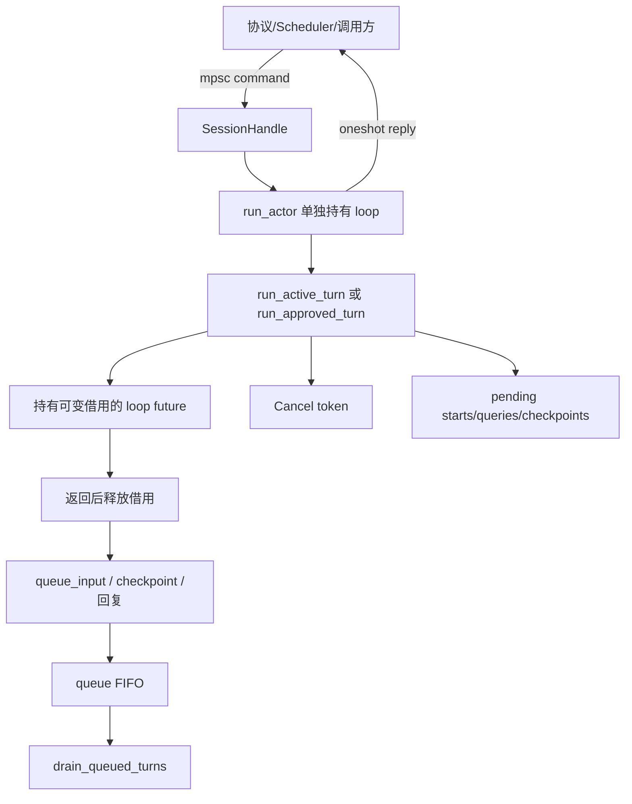
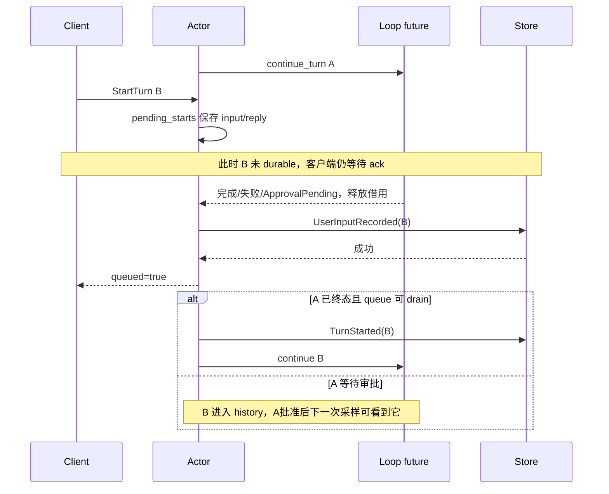

# 第 10 章：Session Actor 与并发

## 1. 本章解决什么问题

模型正在等待 HTTP，用户发送取消；工具等待审批，另一条输入到来。如果两个 task 同时改 SessionState、各算 last_seq+1，会丢输入、错认 active Turn，甚至记下一条永远无法重放的事件。Actor 怎样处理这些冲突？

## 2. 先理解设计思想

Actor 是唯一拥有 AgentLoop 可变权限的任务。其他调用者发送命令；它决定什么时候执行、何时回复。单写者让“检查前置状态—生成事件—持久化—提交”保持统一顺序。它不等于整个进程只有一个任务，Provider/Tool/output readers 仍可并发。

## 3. 模块在整体架构中的位置



## 4. 源码位置

- [session.rs](https://github.com/nothiny/mini-harness/blob/1720acefc11fe38cfb9b3bb3d649832ef951d4a8/src/runtime/session.rs)：SessionCommand、SessionHandle、spawn_actor、queue_approval。
- [session_actor.rs](https://github.com/nothiny/mini-harness/blob/1720acefc11fe38cfb9b3bb3d649832ef951d4a8/src/runtime/session_actor.rs)：run_actor、run_active_turn、run_approved_turn、drain_queued_turns、flush_deferred_outcomes。
- [agent_loop.rs](https://github.com/nothiny/mini-harness/blob/1720acefc11fe38cfb9b3bb3d649832ef951d4a8/src/runtime/agent_loop.rs)：queue_input、begin_queued_turn。
- [tests/actor_queue_edges.rs](https://github.com/nothiny/mini-harness/blob/1720acefc11fe38cfb9b3bb3d649832ef951d4a8/tests/actor_queue_edges.rs)、[tests/session_cancel.rs](https://github.com/nothiny/mini-harness/blob/1720acefc11fe38cfb9b3bb3d649832ef951d4a8/tests/session_cancel.rs)、[tests/scheduler.rs](https://github.com/nothiny/mini-harness/blob/1720acefc11fe38cfb9b3bb3d649832ef951d4a8/tests/scheduler.rs)。

## 5. 从入口逐步分析源码

### 5.1 命令如何发出去

spawn_actor 接收已经创建/restore 的 loop，建立容量 16 的 mpsc，并 tokio::spawn(run_actor)。SessionHandle 可 clone，但只含 sender，不包含 &mut state。

start_turn_with_status 建立 oneshot，把 input/reply 放 SessionCommand::StartTurn，await send 再 await 回复，返回 `(TurnId, queued)`。mpsc 是多调用者长期发送命令，oneshot 是单命令单结果。WaitTurn 用不同 reply 返回 TurnOutcome；取消/审批/快照也各自有回复。

channel 容量 16 只限制尚在 channel 中的命令。Actor 消费到 pending_starts/queries Vec 后，它们不是由 channel 容量直接约束；max_queued_inputs 在 durable queue 接收处检查。不要宣称所有等待内存都有统一硬上限。

### 5.2 空闲状态的 StartTurn

run_actor 在没有 active Turn 时产生 TurnId，begin_turn 持久化输入/开始事实，成功后发 `(turn,false)`，再进入 run_active_turn。失败时回 Err，Durable/Invariant 才把 actor 标 stopped；普通 turn-scoped Provider/Tool/Policy 错误不永久停止整个会话。

这解释 Start ack 与完成之间的间隔：它说明已持久化接收，不说明模型已完成。

### 5.3 活跃 future 持有借用时能做什么

run_active_turn 创建 CancellationToken，调用 `loop_.continue_turn(...)` 并 pin future。future 一直持有 `&mut AgentLoop`；`tokio::select!` 在它和 receiver.recv 之间轮询。这是一个 actor task 中的两种等待，不是把 loop 可变引用交给第二个 task。

CancelTurn 若 ID 匹配就 cancel token，保存 cancel reply；WaitTurn 登记 waiter；StartTurn 放 pending_starts；QueryState 和 Checkpoint 延迟；ApproveTool 返回 TurnAlreadyActive。Shutdown cancel 后最多再等 1 秒。

`pin!` 保持 future 的位置稳定，方便反复 poll；select 接收了命令，不意味着 future 的可变借用已经释放。只有 run 完成、审批暂停或 shutdown 分支退出并 drop future，Actor 才能调用 queue_input。

Provider/Tool task 自己拥有 Arc 和输入快照，能并发运行；它们无法直接替 Actor 更新 SessionState。ProviderObserver 通过 channel 把 attempt 交回 loop 记账。

### 5.4 排队输入的两种时间线



审批暂停时 main run_actor 已重新持有 loop，因此 StartTurn 可直接检查 queue.len、queue_input、push `(预分配TurnId,input)`、reply queued=true。执行中的输入则须等 future 返回；它不会影响当前仍在执行的那次采样。

UserInputRecorded 同时进入 history 与 pending_inputs，所以审批期间新输入既 steer 当前 Turn，又安排后续 Turn；这两个用途来自同一个 durable 事实。队列满时先拒绝，不追加、不确认。输入过长/存储错误也不会被确认成功。

### 5.5 FIFO、等待与审批继续

drain_queued_turns 只在无 active_turn 且未 stopped 时 pop_front；begin_queued_turn 消费 durable pending 输入，按同一个预分配 ID 开始。run_active_turn 保存结果并通知等待者，之后继续 FIFO。

run_approved_turn 与 active-turn 包装相似，但持有 approve_tool future。审批回复直到决策写入、工具/后续采样返回后才发，不是“命令刚入队就 persisted=true”。批准后也调用 drain，避免审批阶段接受的输入卡住。

outcomes 仅保存最近 32 项，deferred_waiters 按 queued TurnId 等待结果。old Turn wait 可能 unknown，即使日志中仍有其终态；WaitTurn 是 actor 内存 API，不是无限历史结果查询。

### 5.6 shutdown 和恢复边界

Shutdown/receiver closed 会 cancel，最多等待 1 秒；未能确认运行工具时 `cancel_active_after_shutdown` 追加 cancel_requested 和 ToolOutcomeUnknown，保留 active Turn。已无 running/unknown 才追加 TurnCancelled。queued waiters 返回 Cancelled，durable 输入事实不删除。

但重启的 run_actor 初始化空 queue/outcomes/deferred_waiters，并不从 state.pending_inputs 恢复预分配 ID 绑定，也不在启动时自动 drain。持久化输入文本/FIFO可 replay，与“已经 ack 的 TurnId 可跨重启继续 wait”是不同保证。新输入也不能被当成无条件修复旧 pending 队列的完整协议；恢复应先检查 state 与事件，扩展该能力需新的 durable binding。

### 5.7 Actor、Mutex、EventStore 的边界

| 机制 | 解决什么 | 不解决什么 |
|---|---|---|
| Actor 与 &mut loop | 多命令的迁移顺序、回复时机 | 不跨进程、不能撤销外部副作用 |
| store Tokio Mutex | 本实例 append 串行 | 不代替状态机，也不让多 state 自动同步 |
| fs2 文件锁 | 协作进程完整追加和验证 | 不让所有历史改写可信 |
| reducer/seq | 顺序与前置状态合法性 | 不负责 OS 取消 |
| CancellationToken | 与正在运行任务通信 | 不持久化取消事实 |

## 6. 完整运行示例

```bash
cargo test --test actor_queue_edges
cargo test --test session_cancel
cargo test --test scheduler
cargo test wait_turn_observes_provider_failure_after_start_ack
```

特别对比 `queued_input_steers_the_turn_that_resumes_after_approval` 与 `queued_input_during_execution_becomes_visible_to_the_next_turn`：前者当前 Turn 后续请求看见 steer，后者只在下一轮看见。`shutdown_with_queued_input_answers_waiters_and_keeps_the_fact` 验证关闭后等待者不悬挂、输入事实保留，未证明重启自动执行。

## 7. 为什么这么设计

Arc<Mutex<Session>> 也可串行访问，但若一次 start_turn 持锁跨所有 await，取消者拿不到锁。Actor 把控制信号和状态写入分开，明确延迟哪些命令；代价是命令包装、oneshot、结果保留及队列恢复绑定问题。Actor 不自动意味着低延迟：长 future 的独占借用仍会延迟某些 ack 和 QueryState。

## 8. 常见误解

- 单写者不等于没有 async tasks。
- 收到 StartTurn B 不等于已经 durable B。
- QueryState 活跃执行时可能等到 Turn 返回，无法保证实时读取 RunningTool。
- durable 文本队列不等于持久化所有 actor 控制状态。

## 9. 本章总结

Actor 的核心是所有权与时序：谁能写、谁能发信号、什么时候才能回复持久化成功。并发正确性不能只靠一个“用了 Actor”的名词概括。

## 10. 自测问题

1. 两个任务各自算 last_seq+1 会怎样？参考：同序号期望/状态落后，写入与迁移可能冲突。
2. 为什么 pending_starts 不立即 append？参考：continue future 持有 &mut loop。
3. queued ack 先于存储吗？参考：必须晚于 UserInputRecorded。
4. Actor 与 file lock 是否替代关系？参考：不是，状态序列与跨进程字节追加不同。
5.重启后 wait 已排队 TurnId 一定成功吗？参考：不保证，ID/queue/outcomes 绑定不持久化重建。

## 11. 下一章如何衔接

取消 token 已出现，下一章进入[进程管理与取消](06-process-cancellation.md)，看它怎样落到操作系统。

---

导航：上一章 [第 9 章：Event Sourcing、EventStore 与 Reducer](02-event-store-and-reducer.md) · [首页](README.md) · 下一章 [第 11 章：进程管理、输出与取消](06-process-cancellation.md)
